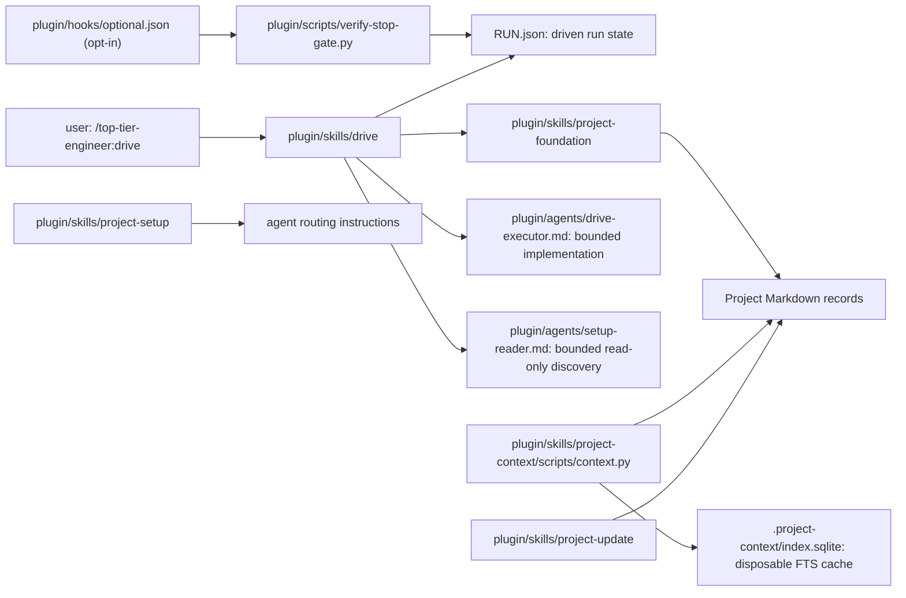

<!-- context-id: architecture:plugin -->
<!-- context-type: architecture -->
<!-- context-paths: plugin/hooks/hooks.json, plugin/scripts/verify-stop-gate.py, plugin/skills/project-context/scripts/context.py, plugin/skills/project-setup/SKILL.md, plugin/skills/project-foundation/SKILL.md -->
# Plugin architecture

Independent skills do engineering work; shared project memory makes their results discoverable.
This is the observed implementation, not a proposed product architecture.

## Boundaries and sources
| Relationship | Source |
|---|---|
| Default install runs no hooks | plugin/hooks/hooks.json:3 |
| Opt-in Stop gate checks verify and RUN.json evidence | plugin/hooks/optional.json:9 |
| Drive owns worker routing | plugin/skills/drive/references/model-routing.md:1 |
| project-foundation owns foundation preparation and the category list | plugin/skills/project-foundation/SKILL.md:1 |
| Economy worker is declarative read-only configuration | plugin/agents/setup-reader.md:1 |
| Context indexes authoritative files transactionally | plugin/skills/project-context/scripts/context.py:161 |
| Context retrieves indexed or fallback records | plugin/skills/project-context/scripts/context.py:201 |
| Update maintains only affected records | plugin/skills/project-update/SKILL.md:20 |

## Invariants and limits
- Files own facts; SQLite is a rebuildable ignored cache. RUN.json owns driven execution state.
- Worker findings are inputs; the coordinator checks sources and product evidence before claims.
- Diagram arrows to workers/records describe instructed behavior; actual agent compliance needs evals.
- Representative context-paths identify boundary changes; internal edits need no automatic redraw.
- Mermaid source inspected; renderer not run. One live setup-only trial passed; tier delegation remains unvalidated.
