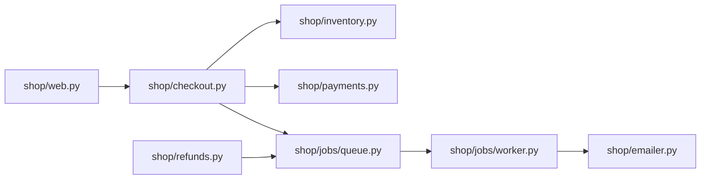

# Shop architecture

- Checkout reserves stock, charges the card, records the order, then puts the
  receipt email on the job queue. The customer never waits for email.
- The worker drains the queue and sends every customer email.
- Refunds use the same queue for their confirmation email.
