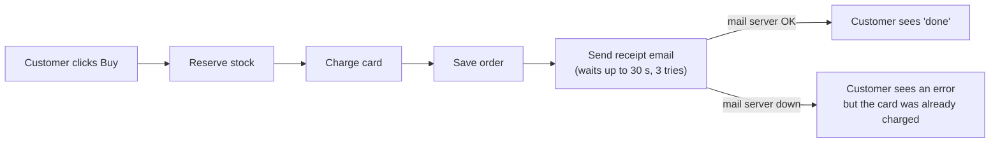
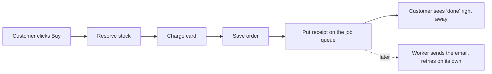

# Your shop's structure, in plain words

**Verdict: messy in one important place.** Checkout waits for the receipt email
before it tells the customer "done". That one chain explains both things you
noticed: slow checkouts, and customers who were charged but saw an error page.

**Your map is out of date.** `docs/architecture.md` says checkout puts the
receipt on the job queue and the customer never waits for email. The code does
not do that: `shop/checkout.py:12` sends the email itself, right there in
checkout. Anyone (or any AI) reading the map would believe a problem is solved
that isn't.

## Before: what happens today

The card is charged at step 3. The email comes after. If the mail server is
slow, the customer stares at a spinner for up to about 100 seconds. If it is
down, the page shows an error, even though the money was already taken.

## After: what better looks like

You already own the piece that does this: refunds put their email on the job
queue (`shop/refunds.py:7`) and the worker sends it. The receipt would join the
same queue. No new system to buy or run. The queue is not unused, refunds depend on it.

| Candidate | Problem | Strength |
|---|---|---|
| Receipt through the existing queue | slow checkouts, charged-but-error | Strong |
| Fix the map | the map tells readers the wrong story | Strong, tiny |

**Proof it worked:** with the mail server switched off, checkout still says
"done" and the receipt waits in the queue.

Which one would you like to look at first? I'd start with the receipt.
