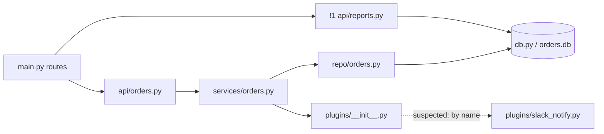

Saved `docs/architecture.md`. The code is not quite the README's picture: **`api/reports.py` goes
straight to `db.py`**, skipping `services/` and `repo/`.

| arrow | evidence |
|---|---|
| main → api/orders | main.py:4 |
| main → api/reports | main.py:4 |
| api/orders → services | api/orders.py:1 |
| services → repo | services/orders.py:1 |
| repo → db | repo/orders.py:1 |
| **api/reports → db** | api/reports.py:1 (and the SQL at :7) |
| services → plugins | services/orders.py:2 |
| plugins ⇢ slack_notify | *suspected*: `importlib.import_module` over the `ENABLED_PLUGINS` string in settings.py:1 (plugins/__init__.py:10) |

| # | problem | where | fix |
|---|---|---|---|
| !1 | reports route skips two layers | api/reports.py:7 | move the query into `repo/`, call it via `services/` |
