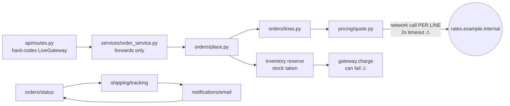
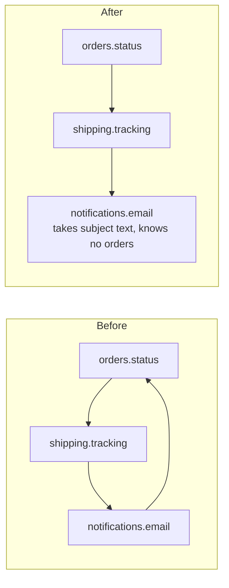

# Architecture audit: `fixture/` (order backend, 53 files, 431 lines)

**Verdict: messy in places, not tangled.** Most modules are small and single-purpose. Two specific chains cause both of your complaints:

- **The offline problem:** an order makes a network call per line item, and the HTTP route always uses the live payment gateway.
- **The ripple problem:** a forwarding-only layer, an import cycle, and copied helpers mean one change lands in several files.

**What I had to work with:** there's no `docs/architecture.md`, no ADRs, and no git history. So there was no map to check, and no co-change or hotspot data. Everything below comes from reading all 431 lines and running the order flow. Running `/top-tier-engineer:project-foundation` afterwards would give the next review a map to start from.

**Changes most likely next** (my guess from the code, since there's no tracker or history to check): a new pricing rule, a new order field (for example, choosing a shipping address), and a new notification. I ranked the candidates by how much each one makes those cheaper.

### Current shape: one order, end to end



---

### 1. A network call per line item inside every order — **Strong** (proven)

**What you feel:** nobody can place an order offline. On flaky wifi, checkout stalls. With no network at all, prices come out quietly wrong.

**The cause:** `pricing/quote.py:19` calls `_fetch_margin()` for every line. That function does an HTTP call with a 2-second timeout (`quote.py:12`), and it's reached through `orders/lines.py:6`. If the call fails, `quote.py:15` falls back to a margin of `1.0` without saying so. Separately, `api/routes.py:1,10` always constructs `LiveGateway()`, so even the HTTP entry point can't run with the fake gateway, although `payments/fake.py` already exists.

**What I measured:**
- With a connection that never answers, a 3-line order took **6.0 s** (2 s per line).
- With DNS failing outright, the order completed at **margin 1.0** with no error or log line. It looks like success.

```mermaid
flowchart LR
  subgraph Before
    A1[place_order] --> B1[unit_price ×N lines] --> C1((HTTP ×N, 2s each ⚠))
  end
  subgraph After
    E[api / job edge] -- "margin = rates.get() once<br/>gateway from config" --> A2[place_order(margin, gateway)] --> B2[unit_price(sku, margin)<br/>pure arithmetic]
  end
```

**What gets cheaper or safer:**
- Network calls per order go from N to 0 inside the pricing logic. At most one call is made, at the edge.
- The whole order flow runs on a laptop with `FakeGateway` and a fixed margin.
- Pricing rules can be tested without a network.
- A rates outage becomes a visible, deliberate choice instead of a quiet one.

### 2. Stock is taken before the charge and never given back — **Strong** (proven)

**What you feel:** a declined card still removes stock.

**The cause:** `orders/place.py:14-16` reserves stock first, then calls `gateway.charge` as the final step. Nothing releases the stock if the charge fails. `inventory/reserve.py:11` already has `release()`, but nothing calls it.

**What I measured:** I made one order with a gateway that declines. Stock for SKU `A` went from **4 to 3**, and no order was created.

**The fix:** wrap the charge in a try block and call the existing `release()` for each line if it fails, or charge before reserving. This is a one-file change that reuses the code already there.

### 3. Import cycle: status → tracking → email → status — **Strong** (proven with an import-graph script)

**What you feel:** changing order labels, delivery tracking, or emails means touching all three.

**The cause:** `orders/status.py:1,9` imports `shipping.tracking` to build a label. `shipping/tracking.py:1,10` imports `notifications.email` to send. `notifications/email.py:1,15` imports `orders.status` to build a subject line. Each module needs the next, so they all have to change together.



**The fix:** move `subject_for` out of `notifications/email.py`. The caller builds the subject and passes it in, so notifications only needs `templates` and `accounts`.

### 4. A layer that only forwards, plus the order field passed by hand through 4 files — **Worth exploring** (read through by hand)

`services/order_service.py:4-5` passes its arguments straight through to `orders.place.place_order` and does nothing else. Adding one order field today means editing 4 files: `api/schemas.py`, `api/routes.py`, `services/order_service.py` and `orders/place.py`. Removing the forwarder makes that 3. If I mentally delete it, nothing gets more complicated, so it's a real finding.

`services/customer_service.py` is different: it combines three calls, so it does real work. Keep it.

### 5. The ship-to country is looked up in 2 places, and the same imports are copy-pasted into 5 files — **Speculative** (read through by hand)

- **Country lookup:** `(default_address(cid) or {}).get('country', 'US')` appears at `orders/place.py:11` (used for tax) and `shipping/rates.py:10` (used for shipping cost). Both answer "where does this order ship?", the same question for the same reason. So the moment orders can pick an address (likely change #2), tax and shipping can disagree. Give that question one owner: compute it once in `place_order` and pass it down.
- **Copied imports:** `from core.util import clamp, as_cents, slug, first` is pasted into 5 files. `catalog/search.py:2` and `customers/accounts.py:2` use none of those names. `core.util` is imported by 16 modules. That's fine for a stable shared module, but the unused copies are clutter. This is low value; do it only when you're already editing those files.

---

### Top move, written out (candidate 1)

Each step keeps behaviour the same:

1. Add a `margin` parameter to `pricing.quote.unit_price` that defaults to `None`. When it's `None`, it calls `_fetch_margin()` as it does now.
2. Thread `margin` through `orders.lines.build_lines` and `place_order`. In `place_order`, fetch the margin once per order, not once per line.
3. Move that one fetch, and the choice of gateway, into `api/routes.py`. Read both from configuration, for example `PAYMENTS=fake` and `MARGIN=1.0` for local runs. Make a failed fetch either raise or log, instead of passing silently.
4. Remove the `None` default once all callers pass a margin.

**Proof:** the scripts I used live in `/tmp` and are throwaway. A small test kept in the repo would hold this proof:
- a 3-line order placed with `FakeGateway` and `margin=1.0` with the network disabled should finish in under 0.1 s (it took 6.0 s before);
- the same order should give the same total as today's online run.

**Door:** two-way. This changes function signatures inside the codebase only, not stored data or a public API.

**Second option:** keep the network call inside `quote.py`, but cache the margin for the whole process and make the URL configurable. That's less code to move, but pricing logic stays tied to the network and remains hard to test.

I recommend the first option, because it fixes both the offline problem and the testing problem.

**Not adding:** a new "rates service" abstraction or a caching layer. Passing one number into pricing is enough, and a cache would be one more thing to invalidate and keep running.

---

**What to do first:** candidate 2 is a one-file bug fix that reuses existing code. Ship it now. Then do candidate 1, which is the change that lets the order flow run on a train.

I haven't changed any files. Which candidate do you want to explore in detail?