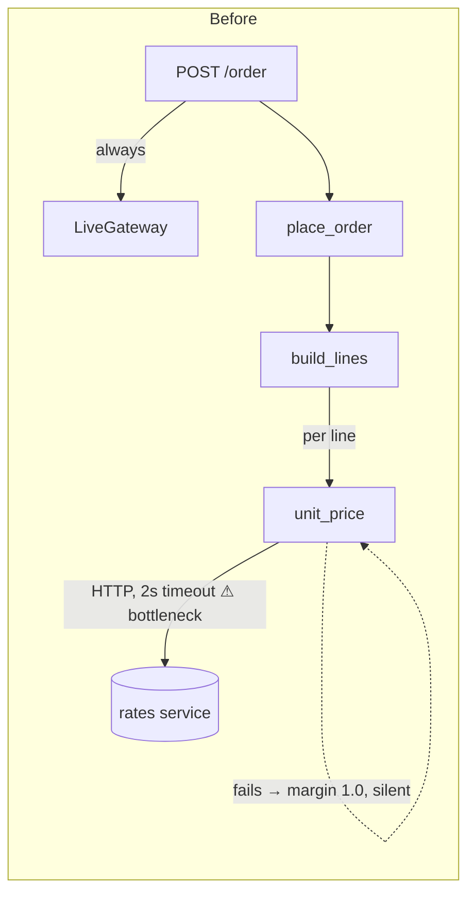
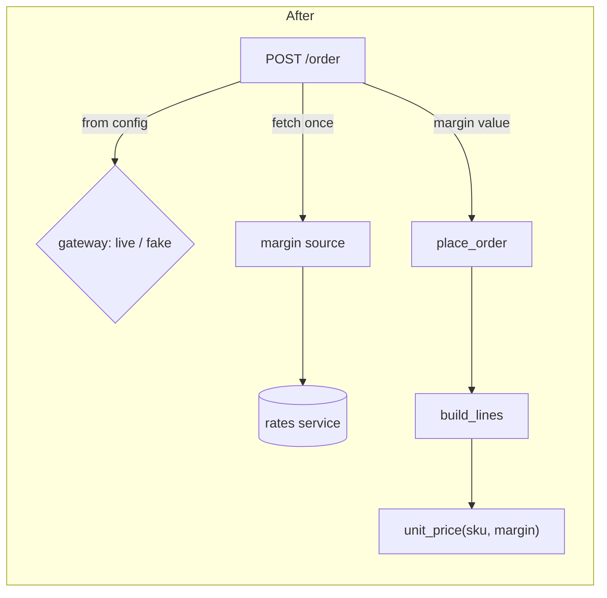
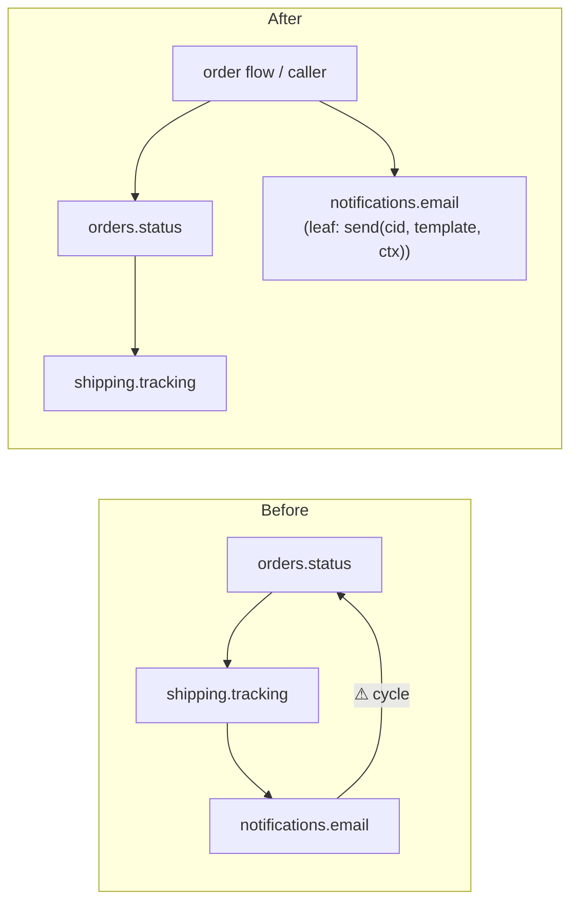

I ran `arch-design` in audit mode. **Verdict: messy in places.** Each module is small and mostly clear, but three problems cause both of your symptoms. The order flow makes a network call to a rates service every time it prices a line, and its only entry point is hard-wired to the live payment gateway. A three-package import cycle and a lookup that's repeated in three files mean small changes spread further than they should.

I changed nothing, not even docs. Context:
- **No map to check against.** There's no `docs/architecture.md`, no ADRs and no git history, so I built the picture from the code. I read all 431 lines in 53 files.
- **The "likely next changes" are my guess from the code.** Without git history I can't confirm them: (a) choosing the payment gateway per environment, (b) changing pricing or margin rules, (c) adding the "shipped" notification. The `shipped` template exists at `notifications/templates.py:4`, but nothing sends it.
- **Evidence for each finding** is marked *proven* (I ran it with a probe script outside the repo) or *traced* (I read the whole chain).

---

### 1. The order flow can't run offline, and offline it prices silently wrong — **Strong**

**How it feels:** on a train you can't place an order without hitting the internet and a live gateway. When the rates service is unreachable you still get an order, just at the wrong price.

**Chain (traced):** `api/routes.py:10` hard-codes `LiveGateway()` → `place_order` → `build_lines` (`orders/lines.py:6`) calls `unit_price` **once per line** → `pricing/quote.py:12` opens `https://rates.example.internal/v1/margin` with a 2-second timeout. On any network error, `quote.py:14-15` quietly uses a margin of `1.0`.
- **Cost (traced):** an order with N lines makes N network calls, so a flaky network can add up to 2N seconds.
- **Proven:** with no network, a 3-line order went through at margin 1.0 (base price) with no error or log. The same fallback would fire in production whenever the rates service is down.
- **Already in the code:** `FakeGateway` (`payments/fake.py`) satisfies the `PaymentGateway` Protocol, so the seam exists. Only the route ignores it.

**What gets better:** pricing makes no network calls (down from N per order). The whole flow runs on a laptop with `FakeGateway`. Pricing logic can be tested without mocking `urllib`.

**The move**, in steps that each keep behaviour the same:
1. Add a `margin` parameter to `unit_price`, `build_lines` and `place_order`, defaulting to `None`, which means "fetch it like today."
2. Have the route fetch the margin once and pass it down.
3. Have the route pick the gateway from config or env. It stays live by default; local runs use `FakeGateway`.
4. Remove the per-line fetch.

**Proof:** a test that patches `urllib.request.urlopen` to raise, places a 3-line order with a fixed margin and `FakeGateway`, and checks the total. Before the change the patch gets hit 3 times; after, 0 times. The 3-line probe gives the expected total at margin 1.0 (3785 cents).

**Two options:**
- **(a)** Pass the margin as a plain value. This is the simplest, and it's what I recommend.
- **(b)** A `MarginSource` interface with an HTTP version and a fixed-value version. It's justified because it crosses the network, but it's more than one number needs today.

**Door:** two-way. These are internal function signatures only.

**One question only you can answer:** when the rates service is down, should the order fail, or sell at base price? Today it sells at base price without telling anyone.

### 2. An import cycle ties orders, shipping and email together — **Strong**

**Chain (traced):** `orders/status.py:1` imports `shipping.tracking`, which imports `notifications.email` (`shipping/tracking.py:1`), which imports `orders.status` (`notifications/email.py:1`).
- It only works because all three use `import x` instead of `from x import y`. That's a sign someone already ran into the cycle.
- **What it costs:** changing how an order's label reads (`status.label`) means re-checking 3 packages. Tracking also sends email directly (`tracking.py:10`), so adding the "shipped" notification means touching shipping code.

**The fix:** notifications becomes a leaf that doesn't know about orders.
- Move `subject_for` next to `label` in `orders/status.py`.
- `mark_delivered` records the delivery; its caller sends the email.

**Caveat:** `subject_for`, `label` and `mark_delivered` have **no callers inside `fixture/`**. Their real entry points are outside the folder, so find those before moving anything.

### 3. The ship-to address is looked up in three places, with the US default written twice — **Strong, cheap**

**Where (traced):**
- `orders/place.py:11` and `shipping/rates.py:10` both run `(default_address(cid) or {}).get('country','US')`.
- `shipping/labels.py:6` does the same lookup for the city.
- `place_order` works out the country and then passes `cid` to `quote_shipping`, which looks the address up again.

**What it costs:** a change like "use the order's shipping address, not the default one" or "change the fallback country" means 3 edits that have to agree. If they drift apart, tax and shipping get charged for different countries.

**The fix:** `place_order` looks up the address once and passes it on as `quote_shipping(country, weight_g)`. Labels take the address as an argument.

**Door:** two-way.

### 4. Copy-pasted imports make the dependency graph lie — **Worth exploring**

**Where:**
- **Unused imports (proven by an AST scan):** 14 files import names they never use, 31 names in total.
  - The line `from core.util import clamp, as_cents, slug, first` is pasted into `catalog/*` (4 files) and `customers/accounts.py`, and most of it goes unused.
  - `orders/status.py:2` and `reporting/sales.py:1` import `lines_total` without using it.
- **Two owners for money code:** `as_cents` sits in `core/util.py:5`, while the rest of the money helpers are in `core/money.py`.

**What it costs:** any "what does this change affect?" check, by a person or an AI, overstates the ripple. For example, `orders.status` looks like it depends on `orders.lines`.

**The fix:** remove the unused imports (a linter does it: rule F401) and move `as_cents` into `core/money`. This is cheap; on its own it's tidying, but it makes impact checks for findings 2 and 3 trustworthy.

### 5. `services/order_service.py` only forwards — **Speculative**

It's a 5-line pass-through to `place_order`. Inlining it removes one hop and loses nothing. By contrast, `customer_service.register` really does coordinate three modules, so keep it. This is low value; only do it if it's in the way during finding 1.

---

**Found along the way: a correctness bug, not a structure issue (proven).** `place_order` reserves stock *before* charging (`orders/place.py:14-16`) and never releases it if something fails. In the probe, a declined charge left 2 units stuck as reserved. A shortage on line 2 would leave line 1's stock stuck the same way. `inventory/reserve.py:11` already has `release`, so it's worth fixing alongside finding 1, since both touch `place_order`.

**What to do first:** finding 1. It's the only one that fixes the train problem, it uncovers a pricing risk in production, and the gateway seam it needs already exists. Finding 3 is a cheap second.

I skipped the HTML version of this report since we're in a terminal. Which candidate should I dig into? If it's finding 1, I'd also want your answer on the rates-service question.