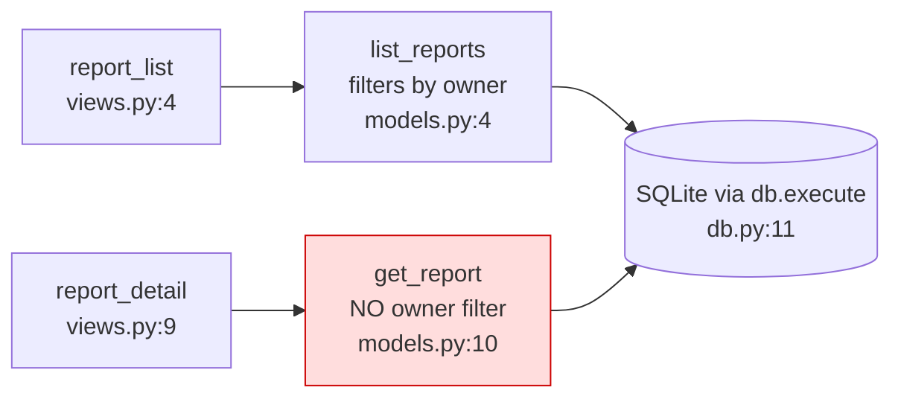
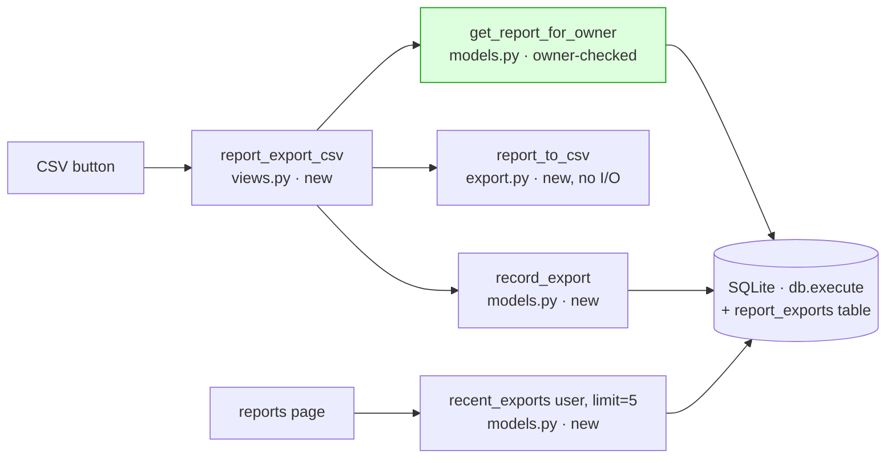

I ran `arch-design` in design mode over `fixture/`, reading all 4 files. There's no `docs/architecture.md`, no ADRs and no git history, so I worked from the code alone. **I haven't changed anything.**

## Verdict

The codebase is clean and small, and this feature fits without adding any new infrastructure. There is one problem you need to fix first: **a report can currently be fetched without checking who owns it.** A CSV button would turn that into a way to download any report.

## What exists today



- **`app/db.py:1`** is the single owner of database access ("The one place that opens a connection"). The export history should be stored through it, not through a second store.
- **`app/reports/models.py:12`** is the problem. It runs `WHERE id = ?` with no `owner_id`, and `views.py:10` passes in whatever `report_id` it receives. `list_reports` does filter by owner (`models.py:6`), so the two lookups don't match.
- **`views.py:14`** shows `render()` is a stub that returns the data unchanged. Nothing in the code builds HTTP responses yet, so nothing currently sets a content type or a download header for a file.
- **No schema or migration code is in `fixture/`.** I can't see where the `reports` table gets created.

## Proposed structure



| Module | Owns | Must never know |
|---|---|---|
| `reports/export.py` (new) | Turning a report into CSV text. Uses the standard-library `csv` module and is a pure function, so it can be tested without a database. | Requests, the database, the export history |
| `reports/models.py` | Report queries, now owner-checked, plus writing and reading the export history | CSV, HTTP |
| `reports/views.py` | One new view: check ownership, build the CSV, record the export, return the file | SQL |

The order inside the view is: owner check, then build the CSV, then `record_export`, then respond. If building the CSV fails, nothing is recorded. If saving the history fails, I'd still return the file and log the error, so the history never blocks the download (this is my call, and it's easy to reverse).

**History table, kept small:**
```sql
report_exports(id INTEGER PRIMARY KEY, user_id, report_id, report_title TEXT, exported_at TEXT /* ISO-8601 UTC */)
```
"Last few" is handled when reading, with `ORDER BY exported_at DESC LIMIT 5`. Old rows are never deleted, so there's no cleanup job, and keeping a full record does no harm.

**Things I'm deliberately not adding:**
- **An exporter interface or plugin system.** Only one format has been asked for, so it's one function.
- **A background job queue.** I'm assuming reports are small enough to export within the request (I haven't checked this).
- **Stored CSV files.** They're regenerated each time, so there's no file storage to secure or back up.
- **pandas.** The standard-library `csv` module covers it.
- **A separate `exports/` package.** The history only changes when reports change, so it lives in `reports/`.

## The one hard-to-reverse decision: the shape of the history data

Once real rows exist, changing the table's shape means a migration.

- **Option A (recommended): copy the title into each history row (`report_title`).** History stays accurate if a report is later renamed or deleted, because it shows what the user actually exported. The cost is one duplicated text column.
- **Option B: store only `report_id` and look up the title when displaying.** This avoids duplication. But a renamed report rewrites its past history, and a deleted report leaves a hole in it.

There's also a simpler option C: no table, and keep the history in the browser's `localStorage`. It's easy to undo and needs no migration. But the history would be per-device and lost when the browser is cleared, and the server would have no record of exports.

## Before or alongside the button

1. **Add an owner check to report lookups.** Either add `get_report_for_owner(report_id, owner_id)` or put `AND owner_id = ?` into `get_report`. To prove it: a test where user B requests user A's report and gets nothing back.
2. **Protect the CSV against spreadsheet formulas.** If a cell starts with `=`, `+`, `-` or `@`, prefix it with `'` inside `report_to_csv`. Otherwise a report title like `=HYPERLINK(...)` runs as a formula when the file is opened in Excel.

## How this could go wrong a year from now

1. **Exports time out as reports grow.** I'm accepting this risk for launch. If it happens, move CSV generation into a background job; the `export.py` function itself wouldn't change.
2. **The history shows wrong or missing titles.** Option A prevents this.
3. **Data leaks through export URLs.** Fixed by the owner check in step 1.

## Questions only Product can answer

1. **What does the CSV contain?** Is it one report's `body` (from the detail page), or the list of reports with id, title and created date? Your note says "report title" for the history, which suggests one report per export, but `body`'s format isn't defined anywhere in the code.
2. **Should the history follow the user across devices?** If yes, it's option A or B; if no, option C is enough.
3. **Should the history show reports that have since been deleted?** If yes, that's a strong argument for option A.
4. **Where are database tables created today?** It isn't in `fixture/`. I need to know so the new table goes through the same route.

Once you answer these, I can take the chosen option further, or hand it off to `build-discipline` to build in small steps, with the owner check landing first.