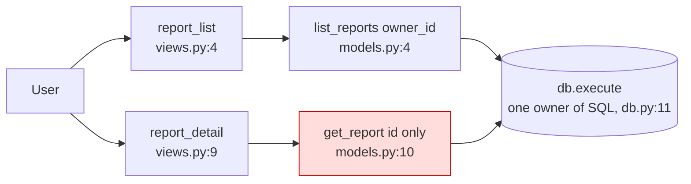
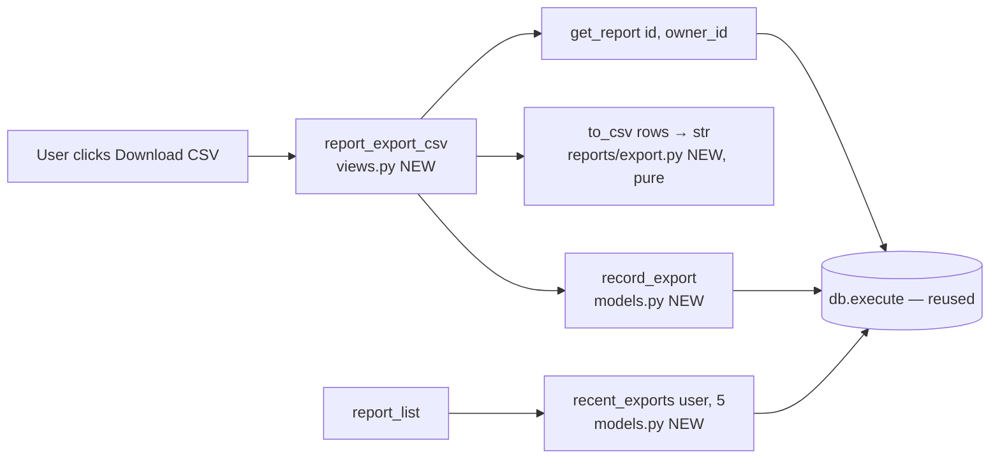

# CSV export and export history: design for `fixture/`

**Verdict:** the codebase is clean and small enough for this change, but two things have to be settled before anyone writes code. A report can currently be fetched by ID without checking who owns it. And nobody has said yet what the CSV should contain.

**What I read:** all 4 files (`db.py`, `reports/models.py`, `reports/views.py`, `users/models.py`). The repo has no architecture doc, ADRs, git history, tests, schema or migrations, and no HTTP framework. `render()` is a stub at `views.py:14`. Everything below comes from reading the code. I didn't run anything because there's nothing runnable.

## Current shape

`db.py` is the only module that touches SQL. It's a solid foundation and the new work should reuse it rather than add anything alongside it.

## Candidates, best first

### 1. Add an ownership check before building export (Strong, traced)
- **Problem:** `get_report(report_id)` (`models.py:10-14`) filters only on `id`, and `report_detail` (`views.py:9-11`) never compares the result against `request.user_id`. If the export endpoint is built the obvious way, on top of `get_report`, then anyone who guesses an ID can download someone else's report as a file.
- **Caveat:** the router and auth layer aren't in `fixture/`, so a check may exist upstream. I couldn't find one in this code.
- **Fix:** `get_report(report_id, owner_id)` with `AND owner_id = ?`, used by both detail and export. That's one query edited and two callers updated.

### 2. Store export history in the existing SQLite database (Strong; one-way door)

- **Option A, recommended:** add a table `report_exports(id, user_id, report_id, report_title, exported_at)` and write to it through `db.execute`. Copy the title into the row at export time rather than joining to `reports`. Otherwise renaming or deleting a report rewrites or removes past history. Read it back with `ORDER BY exported_at DESC LIMIT 5`. Don't build a pruning job for launch; a few rows per click is negligible.
- **Option B:** keep the history in browser localStorage. That needs no schema, but the history is lost when the user switches device or clears storage, and the server never sees it.
- **Not adding:** a separate store, queue or log pipeline. SQLite already handles storage here, and a second store would be one more thing to migrate, back up and secure.
- **Door:** the stored data shape is one-way, so settle the columns before launch. There's also no schema or migration mechanism in `fixture/`, so someone needs to say where `CREATE TABLE` belongs.

### 3. Keep CSV building as a plain function (Strong, two-way)
- Write `to_csv(rows) -> str` in `reports/export.py` using `csv.writer`. It does no I/O, so it can be tested without a database.
- It should neutralise cells that start with `=`, `+`, `-` or `@`. Otherwise a malicious report title becomes a formula when someone opens the file in Excel (CSV formula injection).
- Don't build a format registry or plugin seam. One format was requested, so one function is enough. If XLSX shows up later, it can sit beside this one.

### 4. Make `render()` able to return a file (Worth exploring)
`views.py:14` returns raw data. A download needs `Content-Type: text/csv` and `Content-Disposition: attachment; filename=...`. Whoever owns the real framework has to say where response headers get set. I can't see that layer.

**Likely next changes I ranked against:** more formats (Excel/PDF), exporting the filtered list instead of one report, and re-downloading from history. The design above handles all three without rework, as long as files aren't stored for launch.

## Top move: landing steps (behaviour unchanged after each step)
1. Add `owner_id` to `get_report` and update `report_detail`. **Proof:** a test where user B requests user A's report and gets `None`.
2. Add `export.py:to_csv` plus unit tests: a title containing commas and quotes, and a title starting with `=`.
3. Add the `report_exports` table and `record_export` / `recent_exports`. **Proof:** a test against a temp SQLite file (point `DB_PATH` at it) that inserts 6 exports and reads back the 5 newest in order.
4. Add the `report_export_csv` view. Order matters: fetch with the owner check, build the CSV, record history, then return the response. That way a failed build never shows up in history.
5. Show `recent_exports` on the reports page next to the button.

There are no tests in the repo today, so steps 1 to 3 also create the first ones. A good command to run is `pytest fixture/`.

## Questions before we go further
**For product:**
1. What goes in the CSV: one report's contents (`body`, whose format is unknown) or the list of reports (id, title, created date)? This is the biggest open question.
2. Should history follow the user across devices? Yes means Option A, no makes Option B possible.
3. Is "last few" 5? Do people need to re-download from history? I'm assuming not for launch.

**For engineering:** where does the schema live, and is there auth upstream of these views?

Which candidate do you want to go deeper on? I'd suggest #2, since that's the one that's hard to undo. I haven't changed anything in the repo.