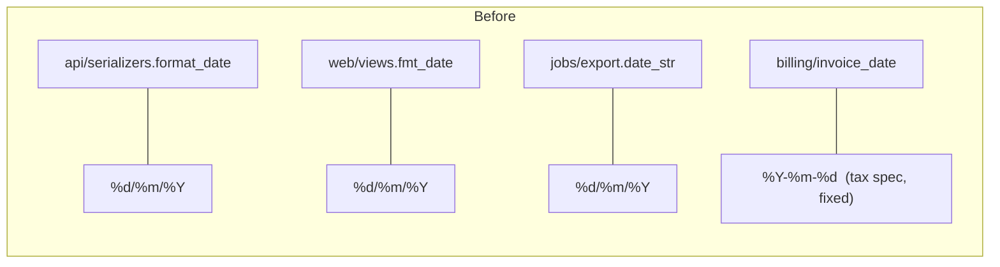
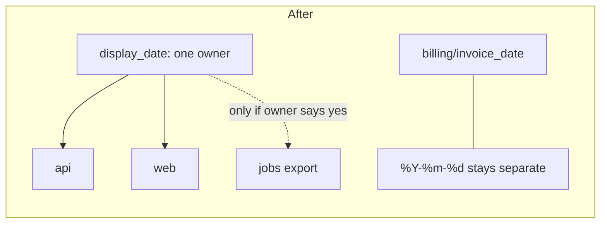

I read all 7 files in `fixture/` (45 lines) and ran each one once to record its current output.

**Short answer: the code is clean overall but messy in two small places.** One of them is a trap for a new person. There is no architecture doc, no decision records and no git history here, so what follows comes only from reading the code and running it once.

## What to know before changing anything

**1. Four date formatters exist, and one must never be merged with the others.**
`api/serializers.py:1`, `web/views.py:1` and `jobs/export.py:1` all use `"%d/%m/%Y"`. That looks like duplication, and it is. But `billing/invoice.py:1` uses `"%Y-%m-%d"` on purpose. The comment at `billing/invoice.py:2-4` says the tax authority's upload spec requires ISO-8601, and changing it "rejects the whole filing." A newcomer cleaning up "all the date helpers" into one would break tax filings. Billing's date format is a legal requirement, not a display choice, so it stays separate even if the formats ever matched.

**2. The `providers/` package is a plugin system with only one plugin.**
`base.Provider`, a `registry` dict and `SmtpProvider` are three files that do the work of one class (the docstring at `providers/base.py:2` says so). Nothing in `fixture/` calls `registry.get`, but code outside this folder might. **This is suspected, not proven.** Don't delete it on that basis.

**3. Nothing imports anything else.** All five folders are independent: no cycles and no layering problems. Changes stay local, except for the date-format issue above.

## Candidates, best first

### A. Give the customer-facing date one owner (Strong)
- **What it costs today:** changing the customer-facing date format means 3 edits in 3 folders (`api`, `web`, `jobs`). Miss one and the website and the API disagree.
- **Same-reason test:** `api` and `web` both change when "how we show dates to customers" changes, so they pass. `jobs/export.py` is a CSV file for some downstream reader. If that reader parses `dd/mm/yyyy`, it needs its own owner. **I can't answer that from the code. The owner can:** *"If the website date format changed, should the CSV export change too?"*




**The move, in steps that each keep behavior unchanged:**
1. Add one `display_date(d)` in a shared module.
2. Point `api` at it.
3. Point `web` at it.
4. Point `jobs` at it only if the owner says yes.
5. Leave `billing` alone.

**Option 2 (simpler):** don't merge. Instead, put a comment on each of the three copies naming the other two. That gives zero structural change and catches most misses. If the date format rarely changes, this is enough.

**Proof:** this check passes today. It must print the same lines after each step:
```
python -I -c "import sys;sys.path.insert(0,'fixture');from datetime import date;from api.serializers import order_json;from web.views import order_page;from jobs.export import rows;from billing.invoice import line;o={'id':7,'placed_at':date(2026,3,4)};print(order_json(o),order_page(o),rows([o]),line(o))"
```
Expected output: `04/03/2026` ×3 and `7|2026-03-04`.

**Can it be undone?** Yes, easily. It's an internal helper.

### B. Collapse `providers/` to one class (Worth exploring)
- **The test of removing it:** `SmtpProvider` keeps working on its own. The base class and the registry add no behavior: 3 files and 13 lines become 1 file and about 4.
- **It only pays off if no second provider is coming.** If someone plans to add another sender (SES, SendGrid), this structure is about to be used, so keep it.
- **Before touching it:** find every caller of `registry.get` / `PROVIDERS["smtp"]` outside `fixture/`, including any `"smtp"` strings in config. Proving it unused is a job for `latent-audit`.
- **Can it be undone?** Yes, unless outside code imports `Provider` or `registry`. That's another reason to find the callers first.

I dropped nothing else. The other folders are one small function each with nothing to improve.

## The Monday briefing in three lines
1. **Never merge `billing/invoice.py`'s date into the others.** It is fixed by the tax authority's spec.
2. The customer-facing date format lives in 3 copies. Change all of them, or do candidate A first.
3. `providers/` is built for many senders but has one. Ask whether a second one is planned before simplifying it or building on it.

No code or docs were changed. **Which candidate do you want to take further: A, B, or neither?** If it's A, the CSV question above is the first thing to answer.