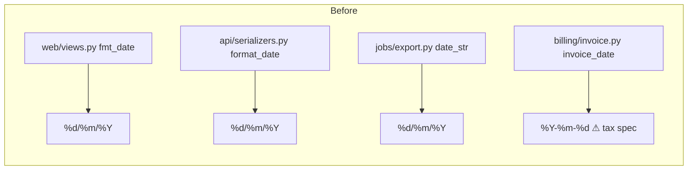
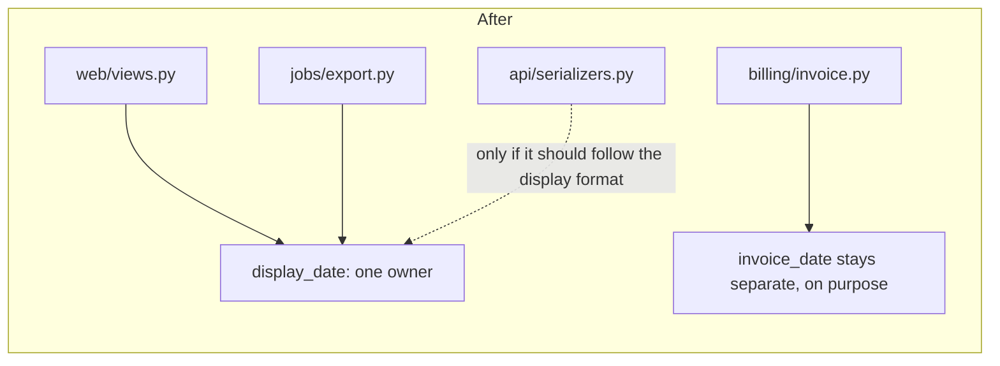

I ran `arch-design` in audit mode on `fixture/`, which is 7 files and 45 lines. I read all of it and changed nothing.

**Verdict: messy in places, but not tangled.** There are no import cycles and almost nothing imports anything else. The real risk for a newcomer is not the structure. It's that four things look the same and one of them must never be merged with the others.

## Before you change anything: the five things to know

1. **There are four date helpers and only three are copies. Don't merge `billing/invoice.py:1`.** `web/views.py:1`, `api/serializers.py:1` and `jobs/export.py:1` all print `%d/%m/%Y`. `invoice_date` prints `%Y-%m-%d` because the tax authority's upload spec requires it. The comment at `billing/invoice.py:2-4` says a change here "rejects the whole filing". Anyone who sees four date helpers and makes one "shared date util" will break tax filings.
2. **The API's date format is a public contract.** `api/serializers.py:6` sends `dd/mm/yyyy` to API clients. Changing it breaks outside clients you can't see. Treat it as a one-way change.
3. **`providers/` is built for many email providers but has only one.** `base.py` has one implementer (`SmtpProvider`), `registry.py:3` has one entry, and nothing in `fixture/` calls `registry.get()`. That is unproven, though: `get(name)` is a lookup by string name, so code outside this folder may call it. Don't delete it on a hunch.
4. **The shape of an order is assumed everywhere and defined nowhere.** All four modules index `order['id']` and `order['placed_at']`, and `placed_at` must be a `datetime`. Renaming a field means editing four files, and no import or type will tell you which ones.
5. **There's nothing to lean on.** I found no architecture doc, no recorded decisions, no tests and no git history. The only recorded reason for anything is the comment in `billing/invoice.py:2-4`, and it's the most important line in the codebase. Because there's no history, the ranking below rests on code reading, not on what has changed most often.

## Candidates, best first

### 1. Give the customer-facing date format one owner (Strong)
Today, changing the customer-facing date format takes 3 edits. Miss one and the web page, the API and the CSV export disagree.

- **What gets cheaper:** a format change goes from 3 edits to 1, with no chance of drift between copies.
- **What I can't decide for you** (the same-reason test): should the API date and the export date *follow* the website's format, or are they contracts of their own? If the CSV goes to an accounting tool or the API has outside clients, they belong with billing and stay separate, not with the website.
- **The move:**
  1. Add `display_date(d)`.
  2. Switch `web/views.py` to use it.
  3. Switch `jobs/export.py` to use it, if the answer above says so.
  4. Switch `api/serializers.py` last, and only if the answer says so.

  Each step leaves the output byte-for-byte the same.
- **Proof:** for a fixed date, `order_page`, `rows` and `order_json` give identical output before and after. There are no tests yet, so write that check first.
- **Door:** two-way for the internal function. Changing the API output itself is one-way.
- **Second option:** leave the three copies as they are and add a comment to each one pointing at the others. This is cheaper, and it's fine if the format never changes.

### 2. Collapse `providers/` to a plain function (Speculative)
The deletion test passes: `base.py`, `registry.py` and `smtp.py` would collapse into one `send()` and nothing of value would be lost. But I can't prove it's unused, because the lookup is by string name and there may be callers outside `fixture/`. Leave it until someone proves it dead, either with `latent-audit` or by confirming no outside callers. If a second provider is actually planned, the structure has earned its place.

### 3. Name the order's shape in one place (Worth exploring)
Four modules depend on `id` and `placed_at` without any definition of them. A small `Order` type or a single accessor would turn a rename from 4 silent edits into 1 checked one. It only pays off if the order's fields are likely to change.

## What I need from you
- Which candidate do you want to explore? I'd pick #1.
- For #1: does the API date or the CSV export date need to stay fixed, like the billing date?

A cheap win for Monday, whichever you pick: turn the comment in `billing/invoice.py:2-4` into a test that checks the `YYYY-MM-DD` output. That way the most dangerous mistake fails a test instead of a tax filing.