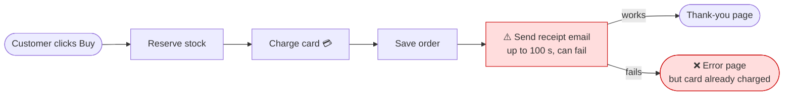
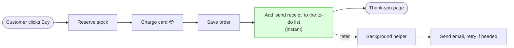
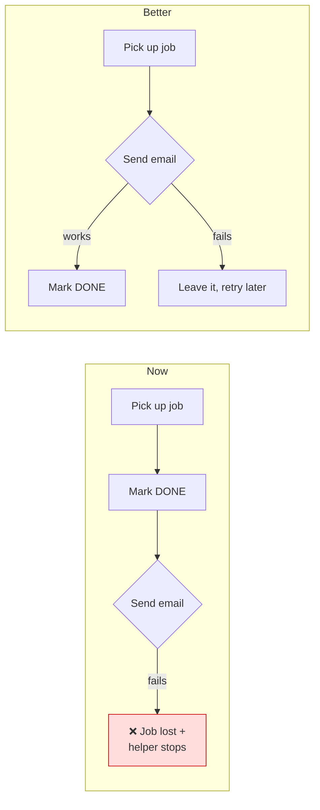

I ran `arch-design` on the shop in `fixture/`. Short answer: **the design is mostly fine, but one piece of the code doesn't do what your design document says, and that one gap causes both problems you've seen.** I didn't change anything.

## First: your design document is wrong in one place

Your architecture document (`docs/architecture.md:14-15`) says:

> "Checkout … puts the receipt email on the job queue. **The customer never waits for email.**"

The code doesn't do that. Checkout sends the receipt email directly, while the customer waits (`shop/checkout.py:12`). The email queue exists, but only refunds use it. Anyone who reads the document, whether a person or an AI, will think this problem is already solved.

## What's wrong, best fix first

### 1. Checkout waits on the email server, and an email failure shows the customer an error *after* their card was charged (Strong)

**What you see:** "checkout sometimes takes ages" and "charged but saw an error page." Both come from this.

**Why it happens:** Checkout does four steps in order: reserve stock, charge the card, save the order, send the receipt. The receipt is sent last, while the customer is still waiting. If the mail server is slow, the shop waits up to 30 seconds and tries 3 times, with a 5-second pause between tries (`shop/emailer.py:8-16`). That's **up to 100 seconds** of waiting. If all 3 tries fail, the customer gets an error page, even though the charge and the order went through.

**I checked this by running it.** I made the mail server unreachable and placed a test order. The customer got an error, the order was saved with a charge on it, and one mug was taken out of stock. The total wait in that case is 3 × 30 seconds plus 2 × 5 seconds = 100 seconds.

**Before (now):**

**After:**

**What gets better:** the customer's longest wait for email drops from 100 seconds to about zero. The number of ways a customer can be charged and still see an error drops from 1 to 0. A mail outage would only delay receipts, not break checkout.

**No new parts are needed.** The shop already has a to-do list (the job queue in `shop/jobs/queue.py`) and a background helper that sends emails (`shop/jobs/worker.py`), and refunds already use them. The fix is to point checkout at the same place. I am *not* proposing a new queue service: that would be one more system to run, secure and back up, to solve a problem the existing queue already handles.

**How it would be done, with nothing working differently at any step:**
1. Teach the background helper how to send a receipt. That's one line in `shop/jobs/worker.py:6-8`. Nothing uses it yet.
2. Change `shop/checkout.py:12` to add the receipt to the to-do list instead of sending it directly.
3. Fix candidate 2 below at the same time, so receipts can't go missing.

**How we'd check it works:** re-run my test above with the mail server down. Checkout should now succeed instantly, and the receipt should be waiting in the queue.

**Reversibility:** easy to undo. It's a code-only change and no stored data changes shape.

**One question only you can answer:** *is it fine if the receipt email arrives a minute or so after purchase instead of instantly?* The code comment at `checkout.py:12` says it was done this way "so the customer has the receipt immediately." If a short delay is fine, this is the fix.

### 2. The background helper can silently lose emails and then stop working (Strong; it matters more once #1 is done)

The to-do list marks a job "done" *when the helper picks it up*, before the email has actually been sent (`shop/jobs/queue.py:18`, then `shop/jobs/worker.py:18`). If the email fails, the job is already marked done and never retried, and the error also stops the helper completely, so every later email waits until someone restarts it. Today this affects refund confirmations. After fix #1 it would affect receipts too, which is why both should ship together.

### 3. If a card charge fails, the stock stays reserved (Worth exploring)

Stock is reserved before the card is charged (`checkout.py:6-9`), and there's no way to un-reserve it (`shop/inventory.py` can only reserve). If a card is declined, those items look sold even though nobody bought them. Your current payment code is a placeholder that never fails (`shop/payments.py:4-5`), so this can't happen yet. It will once a real payment provider is connected.

### 4. Orders and stock are only kept in memory (question for you)

Orders (`shop/db.py:4`) and stock levels (`shop/inventory.py:1`) are kept only in the program's memory, so restarting the shop erases them. If this is just a placeholder for a real database, ignore it. If this is how the live shop actually stores data, it's the most important item on this list, and moving to a database is a big decision that's hard to undo, so we'd work through the options before choosing.

## Which one should we explore?

I recommend **#1 and #2 together**: two small changes that should remove both problems you've noticed. Before that, please tell me:
- whether a receipt arriving about a minute late is acceptable, and
- whether #4 describes the real shop or just this sample.

Once you pick one, I'll go through it in detail with you, and then update the design document so it matches what the code actually does.