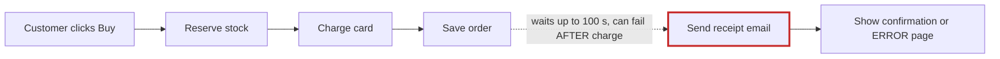
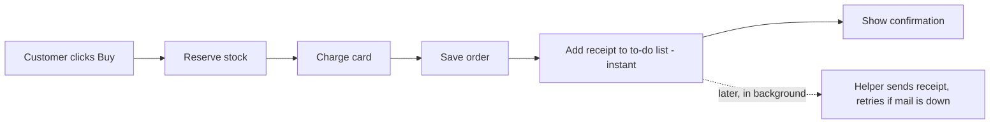

## Your shop's architecture

**The main problem:** when a customer checks out, the shop waits for the email server to send the receipt before it shows them anything. That explains both things you've noticed. Checkout can take up to **100 seconds**. And if the email server is down, the customer sees an error page **after their card has already been charged**.

I tested this rather than guessing. I made the email server "fail" in a test run. The customer got an error page, but the order was saved, the card was charged and the stock was taken.

### First: your architecture document is wrong
Your design document says the receipt goes onto a background to-do list and that "the customer never waits for email." The code doesn't do that. Checkout sends the email itself while the customer waits (`shop/checkout.py:12`). Anyone who reads the document, person or AI, would think this problem is already solved.

### 1. Send the receipt in the background (my top recommendation)

**Now:**

**Better:**

- **What gets better:** customers no longer wait on the email server at all (up to 100 seconds → 0). Email trouble can't cause a charge followed by an error page anymore.
- **Cost:** low. Refund emails already go through this to-do list, so you'd be reusing something you already run.
- **One thing to fix along with it:** right now the to-do list crosses a task off *before* doing it. If an email fails, it's lost for good. That needs fixing first, or receipts could quietly go missing.
- **Risk:** easy to undo. The only change you'd notice is that a receipt might arrive a few seconds to a minute later.

### 2. A failed order can leave stock "used up"

Checkout takes items off the shelf one at a time. If a later item turns out to be out of stock, the earlier items are never put back. In my test, a failed two-item order left the first item's stock at zero. Products could show as sold out when nobody bought them.

**Better:** check that every item is in stock before taking any of them, and put items back if the card is declined. This is worth looking into, and it's also cheap and easy to undo.

### Details for engineers
- **Problem 1:** `web.py:5` → `checkout.py:9` (charge) → `:10` (save) → `:12` `emailer.send_receipt` → `emailer.py:8-16`. That's 3 tries × a 30-second timeout, plus two 5-second pauses, for 100 seconds in total. It then re-raises `OSError`, and nothing catches it.
- **The to-do list:** `queue.py:18` marks a job done before `worker.py:18` runs it. `worker.py:6-8` has no receipt handler, so an unknown task name raises `KeyError` and stops the worker.
- **Problem 2:** `checkout.py:6-7` reserves stock item by item, and `inventory.py` has no release step. The out-of-stock case is proven by the test. The declined-card case is only suspected, because `payments.charge` is currently a placeholder that never fails.
- **Other option for #1:** keep sending inline but catch the error. That's a one-line change, but customers would still wait up to 100 seconds. I'm not suggesting a new message system: the current SQLite to-do list is enough at this size.

There's a visual version with the same diagrams side by side at `<tmp>\architecture-review-shop.html`, and I've opened it for you. I haven't changed anything in your shop or its documents.

**I'd start with #1**, because it's exactly the problem you described. **Which one would you like to explore further?** If it's #1, the one thing I need from you is whether a receipt arriving up to a minute after purchase is OK.