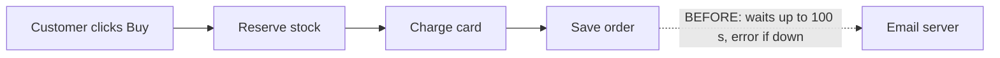
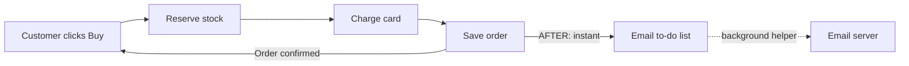

Your shop is **in decent shape overall, but a few parts are messy**, and one of them explains both problems you noticed. Checkout waits for the email server before it shows the customer anything. When email is slow, checkout can take up to 100 seconds. When email is down, the card has already been charged and the customer sees an error page.

I tested all of this by running your shop code with a fake mail server that was switched off. I didn't change any files in your shop.

I opened an illustrated version of this report in your browser. It's saved at `<tmp>\architecture-review-20261011.html`.

## Your design document is wrong
Your design document (`docs/architecture.md`) says checkout puts the receipt on a to-do list and *"the customer never waits for email."* The code doesn't do that. It sends the email right away while the customer waits (`shop/checkout.py:12`). Anyone reading the document, whether a person or an AI, would think this problem was already solved.

## What I'd change, best first

**1. Send the receipt in the background. Strong case.**
Right now the receipt step tries the mail server up to 3 times. Each try can wait 30 seconds, with 5-second pauses in between, so up to 100 seconds in total. If every try fails, the customer sees an error even though they were already charged.

- **What gets better:** the email part of checkout goes from up to 100 seconds to almost nothing. Email problems can no longer cause "charged but saw an error."
- **Nothing new to build:** your shop already has this to-do list and a background helper, and refund emails already use them.
- **Easy to undo:** it's about a one-line change.

**2. Stop the email helper losing emails and crashing. Strong case. Do it together with #1.**
The helper ticks a job off as "done" *before* it sends the email. If sending fails, that email is lost forever. The failure also crashes the helper, so every later email stays stuck until someone restarts it. Today this only affects refund emails. After #1 it would affect every receipt, so the two must ship together.

**3. Failed checkouts quietly "use up" stock. Worth exploring.**
Checkout takes items off the stock count one at a time. If a later item is sold out, or the card is declined, the items already taken are never put back. In my test, one failed cart permanently removed 2 mugs from the count. The fix is to check the whole cart first, and put items back if the charge fails.

**4. Orders and stock are only kept in memory. Speculative.**
If this is how the live shop really runs, every restart forgets all orders and stock. It may just be a stand-in for a real database. Where orders are stored is hard to change later, so I wouldn't touch it until you confirm.

## Where I'd start
Do **#2 and #1 together as one change**. That fixes both problems you noticed, uses parts the shop already has, and is easy to undo.

## Questions for you
1. Which one would you like to look at in detail?
2. Is it OK if the receipt email arrives up to a minute after the customer sees "order confirmed"?
3. Do you know if the background email helper is actually running on your live shop? Nothing in the code starts it. If it isn't running, refund emails aren't being sent today either.