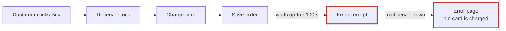
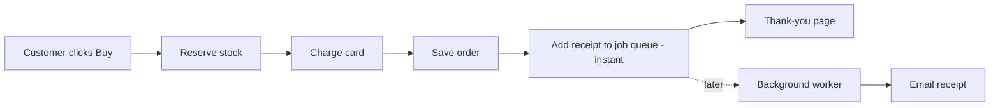

Your feeling is right. The shop is mostly fine, but one important part is badly arranged: **checkout waits for the email server before it shows the customer the thank-you page.** That one problem explains both things in your note. When the mail server is slow, checkout can take up to about 100 seconds. When it's down, the card has already been charged but the customer sees an error page.

I didn't change anything in your shop. I also opened a visual version of this report in your browser: `<tmp>\architecture-review-20261011.html`

## First: your design document is wrong

`docs/architecture.md` says "the customer never waits for email" and that receipts are sent by a background worker. The code doesn't do that. Checkout sends the receipt itself (`shop/checkout.py:12`), and the background worker has no way to send receipts at all (`shop/jobs/worker.py:6-8`). Anyone reading the document would think this problem was already solved.

## 1. Send the receipt in the background · Strong

After charging the card, checkout contacts the mail server. If the server doesn't answer, checkout waits 30 seconds, pauses 5 seconds and tries again, up to 3 times (`emailer.py:8-16`). If all three tries fail, the customer gets an error page, but the money has already been taken. **I ran this with the mail server switched off: the card was charged, the order was saved, and the customer got an error.**

**Better:** checkout drops the receipt into a waiting list of jobs (a "job queue") and immediately shows the thank-you page. A background worker sends the email a moment later and keeps retrying if it fails.

Your shop already has this job queue, and it's used for refund emails (`refunds.py:7`), so nothing new needs to be added or run. This is easy to undo.

## 2. The job queue throws away emails that fail · Strong

The worker marks a job "done" *before* it tries to send it (`queue.py:18`, then `worker.py:18`). If the email fails, it's never retried, and the worker crashes, so no more emails go out until someone restarts it. Refund emails may already be getting lost this way. **This has to be fixed before #1**, or receipts would start disappearing instead.

## 3. A failed order keeps stock locked · Worth exploring

Checkout reserves items one at a time (`checkout.py:6-7`). If a later item is out of stock, the earlier items stay reserved anyway. **I ran it:** an order for a mug and an out-of-stock lamp failed, and mug stock still dropped from 5 to 4. Your site could be showing "out of stock" for items that are still on the shelf.

## 4. A question for you

Orders and stock counts are only kept in the program's memory, so they're lost whenever it restarts (`db.py:4`, `inventory.py:1`). **Is this your real shop's code, or a simplified copy?** If it's real, this matters more than everything above.

## What I'd do first

Fix **#2, then #1**, as one piece of work: together they fix both of your complaints. For engineers, the steps are:
1. Fix the worker so a job is only marked done after it succeeds, and a failure doesn't stop it.
2. Teach the worker to send receipts.
3. Change one line in checkout from "send email now" to "add it to the job queue".

To check it worked, run a test with the mail server switched off. Checkout should finish instantly with no error, and the receipt should go out once the worker runs.

**Which one would you like to explore?** And one question only you can answer: **is it OK if the receipt email arrives a minute after the thank-you page instead of instantly?**