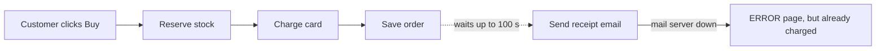
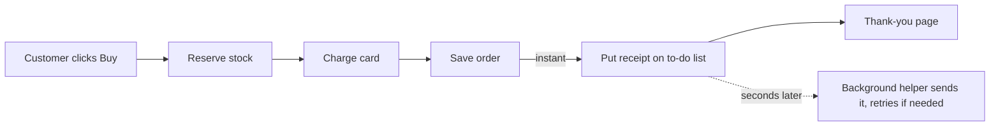

I found the cause of both problems you described: the slow checkout, and customers being charged but seeing an error page. It's one problem with one fix. I've opened a visual report in your browser, and it's saved at `C:\Users\thana\AppData\Local\Temp\archproof\architecture-review-20261011.html`. I didn't change anything in the shop.

## The short answer
**Most of the shop is in good shape, but one part is badly built.** At checkout, the customer has to wait while the shop sends their receipt email. If the email server is slow, checkout can take up to **100 seconds**. If the email server is down, the customer **has already been charged** and then sees an error page.

I tested this rather than guessing. I ran a simulation where the email server was down. The card was charged, the order was saved and the stock was taken, and then the customer got an error. The shop tried the email 3 times, which adds up to 100 seconds of waiting in the worst case.

## ⚠ Your architecture notes are wrong about this
The shop's notes say receipts go on a background to-do list, so "the customer never waits for email." The code doesn't do that. Checkout sends the email itself (`shop/checkout.py:12`), and the background helper has no instructions for sending receipts at all (`shop/jobs/worker.py:6-8`). Anyone reading the notes would think this problem was already solved.

## 1. Checkout waits for email (strong, tested)
**Now:**

**Better:**

- **What improves:** checkout no longer waits for email at all, and an email outage no longer causes any error pages.
- **What it needs:** the shop already has this to-do list (it's used for refund emails), so there's nothing new to install.
- **Risk:** easy to undo.

## 2. The background helper can lose emails (strong; confirmed from the code, not yet tested)
The helper marks a job "done" before it tries to send it. If sending fails, that email is lost for good, and the helper stops working until someone restarts it (`shop/jobs/queue.py:18`, `shop/jobs/worker.py:18`). This doesn't hurt you yet, but it needs fixing alongside #1. Otherwise, moving receipts onto the to-do list would mean receipts quietly go missing.

## 3. Stock isn't put back when a card is declined (worth looking into; not confirmed)
Checkout takes items off the shelf before charging the card. If the charge fails, nothing puts those items back (`shop/checkout.py:6-9`). The result could be items showing "out of stock" when they're actually on the shelf. I can't confirm this happens yet, because the payment code here is a placeholder that never declines a card.

## 4. A question: are orders saved anywhere permanent?
In this code, orders and stock counts are only kept in the program's memory (`shop/db.py:4`, `shop/inventory.py:1`). If your real shop works the same way, restarting it would wipe every order. This may just be a stand-in for a real database. Changing where data is stored is hard to undo, so it should be a separate conversation.

## Where I'd start
Fix **1 and 2 together**. They solve both things you noticed, they reuse what's already there, and they're easy to undo.

The simpler fallback would be to stop the error page and leave everything else as is. Charged customers would no longer see an error, but checkout would still sometimes take up to 100 seconds.

**Two questions for you:**
1. Which of these would you like to look at more closely? I'd suggest 1 and 2.
2. Is it OK if the receipt email arrives a few seconds after the thank-you page, rather than at the same moment?