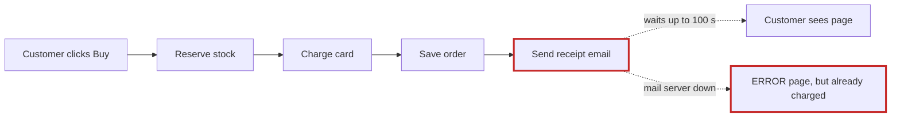
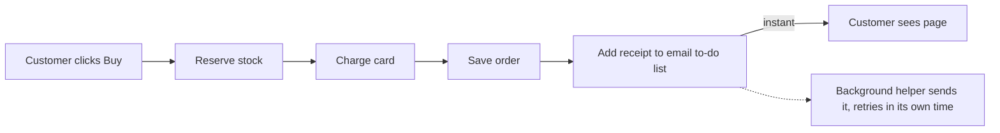

Your shop is mostly simple and in decent shape, but one thing is badly wrong, and it explains both problems in your note. **At checkout, the customer waits while the shop sends the receipt email.** That's why checkout sometimes takes ages, and why some customers were charged but saw an error page.

I tested this, not just read it. I made the email server act as if it were down and ran a checkout. The card was charged and the order was saved, and then the customer got an error page. The shop tries to send the email 3 times, waiting up to 30 seconds each time with short pauses between tries, so the customer can wait up to **100 seconds**.

I put a fuller version with side-by-side pictures in a page that should have opened in your browser: `<tmp>\architecture-review-shop.html`. I didn't change anything in the shop.

## ⚠️ Your design notes are wrong about this
The shop's design notes say *"the customer never waits for email"* (`docs/architecture.md:15`). The code does the opposite: checkout sends the receipt itself (`shop/checkout.py:12`). The background helper that's supposed to send it has no instructions for receipts at all, only for refunds (`shop/jobs/worker.py:6-8`). Anyone reading those notes would think this problem was already solved.

## 1. Checkout waits for the email server (Strong)

**Before:** the customer waits for every step, including the email.

**After:** the email goes on a to-do list, and a background helper sends it.

- **What gets better:** email delays no longer slow down checkout at all (today they can add up to 100 seconds). "Charged but saw an error" can no longer happen because of email.
- **Nothing new to buy or run:** the shop already has this email to-do list, and refunds already use it (`refunds.py:7`).
- **Risk:** low and easy to undo. It's about 3 small edits.

## 2. The background helper loses emails (Strong, do it together with #1)
The helper crosses a job off the to-do list *before* doing it (`queue.py:18`). If sending fails, that email is lost for good. The helper also stops completely (`worker.py:18`), so every email after that sits unsent until someone restarts it. Refund confirmations already have this problem. If we did #1 alone, receipts would get it too.

→ **After:** send first, cross off only after it succeeds, and keep failed emails on the list to retry. Easy to undo.

## 3. A failed checkout keeps stock reserved (Worth exploring)
Stock is set aside before the card is charged, and nothing ever releases it (`checkout.py:6-9`). A declined card could leave items showing "out of stock" when they aren't. This only matters once real card charging is plugged in: right now the payment code is a placeholder that never fails (`payments.py:4-5`).

## 4. Orders are kept only in memory (Speculative, I need your answer)
Orders and stock levels are kept only in the program's memory (`db.py:4`, `inventory.py:1`), so a restart would wipe them. This might just be a stand-in for a real database. **Are your real orders stored somewhere else, like a database or Shopify?** If not, this becomes the most serious issue. Fixing it is a bigger decision that's hard to reverse, because it sets how your data is stored.

## Where I'd start
**Do #1 and #2 together.** They fix both problems you noticed, they're small, they reuse something the shop already has, and they're easy to undo. To check the fix, we'd rerun the same "email server is down" test: checkout should finish straight away with no error, and the receipt should be waiting on the to-do list.

**Which one would you like to look at more closely?** One question only you can answer: is it fine if the receipt email arrives a minute or so after purchase instead of instantly?