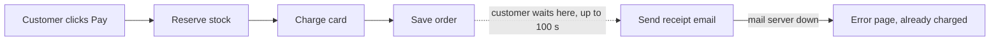
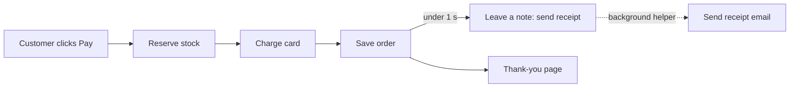
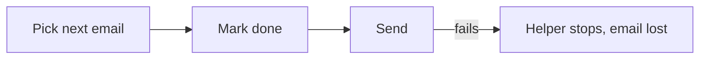

# Your shop: architecture review

**Verdict: messy in places.** During checkout, the customer waits while the receipt email is sent. When the mail server is slow, checkout is slow. When the mail server is down, the card has already been charged and the customer then sees an error page. That explains both things you noticed, and I reproduced the second one by running your shop's code with the mail server switched off.

I've opened an illustrated version in your browser: `C:\Users\thana\AppData\Local\Temp\architecture-review-20261011-1347.html`. I haven't changed anything in your shop's files.

## ⚠ First: your design document is wrong

`docs/architecture.md` says the receipt email goes onto a background list and that "the customer never waits for email." The code doesn't do that. `shop/checkout.py:12` sends the email straight away while the customer waits. Anyone who reads that document, a person or an AI, would think this problem was already fixed.

## 1. Send the receipt in the background (recommended, worth doing first)

**Why it happens:** Checkout goes in this order: reserve stock → charge card → save order → send email. The email step tries the mail server 3 times. Each try can wait up to 30 seconds, with a 5-second pause between tries, so the customer can wait **up to 100 seconds**. If all three tries fail, checkout shows an error, but the charge has already gone through.

**Before**

**After**

**What gets better:** the wait caused by email drops from up to 100 seconds to almost nothing. A mail outage can no longer cause "charged but saw an error." Your shop already has a background helper that sends refund emails, so nothing new needs to be added. This is also easy to undo.

## 2. The background helper loses emails, and one failure stops it (do this together with 1)

The helper ticks a job off as done *before* it sends the email (`shop/jobs/queue.py:18`). If the send fails, that email is never retried. The failure also isn't caught (`shop/jobs/worker.py:18`), so the helper stops completely and no more emails go out until someone restarts it. This already affects refund emails today. Once #1 moves receipts onto the same helper, it would affect receipts too.

The fix: mark the job done only after the email is sent, and if it fails, try again later.

## 3. A failed order can lock up stock (worth exploring)

Stock is set aside one item at a time, and nothing gives it back if the order fails (`shop/checkout.py:6-9`). I tested an order for 2 mugs and 1 hat when no hats were left. The order failed, and mug stock dropped from **5 to 3**. Those 2 mugs now look sold even though they're still on the shelf.

---

**For engineers, on #1:** reuse the existing queue (`jobs/queue.py:7`), which `refunds.py:7` already uses, and don't add Celery or Redis. The steps:
1. Add a `send_receipt` entry to `HANDLERS` in `worker.py`.
2. Replace `checkout.py:12` with `enqueue("send_receipt", …)`.
3. Release #2 in the same change.

The check: a test with the mail server stubbed to fail, where checkout still returns the order and one receipt job is waiting in the queue. The simpler alternative is to catch the email error at checkout. That would stop the error page, but customers could still wait up to 100 seconds.

**Two questions for you:**
1. Which of these would you like to look at in more detail? I'd suggest #1 and #2 together.
2. Is it OK if a receipt sometimes arrives a minute after checkout instead of instantly?