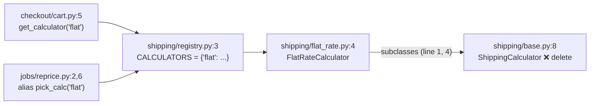

Yes, it's safe to remove, but it is not unused. Deleting only the file would break checkout and the nightly reprice job. The interface is `ShippingCalculator` in `shipping/base.py`. It needs one more edit in `flat_rate.py`, covered below.

**Verdict:** the code is clean but has one extra layer. The interface has a single implementer, so it adds a layer without adding anything.

There's no map to check against: `fixture/` has no `docs/architecture.md` and no ADRs. It also isn't a git repo, so I couldn't use the history to find out why the interface was added. Its own docstring says it was "kept as a seam in case a second carrier is ever needed" (`shipping/base.py:3`). You could run `/project-foundation` later to give the project a map.

## Why it looks unused but isn't

- **One real user:** `FlatRateCalculator` imports and subclasses it (`shipping/flat_rate.py:1`, `:4`).
- **Nothing reaches it directly:** callers get the concrete class through a lookup by the string `"flat"` (`registry.py:3,7`). The nightly job also imports `get_calculator` under the alias `pick_calc` (`jobs/reprice.py:2`). A search for the class name or for `get_calculator` call sites can miss that job.
- **Nothing depends on the base class:** a search found no `isinstance`, no type hints, no `__subclasses__` and no dynamic imports. The base `quote` raises `NotImplementedError` and is always overridden.
- **Deleting only `base.py` breaks everything:** `flat_rate.py:1` fails to import, which takes down `registry.py`, which takes down both `checkout/cart.py` and `jobs/reprice.py`.

## What has to change (2 edits)

1. Delete `shipping/base.py`.
2. In `shipping/flat_rate.py`, delete line 1 (`from shipping.base import ShippingCalculator`) and change line 4 to `class FlatRateCalculator:`.

Nothing else changes. The registry, checkout and the job never name the interface.

**Proof (tested):** I made both edits in a temporary copy outside `fixture/` and called both entry points before and after. The results were identical: `total_with_shipping({'subtotal': 10})` returned `15.0`, and `reprice_open_orders` set `shipping: 5.0`.

**Risk:** low and easy to undo. It's an internal class and hasn't shipped yet, so no stored data or public API depends on it. If a second carrier ever arrives, a new class can be added to the `CALCULATORS` dict (`registry.py:3`) with no base class at all. Python doesn't need one when every calculator just has a `quote` method. A shared base is only worth having once there are two implementers, or a test fake.

## A second, related candidate

**Worth exploring:** `shipping/registry.py` is the same pattern one level up. It's a lookup table with one entry, called twice, both times with the hard-coded `"flat"`. Inlining it would take one more file out of the path. Unlike the interface, it is a place a second carrier would plug in, so keeping it is a reasonable call. Removing it isn't required for deleting the interface.

In audit mode I haven't changed anything in `fixture/`. Do you want me to make the two edits, or look into the registry first?