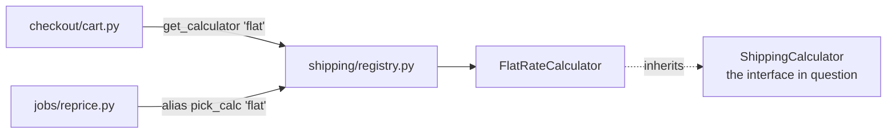

I ran `arch-design` in audit mode over `fixture/`. Nothing in `fixture/` was changed.

## Answer

**Yes, it's safe to remove `ShippingCalculator` (`shipping/base.py:8`), but it isn't unused.** `FlatRateCalculator` is built on it (`shipping/flat_rate.py:1,4`), so deleting `base.py` alone would break every shipping quote with an `ImportError`. The fix is two lines in one file:

1. Delete `shipping/base.py`.
2. In `shipping/flat_rate.py`, remove line 1 (the import) and change line 4 to `class FlatRateCalculator:`.

Nothing else changes. `registry.py`, `checkout/cart.py` and `jobs/reprice.py` never mention the interface.

**Proof (I ran this):** I copied the code to a scratch folder and ran checkout and the nightly reprice job before and after the deletion. Both gave the same result: `total = 15.0` and `shipping = 5.0`. I also searched for every way code could still depend on the interface: by name, by import, through type checks, or by looking it up at runtime. Only the two lines above refer to it.

## Map

There's no `docs/architecture.md`, no ADRs, no tests and no git history. This sketch comes from reading all 5 files.

**Verdict:** mostly clean, with a little structure nobody needs yet. Two layers sit in front of what is really "shipping costs 5.00".

## Candidates

**1. Drop the `ShippingCalculator` interface (Strong; small win, low risk)**
- **Before:** an interface with one implementer, two files, and an import between them. There's no test fake, no type check, and no `super()` call, so nothing relies on it.
- **After:** `FlatRateCalculator` stands alone. That's one file and one import less, and a reader no longer has to wonder where the other carriers are.
- **Why it existed:** the docstring at `base.py:3` says "in case a second carrier is ever needed". That's a guess, and there's no history to show it was ever more than that.
- **Deletion test:** the interface's job vanishes rather than moving somewhere else. If a second carrier does arrive, adding a base class back is about 5 lines.
- **Door:** two-way, as long as nothing outside this repo subclasses `ShippingCalculator`. That's true if, as you say, it hasn't shipped yet. If `shipping` is ever published as a library for others, it becomes a one-way door.

**2. The string registry has one entry (Worth exploring; don't do it as part of this change)**
- `registry.py:3` maps only `"flat"`, and both callers hardcode `"flat"` (`cart.py:5`, `reprice.py:6`). An unknown name would raise an unhandled `KeyError` (`registry.py:7`).
- If someone simplifies this later, there's a trap: `jobs/reprice.py:2` imports the function under another name, `pick_calc`. A search for `get_calculator(` finds only checkout and misses the nightly job at `reprice.py:6`.
- I've left it out of this change because the registry is the switch a second carrier would actually use. Whether to keep it depends on whether a second carrier is on the roadmap.

Neither candidate makes checkout faster or safer in a way you'd notice. Their only benefit is less code to read, which is why both are small.

## Caveats
- There are no tests in `fixture/`. My before/after run is the only proof, and it covers only the flat-rate path.
- There's no git history, so I couldn't check whether anyone ever planned a second implementation beyond what the docstring says.

Which do you want to take further? Candidate 1 is ready to apply as described. Candidate 2 depends on one question: **do you expect a second carrier in the next few months?**