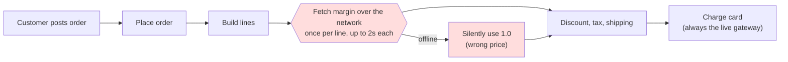
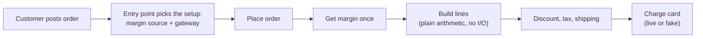
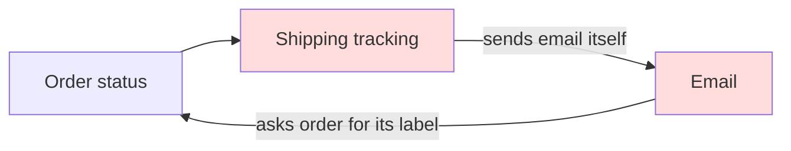
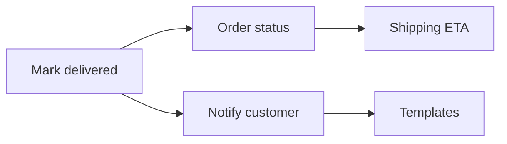

# Architecture audit of `fixture/`

**The verdict is "messy in places", and both of your symptoms trace to specific lines.** The order flow can't run offline because pricing calls a remote service inside the price calculation, and when that call fails it quietly uses a default instead of telling anyone. Changes spread across too many files because `orders`, `shipping` and `notifications` import each other in a loop, so none of the three can change alone.

**What I worked from.** There's no `docs/architecture.md`, no ADRs and no git history, so I read all 53 files (431 lines) and built the dependency graph myself. I didn't change anything. Since there's no history, the three changes I used to rank the findings are my guesses, not something I found:
- a new pricing or margin source
- a new notification, such as SMS when an order ships
- shipping to an address other than the customer's default

Evidence labels: **proven** means I ran it, **traced** means I read the whole chain.

---

## 1. Pricing calls the network halfway through placing an order (Strong, proven)

**Problem.** "I can't run the order flow on a train." `pricing/quote.py:10-15` fetches a margin from `https://rates.example.internal` every time it prices a line, and `orders/lines.py:6` calls it once per line. On any network error it falls back to a margin of 1.0 without logging or raising (`quote.py:14-15`).
- **Proven:** I ran a 3-line order with networking blocked. It made 3 connection attempts and finished with a total of 3678. That total uses margin 1.0, not the real margin, so a laptop gets different prices from production and nothing says so.
- **Traced:** on a network that hangs rather than refusing outright (train Wi-Fi, a captive portal), each line can wait up to the 2-second timeout. A 10-line order could take about 20 seconds.
- The payment side is half-solved already: `payments/fake.py` exists, but `api/routes.py:1,10` hard-codes `LiveGateway`. Nothing imports the fake, so the HTTP entry point can't run offline even if pricing could.

**The chain:** post order → place order → build lines → for each line: product price → fetch margin from the network (wait, or a silent default) → apply discount → tax → shipping → reserve stock → charge card.

**Why it's better.**
- The whole flow runs on a laptop with no network: 0 network calls instead of 1 per line.
- Prices stop changing silently. The margin source either answers or raises, and an offline setup uses a stated fixed margin.
- Testing pricing no longer needs network mocks.

### The move (each step lands on its own, with behaviour unchanged)
1. Change `unit_price(sku, code=None)` to `unit_price(sku, margin, code=None)` (`pricing/quote.py:18`). Keep `_fetch_margin` and call it once in `orders/place.py:9`, then pass the result through `build_lines` (`orders/lines.py:5`). Callers today: only `lines.py:6`.
2. Make the margin source a parameter of `place_order`, the same way `gateway` already is (`orders/place.py:9`). Add a local version that returns a fixed value, next to `payments/fake.py`. The margin service crosses the network and isn't yours, so this is the one place where a swappable interface pays for itself.
3. In `api/routes.py`, choose the gateway and margin source once from config (for example `APP_MODE=local`) instead of importing `LiveGateway` directly.
4. Decide what happens when the margin service fails in production: refuse the order, or use a known fallback and log it. The silent 1.0 should go either way.

**Proof:** run the probe I used (block sockets, place a 3-line order with `FakeGateway`). Today it makes 3 network attempts. After the move it should make 0, and online totals should be unchanged. That gives you a test that can fail.

**Second option:** keep the fetch inside pricing but cache it once per process, and add an environment switch. It's smaller, but pricing still does network I/O, and the cache adds a staleness question.

**Door: two-way.** This touches no stored data or public API (`order_out` keeps the same shape). Step 4 is a business decision, though: is it acceptable to take an order at a fallback price?

---

## 2. Orders, shipping and notifications import each other in a loop (Strong, proven)

**Problem.** "Changes touch more files than they should." The import graph has a cycle:
- `orders/status.py:1` imports `shipping.tracking`
- `shipping/tracking.py:1` imports `notifications.email`
- `notifications/email.py:1` imports `orders.status`

It only loads because all three use bare `import x`. Switching any of them to `from x import y` would probably fail with a circular import error (traced, not run). Two jobs are in the wrong place:
- shipping sends emails itself (`tracking.py:10`)
- notifications reaches back into orders to build a subject line (`email.py:15`)

Adding "SMS on shipped" today means editing `shipping/tracking.py`, then `notifications/*`, and possibly `orders/status.py`.

**Why it's better.** Dependencies point one way. Tracking only records the delivery, and one caller (the delivery handler or job) decides who to tell. The subject line is built by whoever sends the message, from data it's given. Adding a notification goes from about 3 packages to 1.

## 3. The ship-to country is looked up three separate ways (Worth exploring, traced)

`orders/place.py:11`, `shipping/rates.py:10` and `shipping/labels.py:6` each repeat `(default_address(cid) or {}).get('country'/'city', 'US')`. `place_order` already knows the country, but `quote_shipping` looks it up again from the customer ID. Tax and shipping change for the same reason (where the parcel goes), so they should share one owner: resolve the address once in `place_order` and pass it down. Shipping to a non-default address then goes from 3 files to 1.

## 4. `services/order_service.py` does nothing but forward a call (Worth exploring, traced)

It's 5 lines that only call `orders.place.place_order` with the same arguments. If you remove it, nothing gets more complicated: there's one caller (`api/routes.py:2`) and no logic. `customer_service.py` is different: it combines three calls, so it does real work and should stay.

---

**Also noticed, not ranked** (cleanup, or for other tools):
- **Stock leak if the charge fails (traced):** `place_order` reserves stock (`place.py:14-15`) and then charges the card inside the return statement (`place.py:16`). If the charge fails, nothing releases the stock. That's a correctness problem, not a structural one; `debug-protocol` or `correctness-gate` would cover it.
- **Unused imports:**
  - The line `from core.util import clamp, as_cents, slug, first` is copied into 5 files that use one of those names at most.
  - `as_cents` is imported but unused in `api/schemas.py:1`, and `lines_total` in `reporting/sales.py:1` and `orders/status.py:2`. `latent-audit` can confirm and remove them.
- **Hidden coupling:** `jobs/nightly.py:2-3` reads other modules' internal variables (`LOG`, `ON_HAND`) directly.

**What to do first:** #1. It fixes the train problem directly, it's small (about 4 files), it stops prices changing silently, and it gives you a test harness that #2 will need anyway. #2 is next and is the real fix for changes spreading across files.

There's no map in the repo, so it's worth running `/project-foundation` at some point. That way the next review starts from a checked map instead of rebuilding one.

Which one should I go deeper on: #1 (and your answer on refusing vs. a fallback price), #2, or something else?