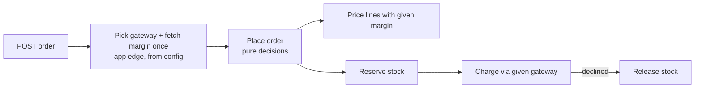
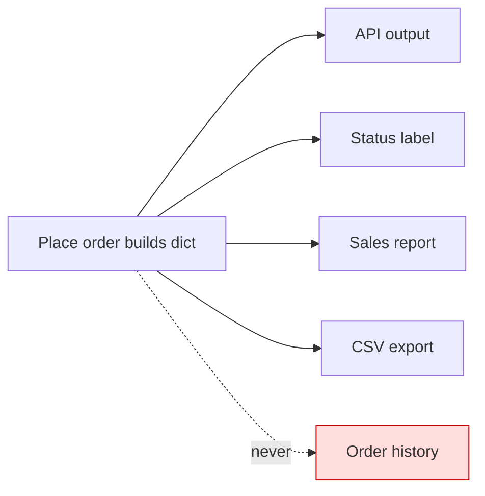
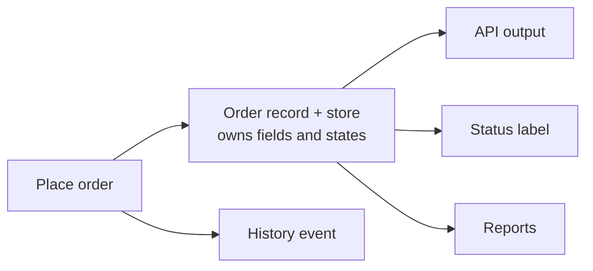

# Architecture audit: `fixture/`

**Verdict: messy in places.** The folders look modular, but placing an order calls straight into six modules across five packages. Two outside services (the pricing-margin endpoint and the payment gateway) are hard-wired into the middle of that flow. And the "order" itself has no owner: it's a bare dict whose keys are read in five other files. Those three facts explain both of your symptoms.

**What I checked.** There is no `docs/architecture.md`, no ADRs, no git history and no tests, so there is no map to check against and no hotspot data. Running `/project-foundation` would give the next review a map to start from. All 431 lines were read (*traced*). I also ran the order flow offline with `FakeGateway` (*proven*):

- It made **3 network calls for a 3-line order**, all to `rates.example.internal`.
- A declined charge **permanently lost 2 units of stock**: they went from 4 to 2 and were never released.

**Changes most likely to come next** (my guess, since there's no tracker):
1. Let the customer pick a shipping address.
2. Add a field to orders, such as currency or a discount shown on the receipt.
3. Add a payment or pricing provider.

---

## 1. Outside services are wired into the order flow (the train problem). **Strong**

**Problem:** You can't run an order on a laptop offline, and even when it "works" you can't trust the result.
- `pricing/quote.py:19` calls the margin service once **per line item**, inside the price calculation.
- `pricing/quote.py:14-15` swallows the failure and silently uses a margin of `1.0`. So offline totals differ from production, and on a flaky connection each line can wait up to 2 s.
- `api/routes.py:1,10` hard-codes `LiveGateway`. A `FakeGateway` (`payments/fake.py`) and a `PaymentGateway` protocol (`payments/gateway.py`) already exist, but the only entry point can't use them. The seam has been built but not connected.

```mermaid
flowchart LR
  A[POST order] --> B[Place order]
  B --> C[Price each line]
  C -->|per line, 2s timeout| N((Margin service<br/>network)):::bad
  N -.offline: silently 1.0.-> C
  B --> D[Reserve stock]
  D --> E[Charge card]
  E --> L((Live gateway<br/>hard-wired)):::bad
  classDef bad fill:#fdd,stroke:#c00
```



**Why it's better:** Network calls per order drop from N to 1. They drop to 0 on a laptop, where you'd use a fixed margin plus `FakeGateway`. The order logic becomes runnable and testable without the network, and offline totals become predictable.

## 2. The order has no owner or shape. **Strong** (data model)

**Problem:** Adding a field to orders touches about 6 files, and nothing stores or logs orders.
- The order dict is built at `orders/place.py:16` and its keys are read in `api/schemas.py:9`, `orders/status.py:9,13`, `reporting/sales.py:6,10` and `reporting/exports.py:10`.
- The status `'placed'` is a string literal at `place.py:16`, separate from the official list at `orders/status.py:5`. That gives status values two owners.
- `orders/history.record` is **never called** anywhere, so `jobs/nightly.py:7` always reports `events: 0`.
- No module saves an order. `place_order` returns the dict and it's gone.





**Why it's better:** Adding an order field touches 2 files (the order module plus the one consumer that needs it) instead of about 6. Status values get one owner.

**Door:** This is a **one-way door** once orders are persisted. The stored order shape is the hardest thing to change later, so it should be decided before a database exists.

## 3. "Where does this ship to?" is decided in 3 places. **Worth exploring**

**Problem:** Letting the customer pick an address means editing three files that don't know about each other:
- `orders/place.py:11` (tax country)
- `shipping/rates.py:10` (shipping country, looked up again)
- `shipping/labels.py:6` (label city)

Each one calls `default_address` separately and repeats the `'US'` fallback. This is coupling nobody named.

**Fix:** Resolve the ship-to address once in `place_order` and pass it to tax, rates and labels. That change goes from 3 files to 1.

## 4. Import cycle: order status → shipping tracking → email → order status. **Worth exploring**

**Problem:** Changing how order status is labelled ripples into shipping and notifications.
- `orders/status.py:1` imports `shipping.tracking`.
- `shipping/tracking.py:1` imports `notifications.email`.
- `notifications/email.py:1` imports `orders.status`, closing the loop.

It only loads because all three use the `import x` style. I confirmed all three modules import without error.

**Fix:** The back edge is `email.subject_for` (`email.py:14-15`). Pass the label in, or move that function into `orders`. Email then knows nothing about orders, and the cycle is gone.

## 5. `services/order_service.py` only forwards the call. **Strong, but small**

**Problem:** `place()` just passes its arguments through to `orders.place.place_order` (`order_service.py:4-5`), and `api/routes.py` is its only caller. That means every new order parameter is threaded through 3 files instead of 2.

**Fix:** Inline it. The deletion test passes: nothing else is lost when it goes. `customer_service.py` is different: it combines three steps, so keep it.

**Noise, not a structural finding:** five files import `clamp, as_cents, slug, first` without using them, and `as_cents` is used nowhere. This makes "who depends on `core.util`" look worse than it is. Proving it's dead and cleaning it up is a job for `latent-audit`.

---

## What to do first: candidate 1, as a move

Each step lands on its own.

1. **Fetch the margin once per order and pass it in.**
   - Rename `_fetch_margin` to `fetch_margin`.
   - Change `unit_price(sku, code, margin)` (`pricing/quote.py:18`) and `build_lines(items, code, margin)` (`orders/lines.py:5`) to take the margin.
   - `place_order` gains a `margin` parameter, and `api/routes.py` calls `fetch_margin()` once.
   - Behaviour is unchanged when online; there's 1 call instead of N.
2. **Choose the gateway at the edge.** `api/routes.py` reads one setting: `PAYMENTS=fake` uses `FakeGateway`, otherwise `LiveGateway`. A matching setting gives a fixed margin for laptop runs. The default behaviour stays the same.
3. **Release reserved stock when the charge fails** (`orders/place.py:14-16`): wrap the charge and call `inventory.reserve.release` for each line on error. This is a deliberate behaviour change (a bug fix), so it lands on its own.
4. **Inline `services/order_service.py`** while you're editing `routes.py`. This is candidate 5, and it's nearly free here.

**Two options for the margin:**
- **A. Pass a plain number** (recommended). The margin is a single number, so a protocol would be structure nobody needs.
- **B. A `Rates` port** with live and fixed implementations, mirroring `PaymentGateway`. It's justified because it crosses the network and would have two implementers. Pick it if more rate data than one number is coming.

**Door:** Two-way. These are internal signatures and a single config setting, with nothing stored and no public API change.

**Proof:**
- Re-run the probe I used (`/tmp/probe.py`, run as `python -I /tmp/probe.py fixture` with `PAYMENTS=fake` and a fixed margin). It should show **0 network calls** and the same total on every run.
- After step 3, a declined charge should leave stock A at 4, not 2.
- Online, the total for the same cart should match what it was before step 1.

**One question for you before step 1:** today, if the margin service is down, orders silently sell at base price (margin 1.0). Is that intended, or should the order be refused? I won't preserve or change that without your call.

---

I'm a terminal session, so I didn't build the HTML visual report, and I haven't changed anything in `fixture/`. Which candidate do you want to explore: 1 (above), or 2, the order data shape, which is the one-way door to settle before orders get a database?