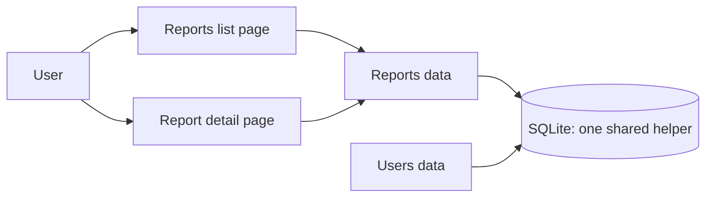
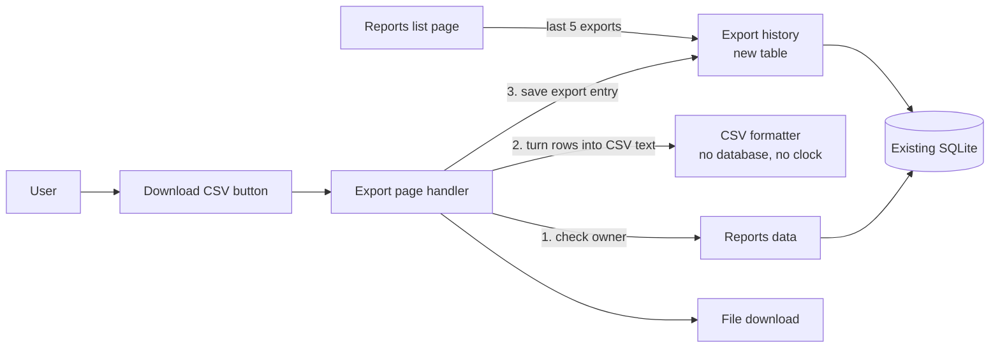

I ran `arch-design` in design mode over `fixture/` and changed nothing. All evidence is from reading the code, since the four files are the whole app. There's no `docs/architecture.md`, no ADRs, no git history and no schema or migrations in the repo.

## Verdict

The codebase is small and clean, and it already has everything this feature needs. Don't add a new store, queue or CSV library. Three things should be settled before anyone writes code: one product question, one data-shape decision, and one existing access-check gap that CSV export would make worse.

## What's there today



- `app/db.py:11` is the only database access point. It opens SQLite, runs one query and commits. Reuse it.
- `app/reports/models.py:4` lists a user's reports (id, title, created_at). `:10` fetches one report, including its body.
- `app/reports/views.py:9` (`report_detail`) fetches any report by id with **no owner check**. `report_list` filters by `owner_id`, but the detail page doesn't.

## Proposed structure



| Piece | Where | Its one job | Must never know about |
|---|---|---|---|
| CSV formatter | new `app/reports/export.py` | Turn rows into CSV text with Python's built-in `csv` module | the database, the request, the clock |
| History data | add `record_export()` and `recent_exports(user_id, limit=5)` to `app/reports/models.py` | Save and read export entries through `db.execute` | CSV format |
| Export handler | add `report_export()` to `app/reports/views.py` | Check the owner, build the CSV, save the entry, send the file with a download filename | how CSV escaping works |
| List page | `report_list` in `views.py:4` | Also return `recent_exports` | none |

History stays inside `reports/` instead of a new `exports/` module. It only changes when reports change, so a separate module would be one more place to look for no benefit. That choice is easy to reverse.

Things I'm deliberately **not** adding:
- **A CSV library.** Python's built-in `csv` module covers this.
- **A background job queue.** One report is one query, so the CSV can be built inside the request. A queue would mean another system to run and monitor, and a "your file is ready" flow product didn't ask for.
- **Saving history in the browser (localStorage).** It's the other real option: no schema change at all. But it's per device, gets lost when browser data is cleared, and can never be audited. Since the existing SQLite database is already there, the server-side table costs very little.

## The one hard-to-reverse decision: the history table

```sql
report_exports(
  id          INTEGER PRIMARY KEY,
  user_id     INTEGER NOT NULL,
  report_id   INTEGER NOT NULL,
  title       TEXT    NOT NULL,   -- report title at the moment of export
  exported_at TEXT    NOT NULL DEFAULT CURRENT_TIMESTAMP  -- UTC
)
-- index on (user_id, exported_at DESC)
```

Decisions I've made, and why:
- **Store a copy of the title rather than looking it up from `reports` each time.** If a report is later renamed or deleted, the history still shows what the user actually downloaded. Getting this wrong later would mean a backfill that can't recover old titles.
- **The database sets the timestamp, in UTC.** That keeps the clock out of application code, and the UI converts to local time.
- **"Last few" is a `LIMIT 5` when reading, not a cleanup when writing.** Every export is kept, so changing 5 to 10 later needs no data change. The cost is unbounded growth. If that matters, add a retention rule later; a trim when writing can't be undone.

**Open question: where does the schema live?** The repo has no migrations or `CREATE TABLE` statements anywhere. `reports` and `users` are created somewhere outside `fixture/`. The new table needs to go wherever that is.

## Risks found while reading

1. **Access gap.** `report_detail` (`views.py:9`) returns any report to anyone who knows its id. If export copies that pattern, anyone can download any report as a file. The export handler must check `report.owner_id == request.user_id` (or query with `WHERE id = ? AND owner_id = ?`). The same fix should go on the detail page. That's a separate change, but I'd land it first.
2. **Formulas in spreadsheets.** Users will open these files in Excel. A title or body starting with `=`, `+`, `-` or `@` runs as a formula there. The formatter should put a `'` in front of such cells. This belongs in the pure formatter, where a unit test can cover it.
3. **What if saving the history entry fails?** My call: the download still goes through and the error is logged. History is a convenience, and losing an export because a log line failed is worse.

## Build order (each step ships on its own without changing current behavior)

1. Add the owner check to report fetching. **Proof:** a request for someone else's report id returns 404.
2. Add `export.py` (the pure formatter). **Proof:** unit tests for plain rows, commas and quotes in values, and the formula-escape case.
3. Add the table, `record_export` and `recent_exports`. **Proof:** with a temporary SQLite file, save 7 exports and get the newest 5 back, newest first.
4. Add the `report_export` view and the button. **Proof:** downloading a report produces a file with a download header and one new history row. Someone else's report returns 404 and writes no row.
5. Show recent exports on the list page. **Proof:** after an export, the list page shows its title and time.

## Pre-mortem: it's a year later and this went wrong

- **Someone exported reports they shouldn't see.** Covered by step 1 and its test.
- **"The CSV is useless."** We guessed the columns wrong (see the first question below). Settle it with product now.
- **History shows the wrong time.** That happens if times are stored in local time. Storing UTC and converting in the UI avoids it.

## Questions before anyone codes

1. **What goes in the CSV?** (product) Either:
   - a single report, exported from its detail page; or
   - the list of reports (title, created date), exported from the list page.
   
   A report today is just `title`, `created_at` and a free-text `body` (`models.py:12`). That body isn't table-shaped, so a single-report CSV would be one row with one big text cell. This answer decides the columns and where the button goes.
2. **History scope:** (product) only the user's own exports, or everyone on their team? I've assumed only their own.
3. **Where do `reports` and `users` get created?** (engineering) The new table needs to go wherever that is.

Once question 1 is answered, I can go deeper on the export handler, or hand this to `plan-work` / `build-discipline` to build. There's no architecture map yet; `/project-foundation` would create one so the next review starts from it.