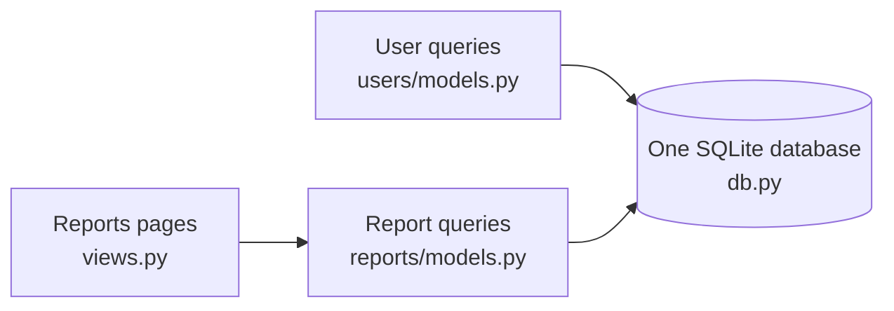
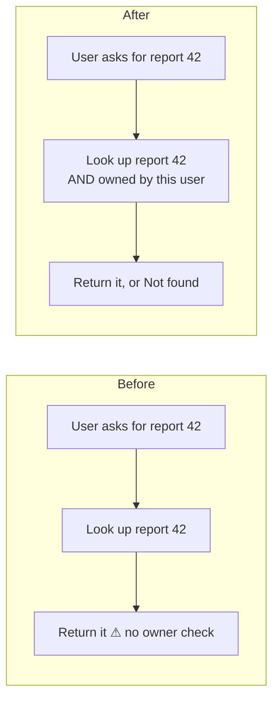
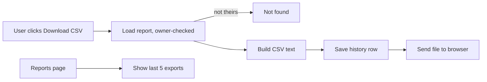

I ran `arch-design` in design mode. `fixture/` is small (4 files, about 50 lines), so I read every line. That means everything below is **traced** (read end to end); I ran nothing and changed nothing.

## Verdict

The code is clean and small enough to take this feature without restructuring. You need one new table, one small CSV function and two views. There is one existing problem to fix first: as written, a CSV download would hand any report to anyone who knows its id.

There's no `docs/architecture.md`, decision records or git history, so I sketched the map from the code. Running `/top-tier-engineer:project-foundation` would give the next review a map to start from.

## Today's map



- `app/db.py:1` already says it is "the one place that opens a connection and runs queries". Every model goes through `execute()`.
- Views call models, and models call `db`. Dependencies all point one way and there are no cycles.

## Candidates, best first

### 1. Fix first: report lookup doesn't check who owns the report (Strong)

**Problem:** the report list filters by owner (`reports/models.py:6`, `WHERE owner_id = ?`), but `get_report` does not (`reports/models.py:12`, `WHERE id = ?`). `report_detail` (`views.py:9-11`) passes any id straight through. The CSV button will almost certainly reuse `get_report`, so every report becomes downloadable by any logged-in user who guesses an id. An export is a file that leaves the app, so it's the worst place for this gap.



**Why it's better:** one query change closes the gap for both the detail page and the export.

### 2. Export history: a new table in the existing database (Strong)

**Reuse before you add:** the history table goes into the SQLite database `db.py` already owns. I am **not** adding a second store (Redis, browser localStorage, a log file). Each of those would be another thing to secure, back up and run, and localStorage would lose history when the user switches device.

Proposed table (stored data shape, so it's hard to change later; see question 1 below):

```
report_exports(id, user_id, report_id, report_title, exported_at DEFAULT CURRENT_TIMESTAMP)
```

- **Copy the title onto each row** (`report_title`) instead of looking it up from `reports` each time. "What I exported on Tuesday" stays true even if the report is later renamed or deleted.
- **"Last few" is a query limit (`ORDER BY exported_at DESC LIMIT 5`), not a cleanup job.** A row is about 100 bytes, so there's nothing to prune at launch.
- **The database stamps the time** (`CURRENT_TIMESTAMP`, UTC), so Python code never reads the clock and the CSV logic stays testable.

### 3. CSV building as plain logic, kept apart from the database and HTTP (Worth exploring)

Add one function, `to_csv(rows) -> str`, using Python's built-in `csv` module. No new dependency. It takes rows and returns text, so you can test it without a database. CSV is the only format, so this is one function and not a format plugin system.

## How the download works



Everything in this flow is local (one SQLite database, no network calls), so nothing slow or outside your control sits in the user's wait. If the browser download fails after the history row is saved, the history will show an export the user never got. I'd accept that at launch.

## The move, in landing order

Each step lands on its own without changing current behavior.

1. **Owner check.** Change `get_report(report_id)` to `get_report(report_id, owner_id)` with `AND owner_id = ?` (`reports/models.py:10-13`), and pass `request.user_id` from `views.py:10`.
   - **Proof:** user A asks for user B's report id and gets `None`; their own report still loads.
   - **Door:** two-way, easy to undo.
2. **Table.** Create `report_exports` as above.
   - **Proof:** the table exists and inserting a row fills `exported_at` automatically.
   - **Door:** one-way (stored data), so it needs your answer to question 1 first.
3. **`app/reports/export.py`** with `to_csv(rows)`.
   - **Proof:** a unit test covering a title with a comma, a quote and a newline, read back with `csv.reader`, matches the original.
4. **Model functions** in `reports/models.py`, through `execute()`: `record_export(user_id, report_id, title)` and `recent_exports(user_id, limit=5)`.
   - **Proof:** after 6 exports, `recent_exports` returns the newest 5, newest first, and only that user's.
5. **Views.** Add `report_export_csv(request, report_id)`, which loads the report with the owner check, builds the CSV, records the export and returns it. `report_list` also returns `recent_exports`.
   - **Proof:** an end-to-end request gets a CSV body, and the history gains one row.

**What gets cheaper:** a second export format later is one function next to `to_csv` plus one view. History and the owner check don't change.

## One thing I can't confirm

`render()` (`views.py:14-15`) just returns its input. The fixture has no HTTP framework, so I can't see how a response would set `Content-Type: text/csv` or `Content-Disposition: attachment`. Whoever wires step 5 needs the real framework's way of returning a file. **(suspected)**

## Questions before anyone builds

1. **Which title should history show?** I recommend the title as it was at export time (copied onto the row). The alternative is always showing the report's current title, which breaks if the report is deleted. This is the one decision that's hard to undo.
2. **What does the CSV contain?** Is it the list of reports on the page (id, title, created) or one report's contents? `reports.body` is a single text field, so "one report as CSV" needs product to say which columns they mean. This decides whether the button sits on the list page or the detail page.
3. **How many is "the last few"?** I assumed 5.

Which of these do you want to settle first? I'd suggest the owner-check fix, since it's needed whatever the answers are.