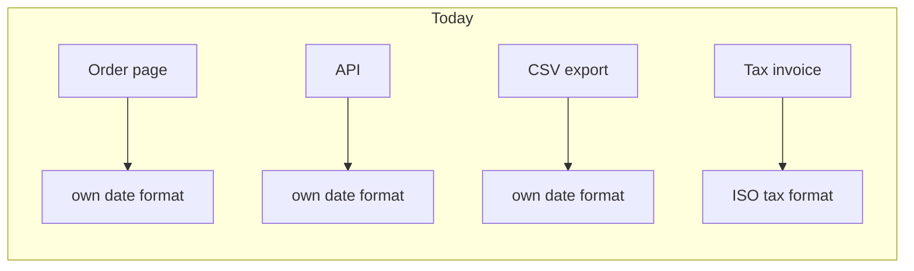
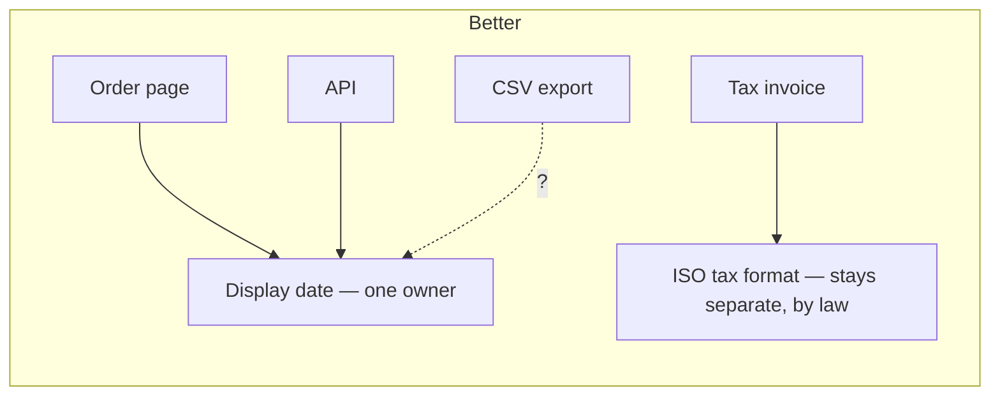

**Verdict: mostly clean, with one trap.** The code is 7 small files, about 45 lines, with no import cycles. The biggest risk for a new person isn't tangled code. It's a date function that looks like a copy of three others and must not be merged with them.

**How I checked:** I read every file this session. There is no `docs/architecture.md`, no ADRs and no git history, so I drew the map from the code and couldn't look at hotspots. Everything below is *traced* (I read the whole chain). Nothing was run.

## What a newcomer should know

### 1. ⚠️ `billing/invoice.py` uses a different date format on purpose. Don't "deduplicate" it.
`invoice_date` (`billing/invoice.py:1-5`) has the same shape as the three display-date helpers, but it outputs ISO `%Y-%m-%d`. The comment at lines 2-4 explains why: the tax authority's upload spec fixes that format, and a change "rejects the whole filing."

It fails the same-reason test: the display dates change when the brand or locale changes, and this one changes only when the tax spec does. A tidy-up PR that sends all four through one `format_date` would break tax filings the next time anyone changes the display format. **This is the one thing to tell them on day one.**

### 2. The customer-facing date format is copied 3 times. *Strong*
- **Problem:** to change how dates look to customers, you have to find and edit 3 files. Miss one and the web page, the API and the export disagree.
- **Copies:** `web/views.py:1` (`fmt_date`), `api/serializers.py:1` (`format_date`), `jobs/export.py:1` (`date_str`). All three are `"%d/%m/%Y"` with three different names, so a search for one won't find the others.

- **Why it's better:** changing the display format goes from editing 3 files to editing 1. The tax format stays isolated, so nobody can break filings by accident.
- **Open question (the dotted line):** is the CSV export's format a contract with whoever reads that file? If it is, the export has its own reason to change, and like billing it should keep its own function. I can't tell from the code, so ask the owner.

### 3. The `providers/` package is built for options nobody uses yet. *Worth exploring*
- `Provider` (`providers/base.py:1`) has exactly one implementation (its docstring even says so), and `registry.PROVIDERS` (`providers/registry.py:3`) has one entry, `"smtp"`.
- Nothing in `fixture/` imports `registry` or calls `get()`. That doesn't prove it's dead, because the caller may live outside this folder. Before removing anything, run `latent-audit` to confirm.
- **For the newcomer:** to change how mail is sent, edit `providers/smtp.py` directly. The base class and the registry don't add anything. If a second provider ever arrives, the structure is already there. If not, it can be collapsed into a single `send()` function.

## The moves (none made)

**Top move, date ownership:**
1. Add one `display_date(d)` in a shared module and point `web/views.py` and `api/serializers.py` at it. Behaviour doesn't change.
2. Only after the export question is answered, point `jobs/export.py` at it or leave it alone.
3. Rename `invoice_date` to something like `tax_filing_date`, so the name itself says "not a copy."

- **Proof:** a small test that checks each output (page, API, CSV, invoice line) for a fixed date matches what it produces today.
- **Door:** two-way for the display helpers. Changing the export or billing format is one-way, because outside parties read those.
- **Simpler alternative:** do only step 3 plus a comment beside each copy. That covers the main risk without moving any code.

**Smaller things worth doing:**
- Add a short `docs/architecture.md` (`/project-foundation` can create one) that records the tax-format rule.
- Consider a short ADR on why billing dates are separate, so a future review doesn't suggest merging them again.

I haven't changed anything. Which do you want to look at more closely: the date ownership move, the export-format question, or the providers simplification?