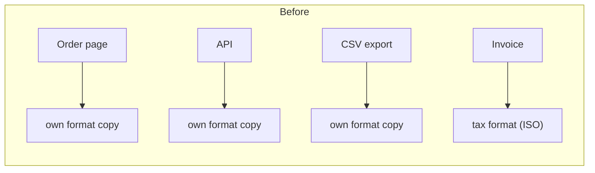
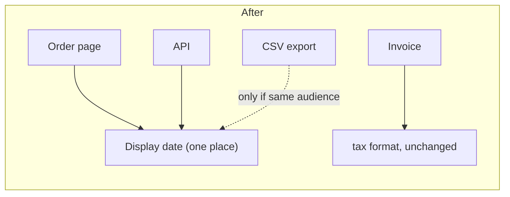

# Architecture audit: `fixture/`

**Verdict: mostly clean, a bit messy in places.** It's 7 files and 45 lines. A newcomer mainly needs to know where the date format is defined and which date must never change. There's no architecture doc, no git history and no tests, so everything below comes from reading every file. I also ran each output path once on a sample date (2026-03-04).

## What to know before changing anything

1. **The invoice date is a legal format. Leave it alone.** `billing/invoice.py:1-5` writes `2026-03-04` (ISO) because the tax authority's upload spec requires that format. The comment there says that changing it "rejects the whole filing." It looks like it duplicates the other date helpers, but it changes for a different reason, so it must stay separate. Never route it through a shared "date format" helper.
2. **The customer-facing date format is written out in three separate places.** Each one is a hand-written `"%d/%m/%Y"`:
   - `web/views.py:2` (order page)
   - `api/serializers.py:2` (API JSON)
   - `jobs/export.py:2` (CSV export)

   If someone changes the display format in one place, the site, the API and the export will disagree.
3. **The email "provider" setup is more machinery than it needs.** `providers/base.py` is an abstract class with exactly one implementation (`smtp.py`). `registry.py` is a lookup table with exactly one entry. Nothing in `fixture/` calls `registry.get()`, so any callers, or a config value that names `"smtp"`, are outside this folder. Find those before touching it.
4. **There are no tests.** The only way to check behaviour is the 4-line run shown under the top move below.
5. **There's no `__init__.py` anywhere.** `providers/` imports itself as `from providers.smtp ...`, so code only works when run with `fixture/` on the Python path.

## Candidates, best first

### 1. Give the display date one owner (*Strong*)

**Problem:** A request like "show dates as 4 Mar 2026" means finding and editing 3 files, and if one is missed the copies drift apart silently.




**Why it's better:** Changing the display format goes from 3 file edits to 1, and the API can no longer quietly disagree with the website.

**The open question:** Is the CSV export read by people, or by another system? If another system imports it, its format is a contract like the invoice's and should stay separate. In that case only the web page and the API merge.

### 2. Shrink the provider setup (*Speculative*)

If the codebase only ever sends email over SMTP, callers could use `SmtpProvider` directly and the base class and registry could go. That's about 12 lines and 2 files fewer. It stays speculative because:
- I can't see who calls `registry.get()` or whether `"smtp"` is read from config.
- A second provider (or a test fake) would justify the setup as it is.

It needs `latent-audit` or a check of the callers first. Nothing gets deleted without proof that it's unused.

Nothing else made the list: there are no import cycles, no slow or network steps in a user's path, and no layers that only forward calls.

## Top move, written out (candidate 1)

1. Add one display-date helper, e.g. `display_date(d)`, next to whichever module already counts as the shared home. If there isn't one, create a small `formatting/dates.py`.
2. Point `web/views.py:1` `fmt_date` at it. The output must not change.
3. Point `api/serializers.py:1` `format_date` at it. The output must not change.
4. Do `jobs/export.py:1` only if the answer to the CSV question is "people read it."
5. Delete the local copies once nothing calls them.

Do not touch `billing/invoice.py`.

**How to prove it still works:** Run this before and after, and the output must be identical. Today it prints `04/03/2026` for the page, API and export, and `7|2026-03-04` for the invoice.
```
python -I -c "import sys,datetime as dt; sys.path.insert(0,'.'); from api.serializers import order_json; from web.views import order_page; from jobs.export import rows; from billing.invoice import line; o={'id':7,'placed_at':dt.date(2026,3,4)}; print(order_json(o),order_page(o),rows([o]),line(o))"
```
Then `grep -rn '%d/%m/%Y' .` should return exactly 1 hit.

**Can it be undone?** Yes, easily. It's an internal helper with no stored data and no public API change.

**The other option:** Keep the 3 copies and add a comment to each pointing at the others. That's zero effort but leaves the drift risk in place. It's the right call only if the CSV turns out to be a machine contract and the web/API pair rarely changes.

I haven't changed any code or docs. There's no `docs/architecture.md`, so `/project-foundation` would be worth running to give the newcomer a map that names the invoice-date rule.

**Which candidate do you want to explore? And for candidate 1: is the CSV export read by people or by another system?**