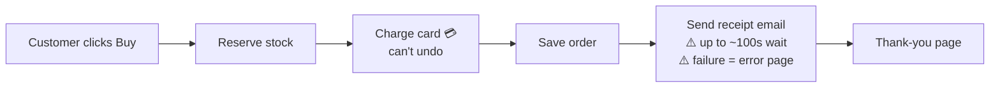
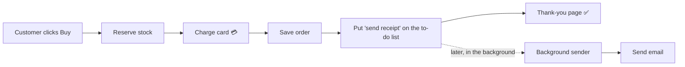
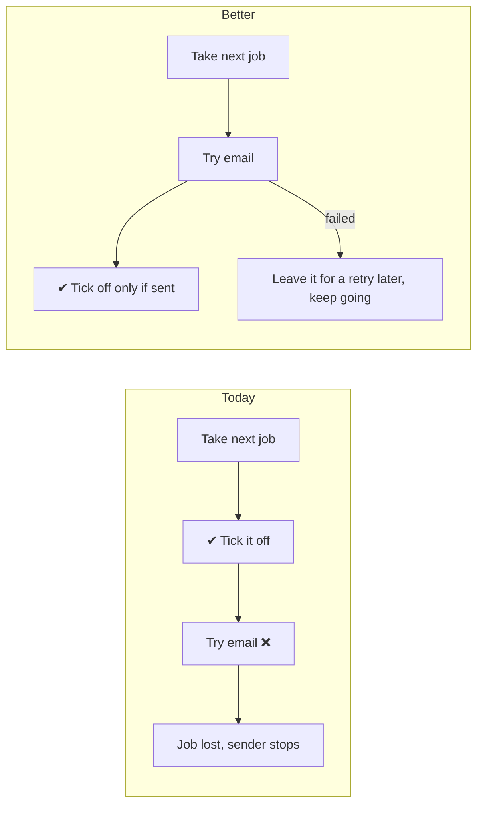
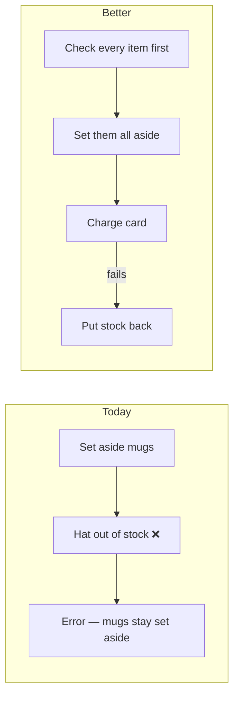

I ran it, and I'm fairly sure I know why checkout is slow and why some customers get charged and then see an error. It's one cause.

**Verdict: the shop is small and mostly tidy. One wrong connection causes both of the problems you've noticed, and your design document says that connection doesn't exist.** I didn't change any code or documents.

How I checked: I read every file (the whole shop is 136 lines). Then I ran the real checkout code on my machine with the email server made to fail on purpose, so nothing real was charged or sent. "Ran" below means I saw it happen. "Read" means I followed the code but didn't run it.

---

## 0. Your design document is wrong about email (ran)

Your design document (`docs/architecture.md`) says *"The customer never waits for email."* That isn't true. Checkout sends the receipt itself, while the customer waits (`shop/checkout.py:12`). The "send it later" system the document describes exists, but only refunds use it. It doesn't even have instructions for sending receipts (`shop/jobs/worker.py:6-8`).

This matters: anyone who reads that document, including a developer you hire or an AI, will think the problem is already solved.

---

## 1. The receipt email is sent in the middle of checkout (ran) — **Strong**

**What you feel:** "checkout sometimes takes ages" and "charged but saw an error page."

**Why:** checkout runs four steps in order: reserve stock → **charge card** → save order → **send email**. The email step:
- tries up to 3 times, waits up to 30 seconds each time, and pauses 5 seconds between tries (`shop/emailer.py:8-16`). If the mail server is slow, the customer can stare at a spinner for **up to about 100 seconds**.
- if it still fails, the customer gets an **error page**. But the card was **already charged** and the order **already saved**. My test showed this: an error, with 1 order saved and charged.

**Today:**

**Better:**

**Why it's better:** a slow or down mail server can no longer cause a wait or an error page after payment. The thank-you page is back to taking well under a second. **No new parts are needed:** you already have the background to-do list and sender for refunds (`shop/jobs/queue.py`, `shop/jobs/worker.py`). We'd point receipts at it too, and then the design document becomes true.

**The plan, in steps (each one is safe on its own):**
1. Teach the background sender to send receipts: add a `send_receipt` entry to `shop/jobs/worker.py:6`.
2. Change `shop/checkout.py:12` to add a receipt job to the to-do list instead of sending the email directly.
3. Fix the to-do list so a failed email gets retried instead of lost (see #2 below). Without this, step 2 swaps "error page" for "receipt silently never arrives."

**How we'd check it works:** repeat my test with the email server down. Checkout should return the thank-you page straight away, and the receipt job should still be waiting on the to-do list.

**Difficulty to undo:** low. It's a code change you can reverse at any time, and it doesn't change how your data is stored.

**One question only you can answer:** is it OK if the receipt email sometimes arrives a minute or two after purchase instead of instantly? The comment at `checkout.py:11` suggests someone wanted it instant. That's the only reason to keep things as they are.

---

## 2. The background sender throws away failed emails (ran) — **Strong** (needed for #1)

**What you'd feel:** a customer says "I never got my refund confirmation," and there's no record of why.

**Why:** the to-do list ticks a job off **before** trying it (`shop/jobs/queue.py:18`). If the email then fails, the job is already gone. My test showed this: a refund email failed and nothing was left to retry. A failure also stops the sender completely (`worker.py:18`), so every email after it stops going out too.

**Why it's better:** emails get sent at least once instead of "maybe," and one bad email can't stop all the others. It's a few lines in two files.

---

## 3. A failed order still takes stock off the shelf (ran) — **Worth exploring**

**What you'd feel:** the website says items are out of stock when you actually have them.

**Why:** stock is set aside item by item before payment (`shop/checkout.py:6-7`). If a later step fails (a second item is out of stock, the card is declined, or the email error above), the set-aside stock is never put back. My test showed this: a basket of 2 mugs + 1 out-of-stock hat failed, but **the 2 mugs disappeared from stock anyway** (2 left instead of 4).

**Why it's better:** your stock count matches reality after any failed checkout.

---

### Things I looked at and decided not to change
- **Orders and stock are only kept in memory** (`shop/db.py`, `shop/inventory.py`), so they're wiped when the shop restarts. This looks like a demo setup, so I didn't flag it. If this is really how the live shop works, tell me, because that would be the most important issue of all.
- No other duplication, and no layers that just pass things along. The structure is the right size for a shop this small.

---

**Which would you like to explore next?** I'd start with **#1 and #2 together**, since #1 depends on #2 to be safe, and together they fix both problems you noticed. Also, please answer the receipt-timing question above. Once you decide, I'll also offer to correct the design document so it matches what the code actually does.