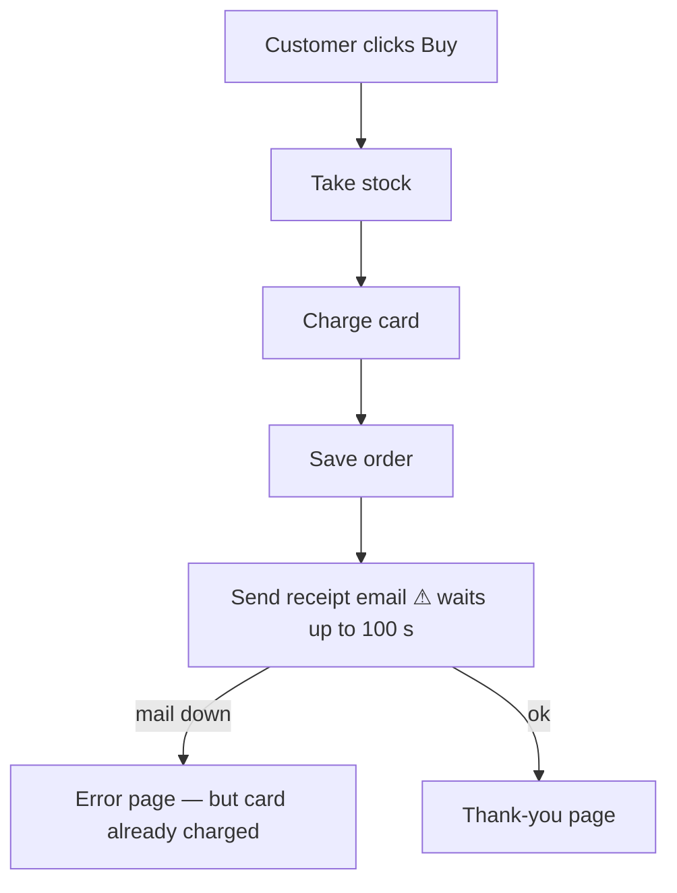
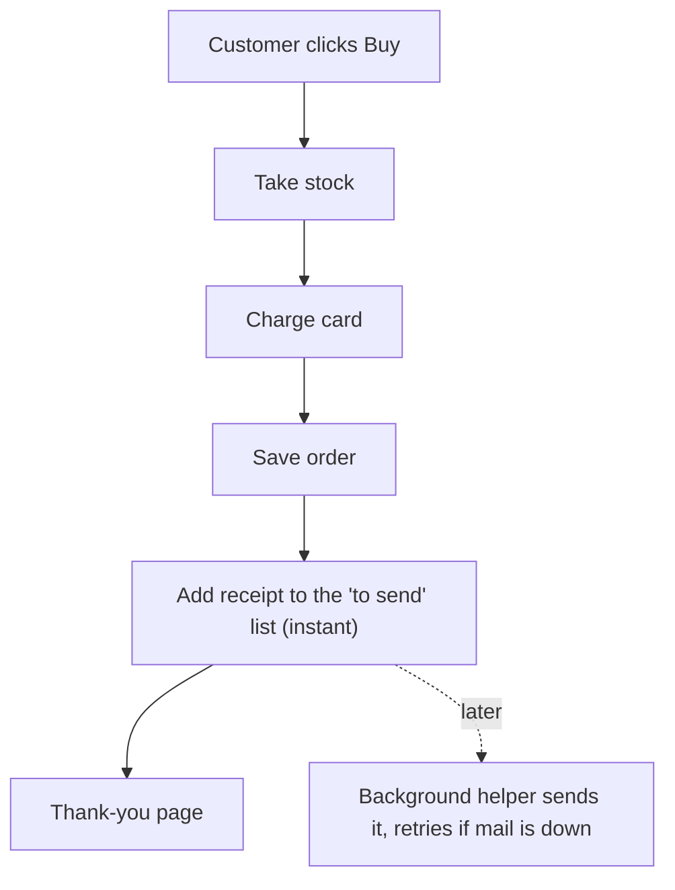
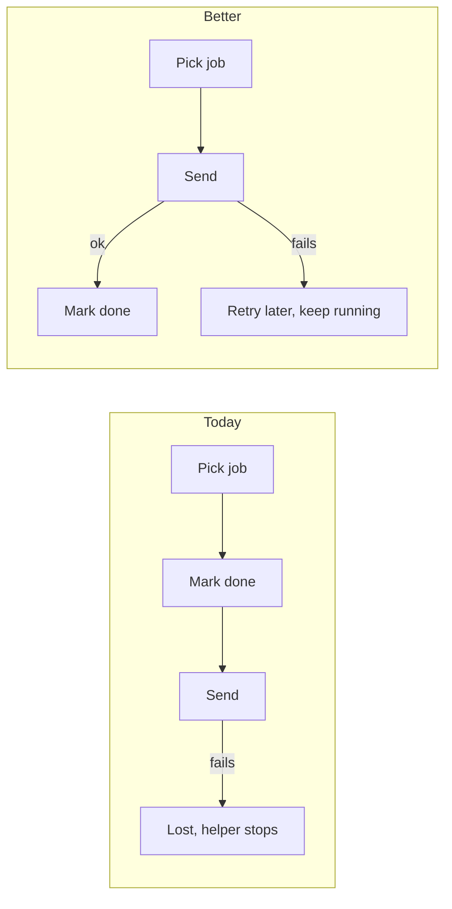

Your shop's design is messy in one place, and it's the same place that explains both problems you've seen. When a customer checks out, the shop sends the receipt email before it shows the thank-you page, so the customer waits on the email. If the mail server is slow, checkout is slow. If the mail server is down, the customer gets an error page, even though their card has already been charged.

I reproduced this. I made the mail server unreachable, placed a test order, and the customer waited 100 seconds, then saw an error. The card was still charged and the order was still saved.

I also opened a visual version of this report with the diagrams drawn side by side: `C:\Users\thana\AppData\Local\Temp\archproof\shop-architecture-report.html`

## First: your architecture document is wrong on this point
Your document (`docs/architecture.md:15`) says *"The customer never waits for email."* The checkout code does the opposite: it sends the receipt directly while the customer waits (`shop/checkout.py:12`). Anyone who reads the document, a person or an AI, would assume this problem is already handled.

## The three problems, most important first

### 1. Checkout waits for the email to go out — Strong (tested)
The shop tries the mail server up to 3 times. Each try can wait 30 seconds, with a 5-second pause between tries. That adds up to 100 seconds.

**Today:**

**Better:**

**Why it's better:** checkout takes a fraction of a second instead of up to 100 seconds, and a mail outage can no longer cause an error after a charge. Your shop already has this background helper and its "to send" list, because refunds use them. Nothing new gets added.

### 2. The background helper loses emails that fail — Strong (tested)
The helper marks a job as done before it tries to send it. If the send fails, the email is gone and nobody finds out. Any error also stops the helper completely. Today this affects refund confirmations. It has to be fixed before receipts move over, or fixing #1 would quietly lose receipts.

### 3. Stock is set aside before the card is charged and never given back — Worth exploring (from reading the code, not tested)
If a card is declined, or a later step fails, the items stay set aside. The stock code can only take items away; it can't put them back. Over time your shop will show items as out of stock when they're actually on the shelf.

*One more thing to check, not ranked:* orders and stock levels are only held in the program's memory (`shop/db.py`, `shop/inventory.py`). If that's how the live shop really works, a restart wipes them. This may just be a simplified copy of the code, so please confirm.

## The recommended fix, step by step
Each step can go live on its own without changing what customers see, until step 3.
1. **Make the helper stop losing jobs.** Only mark a job done after it succeeds. If it fails, leave it for another try, and keep the helper running. *(Technical: change `jobs/queue.py:18` and `jobs/worker.py:18`.)*
2. **Teach the helper to send receipts.** *(Add `send_receipt` to `jobs/worker.py:6`.)*
3. **Change checkout to add the receipt to the list instead of sending it.** *(Replace `checkout.py:12` with a call to `enqueue("send_receipt", ...)`.)*

- **How we check it worked:** I run the same test again with the mail server down. Checkout should succeed straight away with no error, and the receipt should still be waiting in the list to be sent.
- **How easy to undo:** easy. No stored customer or order data changes shape, and each step can be reversed.
- **The other option:** keep sending the email during checkout, but don't show an error if it fails, and wait less for the mail server. That's a smaller change, but customers still wait on email and a failed receipt is still lost. I recommend the background option.

## One question for you
**Is it fine if the receipt email arrives up to a minute after purchase instead of instantly?** A note in the code says it was put there so customers get the receipt immediately. If a short delay is fine, I'd go with the fix above.

Also: which of the three problems do you want to tackle first? I haven't changed anything in your shop yet.