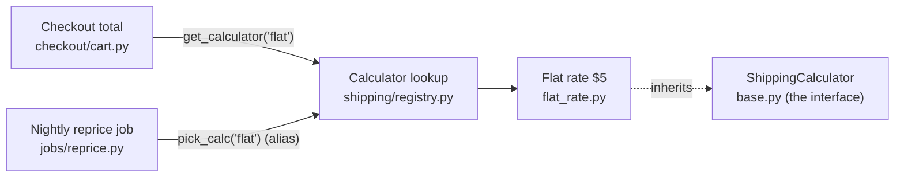

**Verdict: yes, it's safe to remove, and only one other file has to change.** The interface is `ShippingCalculator` in `shipping/base.py`. Its only use is as the parent class of `FlatRateCalculator`. No code calls it by type and no `isinstance` checks exist. It hasn't shipped, so nothing outside the repo can depend on it yet. I checked this by running the code, not just by reading it.

There's no `docs/architecture.md`, ADRs, CLAUDE.md or git history in `fixture/`, so I read the code directly. The five files are small enough to trace start to end.

## How the interface is used today



- **The only reference is the inheritance in `shipping/flat_rate.py`.** `shipping/flat_rate.py:1` imports `ShippingCalculator` and `:4` subclasses it. Nothing else mentions it.
- **The interface does no work.** Its one method just raises `NotImplementedError` (`base.py:10`), and `FlatRateCalculator.quote` replaces it. Both callers use `.quote()` on whatever the lookup hands back, so they never touch the base class.
- **It has one implementer and no test stand-in.** That makes it a guess, not something the code needs. Its own docstring says so: "Kept as a seam in case a second carrier is ever needed" (`base.py:3`).
- **Deletion test:** removing it makes the complexity go away rather than moving it somewhere else. If a second carrier ever arrives, Python can add the shared base back later.

## What has to change

1. Delete `shipping/base.py`.
2. In `shipping/flat_rate.py`, remove line 1 (`from shipping.base import ShippingCalculator`) and change line 4 to `class FlatRateCalculator:`.

That's all. `registry.py`, `cart.py` and `reprice.py` don't change.

**Proof:** I copied the fixture to a temp directory, made both changes there, and ran both user-facing paths before and after:

```
before 15.0 [{'subtotal': 10, 'shipping': 5.0}]
after  15.0 [{'subtotal': 10, 'shipping': 5.0}]
```

The checkout total and the nightly reprice gave the same results. `fixture/` itself is untouched, because this is audit mode.

**Door:** this is easy to reverse. It touches no public API and no stored data, and it hasn't shipped.

## Caveat: the registry is not unused

Whoever "checked everywhere" may also think the registry in `shipping/registry.py` is unused. It isn't. It has two live callers:

- **The nightly job imports it under a different name:** `get_calculator as pick_calc` (`jobs/reprice.py:2`). Searching for `get_calculator(` misses that call.
- **Both callers pick the calculator by the string `"flat"`** (`cart.py:5`, `reprice.py:6`). A search for `FlatRateCalculator` finds only `registry.py:3`, never the callers.

The registry is also a one-entry setup nobody strictly needs (a name-to-class map with one name). Removing it would mean editing both callers and isn't proven dead. Treat it as a separate move worth exploring, not part of this deletion.

## Limits
- There's no git history, so I couldn't find out why the interface was added beyond its docstring.
- There are no tests. My proof is the before/after run above.
- I could only search `fixture/`. Before deleting, also search any sibling repos for `shipping.base`. Unshipped code shouldn't have outside users, but that search is cheap.

Shall I make the two-file change, or look at the registry as well?