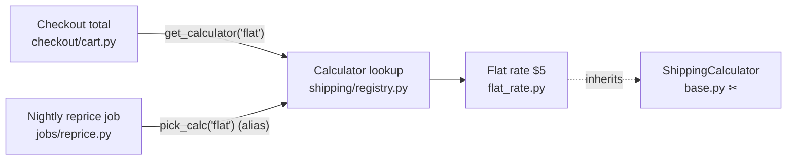

**Yes, it's safe to remove.** `ShippingCalculator` (`shipping/base.py:8`) is a seam with one implementer that nothing reads. Only two files change. It isn't unused, though: `FlatRateCalculator` inherits from it, so deleting `base.py` on its own breaks imports. And the code it sits beside, the registry, is in live use by two flows, one of which a plain search would miss.

Overall the structure is clean. `fixture/` has no architecture map, no ADRs and no git history, so I worked from the code alone and couldn't check why the seam was added beyond its own docstring.

## What depends on what

- **`ShippingCalculator`** (traced): the only reference is `shipping/flat_rate.py:1,4`, the import and the base class. Nothing checks for it by type, by name or with `getattr`. Its `quote()` just raises `NotImplementedError`, and every caller ends up calling `FlatRateCalculator.quote` directly. One implementer and no test fake, so it's structure nobody needs. Remove it and the code gets simpler; no complexity moves anywhere else.
- **The registry is live** (traced). Checkout calls it at `checkout/cart.py:5`. The nightly job calls it at `jobs/reprice.py:2,6` under an alias, `pick_calc`, so searching for `get_calculator(` only finds checkout. Both pick the calculator by the string `"flat"`, so searching for `FlatRateCalculator` finds no callers outside `shipping/`. That's probably why everything "looks unused". Leave `registry.py`, `flat_rate.py` and the `"flat"` key alone.

## What has to change

1. Delete `shipping/base.py`.
2. In `shipping/flat_rate.py`, remove line 1 (`from shipping.base import ShippingCalculator`) and change line 4 to `class FlatRateCalculator:`.

Nothing changes in `checkout/` or `jobs/`.

**Check (proven):** I made both edits in a temp copy and ran each caller. Checkout returned `15.0` for a subtotal of 10. The reprice job set `shipping: 5.0` on each order. There's no test suite, so this run is the only check; repeat it after the real edit.

**Door:** easy to reverse. If a second carrier ever arrives, its implementation is the second real implementer, and the base class can come back then.

## Second option (not recommended yet)

You could also remove the registry, since it's a string lookup with one entry. But that changes both callers, including the aliased nightly job, which the registry protects from churn. It's tidying with no clear gain, so I'd leave it.

I haven't changed anything in `fixture/`. Do you want me to make the two edits, or look further at the registry first?