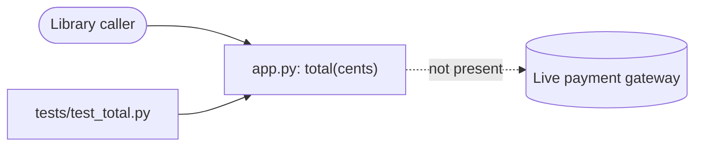

I built the full set of context files for `fixture/`, traced the one behavior the project has, and proved its check works. **Local verification is green, but it only covers the 10-cent fee rule.** No product code changed. `app.py`, `SPEC.md`, `tests/test_total.py` and both `MANUAL:` notes are as they were.

**What was run and the result**
- **Setup:** Python 3.13.4, standard library `unittest`, run from `fixture/`. There is no manifest, lockfile, CI or git repository.
- **Behavior checked:** `total(cents)` returns the price plus a fixed 10-cent fee (from `SPEC.md`), so `total(100) == 110`.
- **Tests:** `python -m unittest discover tests` passed (1 test).
- **The test can catch a mistake:** I changed `+ 10` to `+ 11` in a scratch copy (`verification/fee-mutation.json`). The test failed with `AssertionError: 111 != 110 : expected total 110`, which is the expected failure message. The real source was not touched.
- **Strict verification:** the checks are frozen, the strict run passes, and `verify.py status` reports `VERIFY-STATE: green`.
- **Other checks:**
  - Feature map check: 0 problems.
  - Handoff check: 0 gaps.
  - Foundation check: no issues.
  - Memory index check: no issues.
  - Test mapping: 1 test, mapped, with an assertion.

**Gaps and issues**
- **Prices with no requirement:** `SPEC.md` doesn't say what should happen for zero, negative, non-integer or very large prices. I listed these as open questions in `BRIEF.md` and blind spots in `VERIFY.md` rather than guessing from the code. They are untested.
- **Payment gateway:** the live gateway is outside this project, as your existing note says. Nothing in the code calls it.
- **Packaging:** there is no manifest, so how the library is consumed is unknown.
- **Verify state goes stale easily:** because there's no git, the verifier treats any change in the folder (including the memory cache in `.project-context/`) as a change to the project. Writing the cache, or running tests that create `__pycache__/`, marks it stale. I ran the strict check last so it's green now. Re-run `verify.py run . --strict` after any memory re-index. Setting `PYTHONDONTWRITEBYTECODE=1` stops the test runs from creating `__pycache__`.
- **Housekeeping:** I removed the `__pycache__` folders my first test run created. `.gitignore` is new.

**What I changed in existing files**
- `VERIFY.md`: added a `Checkout total` section and a second blind-spot line. The `MANUAL:` gateway note is kept word for word.
- `AGENTS.md`: added one start-here block at the end. The `MANUAL:` line and the agent-routing block are unchanged.
- No test files were edited.

**Next step:** ask the owner what should happen for zero, negative and non-integer prices. Then add a test for that case, prove it fails on a wrong result, and get a strict green run again.

| category | file | state | what I did | evidence |
|---|---|---|---|---|
| startup | AGENTS.md | present | refreshed: added one start-here block, rest kept | *proven*: foundation check and handoff check both passed |
| intent | BRIEF.md | present | created from `SPEC.md` and `AGENTS.md` | *traced*; still partial because of the open questions above |
| work | BUILD.md | present | created, with a Next step and how to confirm it's done | *proven*: handoff check passed (structure only) |
| features | FEATURES.md | present | created (1 feature, marked partial) | *proven*: feature map check passed; traced from `total` in `app.py`; no CLI, routes or UI exist |
| verify | VERIFY.md (+ `verification/fee-mutation.json`) | present | refreshed: section added, manual note kept | *proven*: mutation caught, then strict run and status green |
| architecture | docs/architecture.md | present | created | *traced*: `tests/test_total.py:2` → `app.py:1-2`; gateway marked not present |
| commands | docs/commands.md | present | created | *proven*: tests, strict verification, the mutation test and the feature check were all run |
| memory | .project-context/index.sqlite | present | created: indexed 5 files, then re-indexed `AGENTS.md` | *proven*: memory index check passed; structure only, it doesn't prove behavior |

<!-- file written by the agent: fixture/BRIEF.md -->
# Brief

Goal: a small Python checkout library that returns a total in integer cents (SPEC.md, AGENTS.md).

## Requirements in force
- The checkout adds a fixed fee of 10 cents to the supplied price. Source: SPEC.md.
- Amounts are integer cents. Source: AGENTS.md ("MANUAL: Keep amounts in integer cents").

## Constraints
- Preserve product behavior. Source: AGENTS.md.
- The live payment gateway is outside this local project; keep that note. Source: AGENTS.md, VERIFY.md.
- No CI or deployment setup requested. Source: AGENTS.md.

## Acceptance
- `total(100)` returns `110` (fee requirement from SPEC.md; checked by tests/test_total.py).

## Open questions (not answered by any source; do not infer from code)
- What should happen for zero, negative, non-integer or very large prices?
- Is the fee ever variable (currency, region, promotions)?
- What is the gateway's interface, and does any code in this project call it? (None found.)

A changed decision replaces its line here; keep the old line's source in the commit or BUILD.md.

<!-- file written by the agent: fixture/BUILD.md -->
# Build

## Current result (2026-10-11)
- Project foundation prepared: BRIEF.md, FEATURES.md, VERIFY.md section, docs/architecture.md,
  docs/commands.md, start-here block in AGENTS.md. No product code changed.
- Evidence: `python -m unittest discover tests` passes (1 test). verify-loop challenge with
  verification/fee-mutation.json (`+ 10` -> `+ 11`) was caught with "expected total 110";
  baseline recorded; `verify.py run --strict` then `status` = VERIFY-STATE: green.

## Blockers
- None for the fee rule. Edge-case prices have no requirement (see BRIEF.md open questions).

## Next
- Ask the owner for the expected behavior on zero/negative/non-integer prices; once answered,
  record it in BRIEF.md and SPEC.md, add a failing test, prove it rejects a wrong result.
- Completion check: `verify.py run --strict` and `verify.py status` print VERIFY-STATE: green
  with the new case in VERIFY.md.

<!-- file written by the agent: fixture/FEATURES.md -->
# FEATURES

What the library does and how each feature is reached. `features.py check --strict` tests every
entry point against the code. Map status: partial — one public function found; no CLI, routes or
UI exist (`features.py init` found 0 entry points; families checked by hand in app.py).
Gap: negative, zero, non-integer or very large prices have no requirement in SPEC.md; unverified.

## Checkout total
- what: Return the checkout total in integer cents: the supplied price plus a fixed 10-cent fee (SPEC.md).
- api: `total(cents)` @ app.py :: def total
- trace: `total` @ app.py
- effect: returns `cents + 10`; no state, I/O or external call.
- requirement: SPEC.md "adds a fixed fee of 10 cents to the supplied price"
- check: tests/test_total.py
- verify: Checkout total
- status: proven: `python -m unittest discover tests` passed 2026-10-11; mutation `+ 10` -> `+ 11` rejected (see VERIFY.md)

<!-- file written by the agent: fixture/docs/architecture.md -->
# Architecture (as-is, traced 2026-10-11)

Altitude: modules. One package root, no dependencies, no storage, no network.

| Edge | Source |
|---|---|
| tests/test_total.py -> app.py | tests/test_total.py:2 `from app import total` |
| caller -> app.py | public function `total`, app.py:1 (no in-repo caller other than the test) |
| app.py -> gateway | none: no import or call; AGENTS.md/VERIFY.md say the gateway is outside this project |

## Boundaries
- app.py: computes the total, `cents + 10` (app.py:2). Pure function; requirement SPEC.md.
- tests/: unittest suite, run via discovery from the project root.

## Placement
- Source at the root (app.py); tests in tests/ as test_*.py. Generated: __pycache__/,
  .verify-state.json, .verify-evidence/, .project-context/ (all ignored by .gitignore).

## Unknowns
- No recorded rationale for the module layout or the fee value beyond SPEC.md.
- No packaging manifest (pyproject/setup.py); how the library is consumed is unknown.

<!-- file written by the agent: fixture/docs/commands.md -->
# Commands

Working directory: the project root (folder containing app.py). Prerequisite: Python 3
(observed 3.13.4). No dependencies, manifest, lockfile, build step or CI.

| Purpose | Command | Source | Status |
|---|---|---|---|
| Run tests | `python -m unittest discover tests` | AGENTS.md | ran 2026-10-11: 1 test OK |
| Strict verification | `python <verify-loop>/scripts/verify.py run . --strict` then `status .` | VERIFY.md | ran: green |
| Challenge the fee check | `python <verify-loop>/scripts/verify.py challenge . --feature "Checkout total" --mutation verification/fee-mutation.json` | verification/ | ran: caught |
| Feature map check | `python <feature-map>/scripts/features.py check --strict` | FEATURES.md | ran: exit 0 |

`<verify-loop>` and `<feature-map>` are the installed top-tier-engineer plugin skill folders,
not part of this project. No launch, build or deploy commands exist.
