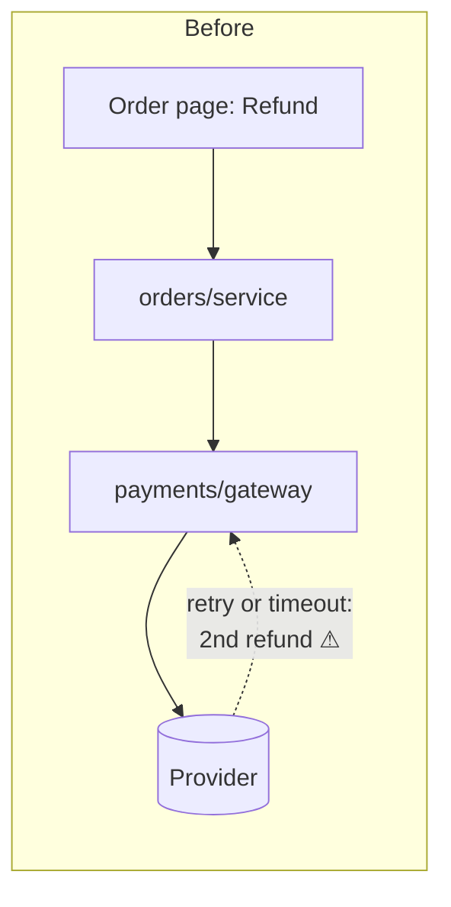
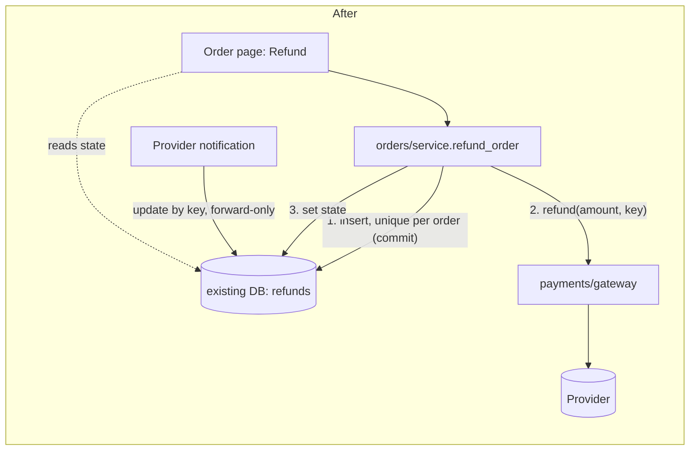

# Operator refunds: design recommendation (arch-design, design mode, no code changed)

**Verdict:** The shape is clean enough to build this with no new infrastructure. Add one refund record to the database you already have, and send the payment provider the same idempotency key on every try. No queue, worker or new endpoint is needed for 20 refunds a day.

## Read this first: what the evidence covers

- **`fixture/` contains only `requirements.md`.** The files it names (`orders/service.py`, `web/order_views.py`, `payments/gateway.py`, `db/connection.py`) are not there. Every claim below about existing code is **suspected**, taken from the requirements doc, not from reading code.
- There's no `docs/architecture.md` or ADR to check against. Next time, a short map would help (`/project-foundation`, if it's available).
- **The biggest unknown is whether the payment provider honours an idempotency key.** The doc says its response time and retry behaviour aren't documented (`requirements.md`, "Existing shape"). The whole "never refund twice" guarantee depends on the answer.
- **Both options below are same-model sketches from this one session.** No workers or second model were used. Cost was well under the $8 / 25-minute cap.

## How I chose (criteria set before the options)

| Rank | Criterion | From the requirements |
|---|---|---|
| 1 | The same amount is never refunded twice, whether from a double click, a retry or a repeated provider notification | hard requirement |
| 2 | Provider failures can be retried safely | hard requirement |
| 3 | The operator sees whether the refund completed or failed | hard requirement |
| 4 | Fewest new stored or public contracts, and fewest new moving parts | the doc flags the refund-state contract and stored key as costly |
| — | Speed | no target given. Load is about 20 a day, an assumption, not a proven ceiling |

**Option A (simplest, reuses existing owners).** The operator's request writes a refund row in the existing database, calls the provider during the same request with that row's key, and updates the row. Provider notifications update the same row.

**Option B (structurally different).** The request only queues a job. A worker calls the provider, and a new status endpoint lets the page poll for the result.

**A wins.** Both meet criteria 1–3, because the guarantee comes from the stored key, not the queue. B adds a queue, a worker and a public status contract, and none of them is needed at 20 a day with no speed target. B only pays off if the provider is often slow enough to time out the page. That's unknown, and A copes with it through a "pending" state (below). What A gives up: if the provider hangs, the operator's request waits until a timeout.

## Candidate cards (best first)

### 1. One refund record plus a reusable provider key. Strong.

**What the operator would feel without it:** a double click or a retry after a timeout sends money back twice.

**Behind it:** with no refund table or stored key (`requirements.md`, "Existing shape"), nothing remembers that a refund already started. Each retry becomes a fresh provider call.

**What gets safer:**
- Paths that can double-refund go from 3 (double click, retry, repeated notification) to 0. This holds as long as the provider honours the key, which is the one fact to confirm first.
- New parts: 1 table and 1 column of logic. No queue, worker or endpoint.
- Not adding: a queue or worker (another thing to run, secure and monitor) or a public status API (a contract callers would depend on).

**States:** `requested → submitted → succeeded | failed | unknown`.
- `unknown` covers a timeout. It shows as "pending" on the page and is settled by the provider's notification, or by looking the key up with the provider.
- Retrying is allowed only from `failed` or `unknown`, and it always reuses the same key.

### 2. Keep the state rules apart from the database and provider calls. Strong (folds into card 1).

The rules ("may this order be refunded?", "is this a legal next state?") go in plain functions in `orders/` that never call the database or the provider. They become testable without either.
- No interface layer for the database: the existing one has a local stand-in.
- Use a fake for the provider only, because the provider is the part that isn't yours.

### 3. Queue plus worker plus status endpoint (Option B). Speculative for now.

Revisit only if measured provider latency regularly goes past the page timeout, or volume grows by orders of magnitude. Moving from A to B later is a two-way change, because the refund table and key carry over unchanged.

## The top move: the doors

**One-way doors (stored data). Decide these before building:**

1. **Key scope.**
   - Option (a): one refund per order. The key is derived from the order id (for example `refund:{order_id}`) with a unique constraint on the order. A double click collapses into one refund for free.
   - Option (b): one key per refund request, so partial or multiple refunds are possible. This needs a token generated when the form loads.
   - **Question for the owner:** will partial or repeated refunds per order ever be needed? If not, choose (a). Choosing (a) and needing (b) later costs a migration of the key and constraint.
2. **The refund state stays internal for now.** It's shown on the existing order page and not published as an API. That keeps the public contract closed. Opening it later is additive.

**Two-way doors.** Module layout: the refund logic lives in `orders/service.py` next to the other order actions. Settled.

## Safe first implementation plan

Each step leaves behaviour unchanged until step 6 turns the button on.

1. **Confirm the provider facts (first, and it decides go/no-go).**
   - Read `payments/gateway.py` and the provider docs. Does the refund call accept an idempotency key? Can a refund be looked up by our reference? What timeout is in effect?
   - **Proof:** a sandbox call made twice with the same key returns the same refund, not two.
   - If there's no key support, change the design: before any retry, look the refund up by our reference instead of resubmitting.
2. **Additive migration.** Add a `refunds` table: order id, amount, key (unique), state, provider refund id, timestamps. Nothing reads it yet. **Proof:** the migration runs up and down, and the existing test suite still passes.
3. **Pure state rules plus tests** in `orders/` (card 2). Test every transition, and that retry is allowed only from `failed`/`unknown`.
4. **`gateway.refund(amount, idempotency_key)`** with an explicit timeout. A timeout maps to `unknown`, not `failed`. Test it against a fake provider: timeout, error, success.
5. **`orders/service.refund_order`.**
   - Insert the row and commit it before calling the provider, so a crash still leaves a record.
   - A unique-constraint violation returns the existing refund rather than starting another.
   - Then call the gateway and update the state.
   - **Proof:** a test that fires two concurrent requests and checks that exactly one provider call was made.
6. **Refund button and state on the order page** behind a flag. Shows pending, completed or failed, with Retry only when it's allowed.
7. **Provider notification handler.** Update by key, move state forward only, and ignore repeats.
   - **Proof:** replaying the same notification three times gives one state change and no provider call.

**Pre-mortem: three likely ways this fails a year on.**

| Failure | Response |
|---|---|
| The provider ignored the key | step 1 is a gate |
| Refunds stuck in `unknown` | a daily lookup for refunds left in `unknown`; an accepted risk at 20 a day |
| Partial refunds turn up as a need | the key-scope question above |

---

**I've stopped here and changed nothing.** Which do you want to explore? Card 1 with key scope (a) or (b) is my recommendation, or I can push harder on Option B. Answering the partial-refund question will settle the main one-way door.