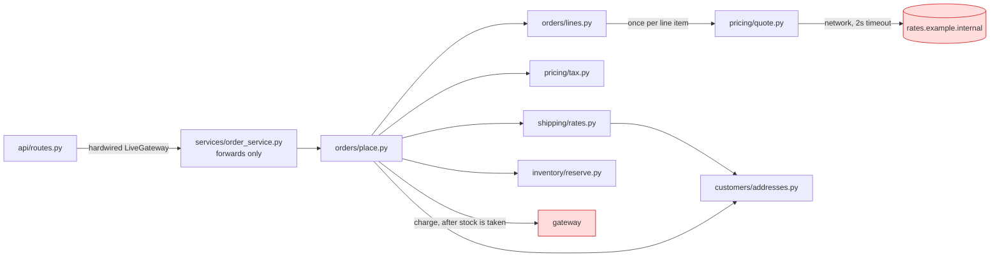

# Architecture audit: `fixture/`

**Verdict: messy in places.** The module layout is reasonable. The pain comes from the order flow: it makes network calls and picks the payment provider deep inside itself, and three modules form a loop. That is why nobody can run it on a train, and why one small change spreads across several files.

**About the evidence:** there's no `docs/architecture.md`, no ADRs and no git history, so I mapped the system from the entry points (`api/routes.py`, `jobs/nightly.py`). "Proven" below means I ran it, using a throwaway script outside the repo with `FakeGateway`. Running it left `__pycache__` folders in `fixture/`; I deleted them and changed nothing else.

**What I ranked against.** These are the changes most likely to come next. They're my guess from the code's shape, since there's no tracker or history to check:
1. Changing pricing or margins.
2. Letting customers choose a delivery address or country at checkout.
3. Changing the payment provider, or fixing what happens when a payment fails.

**The order flow today** (`POST /order`):

---

### 1. Placing an order calls the network and the live payment provider from inside · **Strong** · proven

- **How it feels:** you can't run the order flow offline. When it does run, prices are quietly wrong.
- **What causes it:**
  - `pricing/quote.py:19` calls `_fetch_margin()` (an HTTP request) **once per line item**. On any error, `quote.py:14-15` silently uses a margin of 1.0.
  - With the network blackholed, a 2-item order took **4.00 s**. A 10-item cart would wait about 20 s.
  - On this machine the host doesn't resolve, so even the "online" run fell back to 1.0. The total came out at 4030 either way, with no error.
  - `api/routes.py:1,10` hardwires `LiveGateway()`. The fake (`payments/fake.py`) exists, but nothing can select it.
- **Better:** fetch the margin once, at the edge, and hand pricing a number. Pick the gateway in one place.
  - Pricing becomes plain arithmetic, testable with no network.
  - Margin calls per order go from N to 1.
  - An offline run takes milliseconds.

Both seams pay for themselves. Each one crosses a network and has two real implementations: live and fake for payments, live and a fixed value for margin.

### 2. A failed order still uses up stock · **Strong** · proven (correctness bug)

- `orders/place.py:14-16` reserves stock line by line, then charges the card last, with no way to undo either step.
- **Proven, out-of-stock item:** an order of A plus C, where C is out of stock, failed with "short on C". A's stock still dropped from 3 to 2.
- **Proven, declined card:** B's stock dropped from 3 to 2 anyway.
- **Better:** check every line before reserving any. On any later failure, release what was reserved, using `inventory/reserve.py:11`, which already exists. Charging is a step you can't undo, so it should be the last step, after everything that can fail.

### 3. Three modules form a loop · **Worth exploring** · traced

- The loop: `orders/status.py:1` → `shipping/tracking.py:1` → `notifications/email.py:1` → back to `orders/status.py`. My import scan confirmed it.
- It only imports cleanly because each file uses `import x.y` rather than `from x import y`. A change in any of the three can break the other two, so they have to change together.
- **Better:** stop `tracking.mark_delivered` sending the email itself (`tracking.py:10`). It should record the delivery, and its caller sends the email. That cuts the loop in one place. Order status would then depend on shipping, and nothing would point back.
- `email.subject_for` (`email.py:14`) has no callers in this tree. It looks dead, but without history I can't prove it, so I'm not proposing to delete it.

### 4. "What country is this customer in?" is answered in three places · **Worth exploring** · traced

- The default address is looked up separately in `orders/place.py:11` (for tax), `shipping/rates.py:10` (for shipping) and `shipping/labels.py:6`. The fallback to `'US'` is copied in two of them.
- Likely change #2 (choose the address at checkout) therefore means **3 edits**. It also risks tax and shipping using different countries.
- **Better:** `place_order` looks up the address once and passes the country to `quote_shipping(country, weight)`. That makes it 1 edit.

### 5. Leftover structure (tidying, low priority)

- `services/order_service.py:4-5` only forwards the call to `place_order`. Undo it mentally and nothing gets harder, so it can be inlined.
- Five files copy the same unused import line, `from core.util import clamp, as_cents, slug, first`. `as_cents` is never called anywhere. This makes renaming anything in `core.util` look like a 16-file change.

**Fine as it is:**
- `core/*` is used everywhere and depends on nothing. It's a stable base, not a problem.
- `PaymentGateway` has two real implementations, so it's a seam worth keeping.
- `customer_service.register` genuinely combines three steps.

---

## First move: candidate 1, lifting I/O to the edge

Each step leaves behavior unchanged:

1. **Fetch the margin once per order.**
   - `unit_price(sku, code, margin)` and `build_lines(items, code, margin)` take the margin as a value.
   - `place_order` gets a `margin` argument, and `routes.post_order` calls `_fetch_margin()` once and passes it in.
   - For each item, the price comes out the same as before.
2. **Choose the gateway in one place.**
   - Add a small `make_gateway()` in `api/` that reads e.g. `PAYMENTS=fake|live`, defaulting to live so production doesn't change.
   - `routes.py` uses it instead of `LiveGateway()`.
3. **Inline `services/order_service.py`** while you're in `routes.py`. It has one caller and is 5 lines.
4. **Then fix candidate 2** (validate first, release stock on failure, charge last). It's now testable offline.

**Proof:** run the order flow offline with the fake gateway and a fixed margin. It should finish in under 0.1 s and make 1 margin call per order, not N. The totals should match today's for the same inputs.

**Alternative I considered:** cache the margin inside `pricing/quote.py`, with a module-level TTL, plus an environment switch. That's fewer edits, but pricing still makes hidden network calls and tests still need patching. I recommend lifting the I/O to the edge.

**How reversible:** this is easy to undo. It only changes internal function signatures; no stored data or public API changes.

**One question only you can answer:** when the rates service can't be reached, what should happen? Options are refusing the order, pricing at the base price, or using the last known margin. Today it prices at the base price silently. That's a business rule, so I've kept the current behavior until you decide.

**Which candidate do you want to explore further?** I haven't changed anything yet.