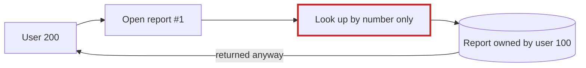
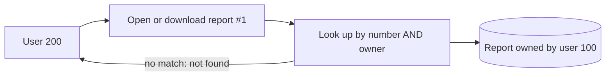
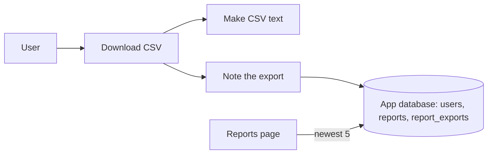

# Arch-design (design mode): CSV download and export history in `fixture/`

**Verdict:** the code is small and clean, and the feature fits without new infrastructure. One thing has to be fixed first: **any logged-in user can open any report by its number**, so a Download button would let them save someone else's report as a file.

**Map check:** there's no `docs/architecture.md` and no ADRs, so I drew this from the 4 source files. I also found no code in `fixture/` that creates the `users` or `reports` tables. That matters, because the history needs a new table (see #4).

## 1. Make report lookups check the owner before Download ships (Strong, proven)

- `app/reports/models.py:10-14`: `get_report(report_id)` looks a report up with `WHERE id = ?` only. `list_reports` at line 4 does filter by owner.
- `app/reports/views.py:9-11` passes the report number through without checking `request.user_id`.
- **Proven:** I ran a probe against a temporary database outside the repo. User 200 fetched user 100's report #1 and got the full body back.




**Move:**
1. Change it to `get_report(report_id, owner_id)` with `WHERE id = ? AND owner_id = ?`.
2. Update its one caller. The export view then reuses the same function, so view and download share one check instead of each needing its own.

**Proof:** re-run the 2-user probe. User 200 should get `None` and user 100 should get the row.

**Door:** two-way.

## 2. Export history: one new table in the existing SQLite database (Strong, one-way door)

The history reuses what's already there: `app/db.py:11` `execute()`, which already commits on every call. I'm deliberately not adding a separate store (Redis, a log file, an audit or events system). Each of those would be one more thing to secure, back up and run, for a 5-row list.



```sql
CREATE TABLE report_exports (
  id          INTEGER PRIMARY KEY,
  user_id     INTEGER NOT NULL,
  report_id   INTEGER NOT NULL,
  title       TEXT    NOT NULL,   -- snapshot at export time
  exported_at TEXT    NOT NULL DEFAULT CURRENT_TIMESTAMP  -- UTC, set by the DB
);
CREATE INDEX report_exports_user_time ON report_exports(user_id, exported_at DESC);
```

- **New module:** `app/reports/exports.py` with `record_export(user_id, report)` and `recent_exports(user_id, limit=5)`.
- **Old rows:** they aren't pruned. The read uses `LIMIT 5`, and one small row per export is negligible.
- **Second option:** keep the history only in the browser. That avoids a migration, but it's lost on another device or when the browser is cleared, and the server has no record of who downloaded what. The table costs one migration and about 15 lines, and I recommend it.

**Technical calls I've made:**
- The title is stored as a snapshot rather than looked up from `reports` each time, so history survives a report being renamed or deleted.
- Timestamps come from the database in UTC, so no app code reads the clock.
- The history row is written only after the CSV has been built.

## 3. CSV is one plain function, not an export-format framework (Strong, two-way)

One format was asked for, so it gets one function: `report_to_csv(report) -> str`, using the stdlib `csv` module. It touches no database and no clock, so it can be tested with a sample tuple. There's no exporter interface or format registry. If XLSX or PDF is ever requested, that's the time to add a second function.

## 4. Where do tables get created? (Worth exploring, suspected)

`db.py:4` points at `app.sqlite3`, but nothing in `fixture/` creates any tables. The new table has to ship however `reports` and `users` do today, so that needs answering before #2 is built.

## Pre-mortem: a year on, this failed because…
1. **One user's exports leaked to another.** #1 fixes this, and `recent_exports` filters by `user_id`.
2. **Users saw confusing times.** The DB stores UTC and the page converts to the user's time zone when it shows it.
3. **"History" turned into a compliance audit log that it can't support.** This is an accepted risk for launch, and it's the reason the rows aren't pruned.

## Questions for product
1. **What goes in the CSV?** A report has `id, title, created_at, body` (`models.py:12`). Is `body` itself tabular data to unpack into rows, or is the file one row of those four fields? This is the biggest unknown.
2. **Renames and deletes:** if a report is renamed or deleted, should its history entry keep the title it had at export time? I've assumed yes.
3. **What should "last few" be:** 5 entries, or a time window?
4. **If saving the history entry fails, should the download still go through?** I'd say yes, since the history is a convenience and not an audit trail. Please confirm.

The same report, with before/after diagrams, is at `<tmp>\architecture-review-20261026-015007.html`.

I haven't changed anything in `fixture/`. **Which candidate should we explore in depth?** I'd start with #1, then settle the table shape in #2, since that's the one choice that's hard to undo.