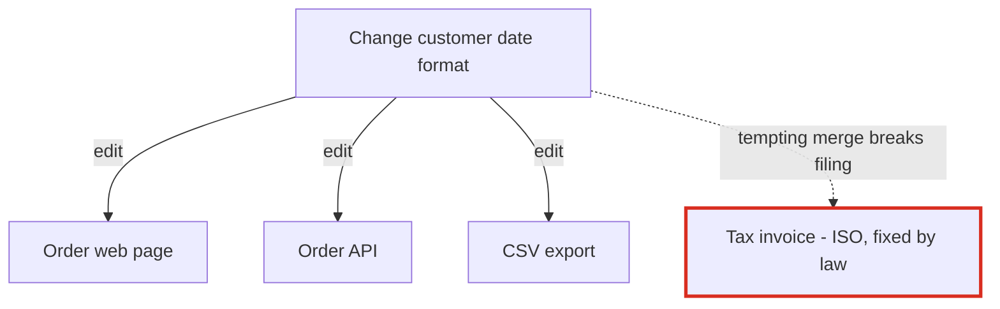
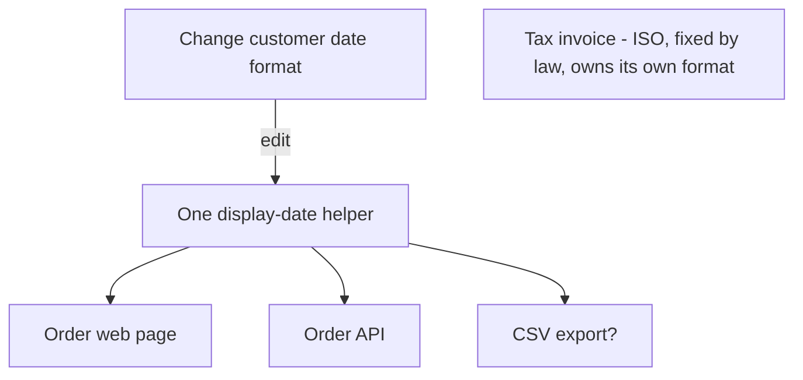

# Architecture audit of `fixture/`

**Overall: the codebase is clean and small (7 files, 45 lines), but it has one trap.** The date format customers see is copied into three places. A fourth date looks like another copy, but it's a tax-filing format that must never change along with the other three.

I didn't change anything in the repo.

**About the project's own docs:** there's no `docs/architecture.md`, no ADRs and no git history. So nothing in the docs contradicts the code, but there's also nothing written down to rely on. The only recorded design decision is a comment at `billing/invoice.py:2-4`. With no history, I couldn't find which files change most. I guessed the three most likely upcoming changes from the code itself: changing the customer date format (the invoice comment expects this), adding a second message provider (the provider framework expects this), and adding a field to orders.

## What a new person should know before Monday

1. **Don't merge the date helpers.** `billing/invoice.py` uses ISO dates (`%Y-%m-%d`) on purpose. The tax authority's upload spec requires them, and one wrong field rejects the whole filing. The three helpers that really are the same are the customer-facing ones.
2. **Changing the customer date format currently takes edits in three files**, and they're easy to get out of sync.
3. **`providers/` is a framework built for one provider.** Read it as "send by SMTP" and don't take its design as a pattern to copy.
4. **There are no tests and no `__init__.py` files.** Imports like `from providers.smtp import ...` only work when `fixture/` is on `sys.path`.

## Candidate 1: customer date format in three places, tax date kept separate (Strong)

**What you feel:** changing how dates look to customers means 3 edits. The obvious cleanup, one shared date helper for everything, would silently break the tax filing.

**Before:**

**After:**

- **Evidence (proven, I ran it):** these three copies are identical and all use `"%d/%m/%Y"`:
  - `api/serializers.py:1`
  - `web/views.py:1`
  - `jobs/export.py:1`

  For 2026-03-04 they all print `04/03/2026`, while `billing/invoice.py:5` prints `2026-03-04`.
- **What gets better:** a format change goes from 3 edits to 1, and the tax date can't be changed by accident.
- **Question for the owner:** is the CSV export something people just read, or does another system parse it? If a system parses it, it's a contract like the invoice and should keep its own format.
- **Landing steps (behavior stays the same at each step):**
  1. Add `display_date(d)` in one place.
  2. Point the web page and the API at it, and delete their copies.
  3. Move the export over only after the CSV question is answered.
  4. Never touch `billing/invoice.py`.
- **Proof:** run the four functions on a fixed date before and after. The output must match exactly (the snippet I ran does this).
- **Door:** two-way. It's just a helper function and easy to undo.
- **Second option:** keep the copies, but name them on purpose (`display_date` vs `invoice_date`) and add a comment. That costs nothing, but a format change still takes 3 edits.

## Candidate 2: a provider framework with one provider and no caller found (Speculative)

- **The setup:**
  - `providers/base.py:1-5` is a base class with one implementer, and its own docstring says so.
  - `providers/registry.py:3` is a registry with one entry.
  - `providers/smtp.py:4` is the one provider.

  Nothing in `fixture/` calls `registry.get`.
- **What gets better:** reading or changing how messages are sent goes from 3 files to 1.
- **Why it's not a recommendation yet:** callers may exist outside `fixture/`, and `get("smtp")` looks providers up by string, so searching the code won't find every user. Treat it as possibly unused until that's proven. Leave it alone unless someone proves it's dead or rules out a second provider.

I dropped everything else. The "add a field to orders" change touches 4 independent order formats, but each serves a different reader, so merging them wouldn't make anything cheaper.

**Full visual report:** `<tmp>\architecture-review-20261026.html`

**Where I'd start:** candidate 1, steps 1–2 (web page and API). It's the change most likely to come next, and it's where a well-meant cleanup can do real damage. **Which candidate do you want to explore? Also, is the CSV export read by people or parsed by another system?**