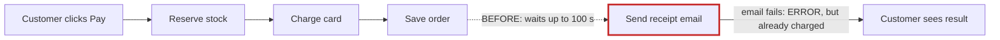
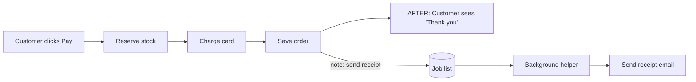
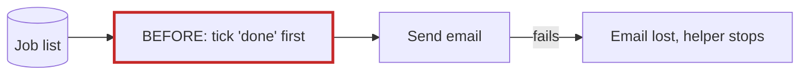
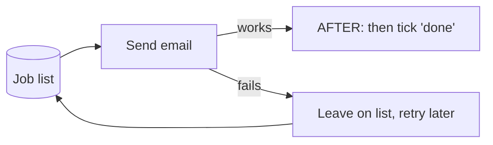

# Your shop: architecture review

**Verdict: messy in places.** Checkout makes the customer wait for the email server, even after their card has been charged. That one problem explains both things you've noticed: checkout sometimes takes up to **100 seconds**, and some customers are **charged but see an error page**.

I didn't just read the code: I ran it with a fake email server that was down. The customer got an error page, their order was saved with a card charge, and they waited 100 seconds. I changed nothing in your shop.

A visual version of this report opened in your browser: `<tmp>\architecture-review-20261026.html`

## ⚠ First: your architecture document is wrong on this exact point

`docs/architecture.md:14-15` says checkout "puts the receipt email on the job queue. The customer never waits for email." The code doesn't do that:
- Checkout sends the email itself while the customer waits (`shop/checkout.py:12`).
- The background worker doesn't know how to send receipts at all (`shop/jobs/worker.py:6-8`).

Anyone reading that document, person or AI, would think this problem was already solved.

---

## 1. Send the receipt in the background — **Strong**

**What you feel:** slow checkout; customers charged but shown an error.

**Why:** after the card is charged and the order saved, the shop tries to send the email before answering the customer. If the email server is down, it tries 3 times, waiting up to 30 seconds each time plus 5-second pauses: up to 100 seconds. Then it gives up and shows an error, but the money is already taken.

**What gets better:**
- Checkout no longer waits up to 100 s for email.
- An email problem can no longer fail a paid order.
- Nothing new needs to be built. The job list and background helper already exist (refunds use them), and your document becomes true.

**Risk:** easy to undo. Only code changes; how orders are stored stays the same.

## 2. The background helper ticks jobs off before doing them — **Strong**

The helper marks a job "done" *before* sending the email (`jobs/queue.py:18`). If the email fails, it's lost forever. The helper also stops completely on the first error (`jobs/worker.py:18`), so every email after it waits until someone restarts it. When I tested it, a refund email failed and the job vanished. This has to be fixed together with #1, or failed receipts would silently disappear.

## 3. Failed orders keep stock locked up — **Strong**

Checkout takes items off stock one at a time (`checkout.py:6-7`). If a later item is sold out, or the card is declined, the order stops but the earlier items are never put back. In my test there were 5 mugs, an order for 2 mugs and a sold-out hat failed, and stock then showed **3 mugs**. Fix: check every item first, take them all at once, and put them back if the charge fails. Easy to undo.

## 4. Orders and stock live only in short-term memory — **Worth exploring**

The file called "db" (`db.py:3-4`) is just a list held in memory, and so is stock (`inventory.py:1`). On a restart, every order and stock count is gone, but the email jobs survive because they're in a small database file. I haven't seen how your live shop runs, so this may be a stand-in for something else. If not, the fix is to keep orders and stock in that same database file, not to add a second database. **Hard to undo:** how orders are stored is a long-lived choice, so it's worth deciding carefully.

---

## Start here

I'd do **#1 and #2 together**. They explain both symptoms, they reuse machinery you already have, and they're easy to undo.

**For engineers:**
- **Steps:**
  1. Make the queue mark a job done only after it succeeds, and make the worker survive errors and retry.
  2. Add a `send_receipt` handler to `worker.HANDLERS`.
  3. Replace `checkout.py:12` with `enqueue("send_receipt", …)`.
  4. Delete the stale comment at `checkout.py:11`.
- **Proof:** with SMTP patched to fail, checkout returns 201 with 0 s waited, and a pending `send_receipt` job sits in the queue.
- **Option considered and rejected:** keep the email in checkout but catch the error and cut the timeout. That still means up to ~15 s of waiting, and a failed receipt is lost for good.

**Two questions for you:**
1. Which of these would you like to explore further? I haven't changed anything yet.
2. Only you can answer this one: **is it fine if the receipt email arrives up to a minute after checkout, instead of instantly?**