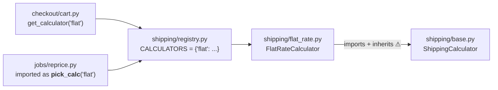
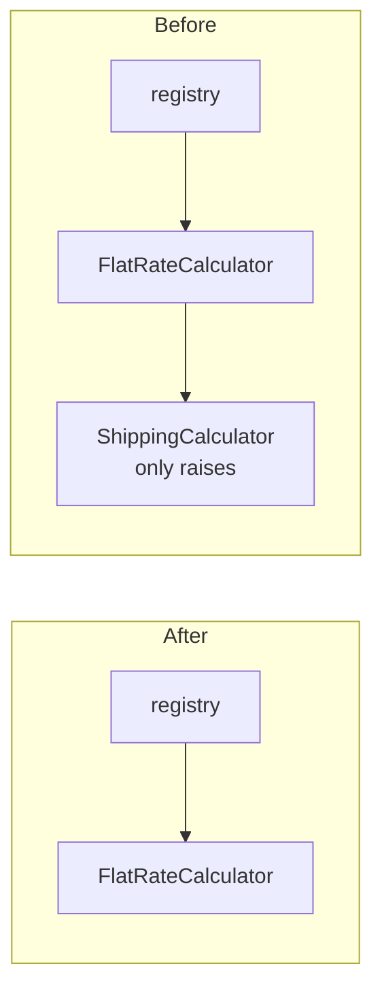

I ran arch-design in audit mode (map, scope, candidates). I haven't changed anything in `fixture/`.

## Verdict
**Yes, it's safe to remove, but deleting the file alone breaks shipping everywhere.** The interface is `ShippingCalculator` in `shipping/base.py`, and it isn't unused. `flat_rate.py` imports it and inherits from it. The checkout and the nightly reprice job both load `flat_rate.py`, so deleting `base.py` by itself crashes both. One other file has to change too: two lines in `flat_rate.py`. With that edit, behavior is the same, which I confirmed by running both flows.

**Overall, the code is clean.** It's five small files. The only extra structure is a placeholder kept "in case a second carrier is ever needed" (`shipping/base.py:3`).

## Map
There's no `docs/architecture.md`, no ADRs and no git history, so I drew the map from the code:

**Why it looks unused:** nothing calls `ShippingCalculator` directly. Callers reach the calculator through the string `"flat"` (`registry.py:3`). The nightly job also imports the lookup under a different name, `pick_calc` (`jobs/reprice.py:2`), so searching for `get_calculator` won't show that the job depends on shipping.

## Candidate 1: delete `ShippingCalculator` (strength: *Strong*, evidence: proven within `fixture/`)

- **Problem:** a reader sees an "abstraction" and assumes there are several carriers. There is only one implementation (`flat_rate.py:5`, "The only shipping calculator in production").
- **What uses it:** exactly one place, `flat_rate.py:1` (import) and `flat_rate.py:4` (base class). Nothing else in the code refers to it: no `isinstance`/`issubclass`, no `__subclasses__`, no dynamic imports.
- **Is anything relying on its behavior?** No. Its only method, `quote`, just raises `NotImplementedError` (`base.py:10`), and `FlatRateCalculator` replaces it with its own `quote`.

**What has to change:** 1 file deleted and 2 lines edited.
1. In `shipping/flat_rate.py`, delete line 1 (`from shipping.base import ShippingCalculator`).
2. In `shipping/flat_rate.py:4`, change `class FlatRateCalculator(ShippingCalculator):` to `class FlatRateCalculator:`.
3. Delete `shipping/base.py`.

`registry.py`, `cart.py` and `reprice.py` don't change.

**Proof:** I ran both flows on a throwaway copy outside the repo.
| State | `total_with_shipping({"subtotal":10})` | `reprice_open_orders` |
|---|---|---|
| Before | `15.0` | `[5.0, 5.0]` |
| `base.py` deleted only | `ModuleNotFoundError: No module named 'shipping.base'` | (same crash) |
| With steps 1–3 | `15.0` | `[5.0, 5.0]` |

**Is it reversible?** Yes. It's an internal class: no stored data, no public API. If a second carrier ever arrives, the base class can come back in about 5 lines. Before you delete it, there are two things this audit can't see:
- Code outside `fixture/` that imports `shipping.base` (other repos, plugins, notebooks). Search for it there before merging.
- Why it was added. The docstring gives the reason (a future second carrier), but there's no git history to say whether that carrier is planned. If it's already on the roadmap, keeping the class costs very little. Otherwise, the rule here is that one implementation means the abstraction is still a guess, not a need.

**Option 2:** keep it, but turn it into a `typing.Protocol` so `flat_rate.py` no longer has to import it. That's only worth it if a second carrier is actually expected soon.

## Candidate 2: the one-entry registry (strength: *Speculative*)
`registry.py` maps a single name, and both callers hard-code `"flat"` (`cart.py:5`, `reprice.py:6`). It's the same kind of placeholder, but string lookups are often reached from config or outside data that this fixture doesn't show. I can't show it's unused, so I'm only flagging it, not recommending removal. Leaving it alone also keeps `cart.py` and `reprice.py` unchanged in Candidate 1.

---
Which candidate do you want to take further? If it's Candidate 1, I can make the three-step change in `fixture/` and run the same check again.