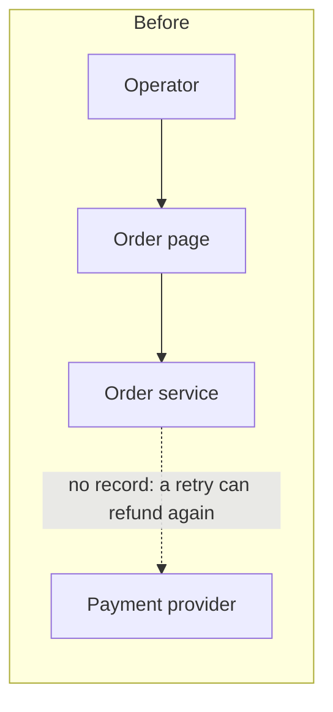
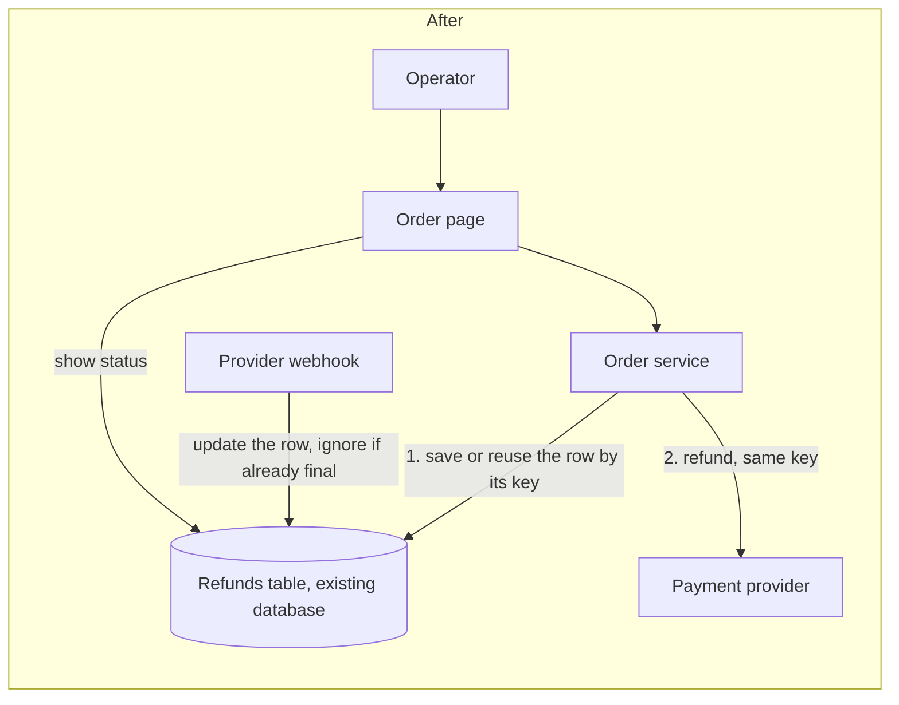

I recommend recording each refund as a row in the existing database, keyed by a unique idempotency key, and calling the payment provider synchronously from `orders/service.py`. Don't add a queue, a worker or a public status endpoint yet.

The skill's gate passed (`ARCH-GATE: done`) and nothing in `fixture/` changed. Before relying on any of this, note that **every finding is suspected, not traced**. `fixture/` contains only `requirements.md`: none of the service, view, gateway or database files exist, and there's no `docs/architecture.md`. I ran nothing against real code and no proof command exists. Everything below rests on the requirements text alone.

## Verdict
The current layout (view → order service → gateway / database) is clean, but nothing records a refund. A retried request or a repeated provider webhook has no stored record to check against, so the same amount could be refunded twice (`requirements.md:6`, `:15`).

## The choice

The criteria, ranked before looking at options:
1. Never refund the same amount twice.
2. The operator sees whether it completed or failed.
3. Provider failures can be retried safely.
4. As few new things to run as possible, reusing existing owners.
5. Fits 20 refunds a day with no response-time target.

Both options are same-model sketches from this one session; no second model was used.

| | **A: synchronous with a refund row (chosen)** | **B: queue + worker + status endpoint** |
|---|---|---|
| No double refund (1, 3) | Unique key on the refund row, and the same key sent to the provider | Needs the same row and key anyway |
| Operator sees result (2) | Shown on the existing order page, read from the row | Needs polling a new public endpoint |
| New things to run (4) | One table | Queue, worker, public endpoint |
| 20/day, no latency target (5) | Fits | More than needed |

A wins on 4 and 5. Safety against double refunds comes from the stored row and key, not from going async, so B pays its extra cost without being any safer.

**Two hard-to-undo decisions** (changing either later is costly):
- **The stored shape of the refund row and its idempotency key.** Suggested columns: `order_id`, `amount`, `idempotency_key UNIQUE`, `status` (`pending` / `succeeded` / `failed`), `provider_ref`, timestamps. Changing this later means migrating existing data.
- **Whether refund status becomes a public contract.** A keeps status internal to the order page, which leaves this decision open.

If A turns out wrong because provider calls are slow or hang, you can put a worker behind the same table and its `pending` status without a data migration.

## Safe first implementation plan
Each step leaves current behavior unchanged until step 5 exposes the feature:
1. **Add the refunds table** through `db/connection.py`. Nothing reads it yet.
2. **Add `gateway.refund(amount, idempotency_key)`** in `payments/gateway.py`, passing the key through to the provider. Nothing calls it yet.
3. **Add `OrderService.refund`.** In one transaction it creates the row for a key or loads the existing one; if the row is already final, it returns that result. Otherwise it calls the gateway and records `succeeded`, `failed`, or `pending` on a timeout or unclear answer. Retrying a failed or pending refund reuses the same key.
4. **Make the webhook handler idempotent:** it updates the row by key or provider reference and ignores rows already in a final state.
5. **Add the refund button and status display** to the order detail page in `web/order_views.py`.

Tests to write with it: the same key twice gives one provider call; a duplicate webhook doesn't change the row; a timeout leaves `pending` and the retry uses the same key; refunding an order that isn't settled is rejected.

## Before building
1. **Does the provider honor idempotency keys on refunds?** `payments/gateway.py` is described but not available, so I couldn't check. If the provider doesn't support them, step 3 has to look up the refund's status with the provider before retrying. This is the biggest risk.
2. **Is a "pending, check back" state acceptable** to operators when the provider is slow?
3. **Partial refunds or full only?** The answer changes whether the key covers the order alone or the order plus amount.

I skipped the optional HTML report to stay within budget; the diagrams above carry the same content. The filled-in design notes are at `%TEMP%\arch-design\911702c62abe\move.md`.

**Do you want to go deeper on option A?** The first thing to settle is the provider's idempotency support.