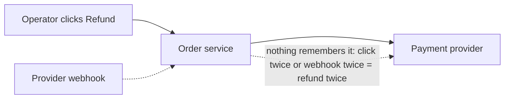
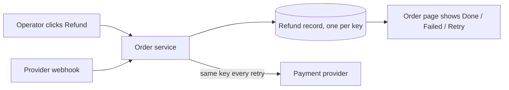

My recommendation: add one refund record per refund to the database you already have, owned by the order service, and keep the provider call synchronous. Don't add a queue, a worker or a status endpoint. The record is what actually stops double refunds; a queue doesn't help with that.

## First, a caution about the fixture

`fixture/` holds only `requirements.md`. The files it describes (`orders/service.py`, `web/order_views.py`, `payments/gateway.py`, `db/connection.py`) don't exist there, and there's no `docs/architecture.md`. So everything below is based on the requirements alone and rated **suspected**. Nothing has been checked against real code. I compared the two designs myself in this session; no second model or worker was used.

## Verdict: messy in places

Nothing currently records a refund, so the system can't recognise a repeat. Three things would each refund twice: an operator clicking twice, the provider sending the same webhook twice, or a retry after a provider timeout where the provider had in fact already paid out (`requirements.md:5,7,13`). The provider's response time and retry behaviour aren't documented (`requirements.md:11`). That timeout case is the riskiest of the three.

**Before**

**After**

## The design choice

The decision criteria, ranked before looking at options:
1. The same amount is never refunded twice, whether from a repeat click, a repeat webhook or a retry.
2. The operator sees whether the refund completed or failed.
3. Provider failures can be retried safely.
4. Reuse the existing parts and add the fewest new things to run, at 20 refunds a day.
5. It stays cheap to change if volume or latency targets show up later.

The two options:
- **A (recommended): synchronous, with a stored record.** The order service writes a refund row with a unique idempotency key, then calls the provider with that same key. The webhook updates the row, and the order page shows its state.
- **B: asynchronous.** The request writes the row and puts a job on a queue. A worker calls the provider, and a new status endpoint is polled by the page.

**A wins.** Criteria 1–3 are met by the stored key and state, and A and B both have those. B's queue only helps with response time, and no response-time target is set. Criterion 4 rules out running a queue, a worker and a public endpoint for 20 refunds a day.

**If A turns out wrong** (for example, the provider is slow), the refund row already works as an outbox. You'd add a worker that picks up pending rows, with no data migration. Choosing B when it wasn't needed would mean operating a queue and worker, plus a public status contract callers start to rely on.

**What's hard to undo:**
- **One-way:** the refund table and the idempotency key. Decide them carefully.
- **Two-way:** whether the provider call is synchronous or asynchronous.
- **Avoided on purpose:** a public status API. State is shown on the existing order page, so there's no external contract to maintain.

## A safe first implementation plan

Each step leaves current behaviour unchanged until step 5:
1. **Add the `refunds` table** to the existing database. Columns: `id`, `order_id`, `amount`, `idempotency_key UNIQUE`, `provider_ref`, `state` (requested, pending, succeeded or failed), `error`, timestamps. Nothing reads it yet.
2. **Add `gateway.refund(amount, idempotency_key)`** with an explicit timeout. Nothing calls it yet.
3. **Add `service.request_refund`.** It inserts the row, or returns the existing one if the key is already there. It marks the row `pending`, calls the provider, then records the outcome. A timeout leaves the row `pending` (outcome unknown) rather than `failed`. Retry always reuses the same key.
4. **Add the webhook handler.** It looks up the row by `provider_ref` and ignores rows that are already succeeded or failed, so repeats do nothing.
5. **Show it on the order page.** Display the state, and show a Retry button only on failed or pending rows.

**How to prove it works:** there's no code yet, so there's nothing to run today. The first test should send the same request twice and the same webhook twice, then check for exactly one provider call and one succeeded row.

## Questions only you or the code can answer

The answers decide the table's unique constraint and whether step 3 is safe:
- **Does the provider accept an idempotency key on refunds?** If it doesn't, a retry after a timeout must first look up whether the provider already refunded.
- **Full refunds only for v1, or partial ones too?** Full-only means one refund per order. Partial means the key is per request, plus a check that refunds can't add up to more than the order total.

## Check results

The skill's `arch.py --gate` check passed on all three stages (read, move, unchanged), and nothing in `fixture/` was changed. The design record it checked is at `%TEMP%\arch-design\877d5411f53d\move.md`. I didn't build an HTML report, because this session has no way to show a page. Spend stayed well under the $8 / 25-minute budget.

As the skill requires, I've stopped before implementing anything. Should we go deeper on option A, starting with the two questions above, or would you rather look at B?