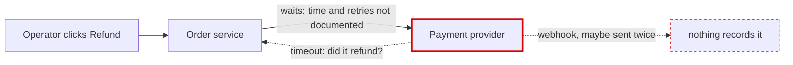
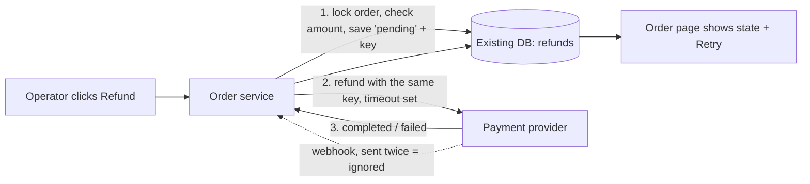

## Arch-design: operator refunds (design mode, nothing implemented)

**Verdict:** There's no code to review. `fixture/` contains only `requirements.md`, so I'm designing a new feature, not restructuring an existing one. The main risk is that a refund is an outside call you can't take back, and nothing records it yet. Without a record, a double-click, a retry after a timeout or a repeated provider webhook could each refund the same amount again.

**Evidence level:** everything below is **suspected**, not traced. `orders/service.py`, `web/order_views.py`, `payments/gateway.py` and `db/connection.py` are described in the requirements but aren't in the fixture, so I couldn't check any of them. I ran the skill's helper (`arch.py`): it reached `ARCH-GATE: done` and confirmed `fixture/` was not changed. There was no code to run a proof against. Everything was done in this one session; no workers or second model were used. It cost about $0.25 of the $8 budget.

**Not on the project's map:** there's no `docs/architecture.md` or ADR folder. The "Existing shape" section of the requirements is the only map, and I couldn't check it against the code.

### The problem (`requirements.md:5,7,11,13`)

### Criteria, ranked before choosing
1. A double-submit, a retry or a duplicate webhook never refunds the same request twice.
2. Provider failures can be retried without a double refund.
3. The operator sees whether the refund completed or failed, and sees "pending" when the result isn't known yet.
4. Fewest new moving parts, reusing the modules that already own each job.
5. No new public contract unless a requirement needs one.

### Two options
- **A (recommended): do the refund during the page request, with a refund record in the existing database.** Add a `refunds` table with columns `order_id`, `request_key UNIQUE`, `amount`, `state` (pending, completed or failed), `provider_ref UNIQUE`, `error` and timestamps. `OrderService.request_refund` does the work and the order detail page shows the state.
- **B: a queue, a worker and a status endpoint the page checks repeatedly.** The order service queues the refund, a new worker calls the provider, and the page polls.

**I chose A** because of criteria 4 and 5. Both options meet criteria 1–3 the same way, through the refund record and an idempotency key (the same key sent with every attempt, so the provider can recognise a repeat). B adds three things that don't exist today (`requirements.md:13`): a queue, a worker and a public status contract. At 20 refunds a day with no response-time target, nothing needs them. If A turns out wrong because provider calls get slow enough to time out the page, the pending record and key already let you move the provider call into a background job later without changing the table.

**Pre-mortem (three likely ways this fails a year on):**
- **The provider ignores idempotency keys.** Then a retry after a timeout could refund twice. Fix: before retrying a pending refund, ask the provider what happened (reconcile) instead of resending.
- **Partial refunds add up to more than was paid.** Fix: lock the order row and check the total of refunds that haven't failed before saving a new one.
- **Refunds stuck in "pending" nobody sees.** Fix: label anything pending longer than N minutes on the page and offer Retry with the same key.

### Safe first implementation plan
Each step can be released on its own and changes no existing behavior until the button is turned on.
1. **Add the `refunds` table** as an additive migration that nothing reads yet.
2. **Add `gateway.refund(idempotency_key)`** with a timeout, tested against a fake provider.
3. **Add `OrderService.request_refund`.** In one transaction: lock the order, check it's settled and that the amount is no more than the paid amount minus refunds that haven't failed, then save a pending record. A repeated `request_key` returns the record that already exists. Commit, then call the provider and record completed or failed. A timeout leaves the record pending.
4. **Add `apply_refund_event` for webhooks.** State only moves from pending to completed or failed. A duplicate `provider_ref` does nothing.
5. **Add the button, the state display and Retry** (Retry reuses the same key), behind a feature flag.

**First tests:** a double-submit, a repeated webhook, and a retry after a timeout. Each must show exactly one provider refund per `request_key`.

**One-way decisions:** the table's layout, what `request_key` means, and whether you rely on the provider's idempotency keys. Data written in that shape is hard to change later. Keeping refund state on the order page instead of a public endpoint avoids a public contract for now.

### Before building, please confirm
- **Does the payment provider accept idempotency keys on refunds?** If it doesn't, step 3 needs the reconcile-before-retry path from the pre-mortem.
- **Do operators need partial refunds, or only full ones?** Full-only makes `request_key` simpler, for example one refund per order.

Which do you want to explore: Option A as planned, or Option B? I haven't changed anything.