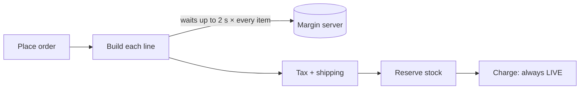
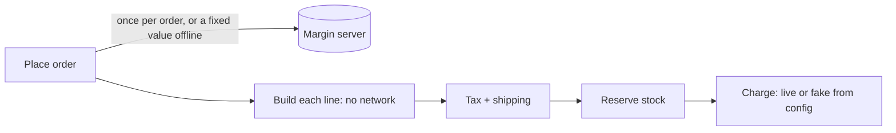

**Verdict: messy in places.** There are two root causes. Every order calls a pricing server once per item, and the order route always uses the live card gateway, so the order flow can't run offline. And three modules (orders, shipping, email) call each other in a loop, so a small change in one forces edits in the others. Nothing in `fixture/` was changed; probes ran in a temp copy, and the skill's check passed (`ARCH-GATE: done`). There is no `docs/architecture.md`, so there was no map to check against.

## 1. One pricing-server call per item, and a hard-wired live gateway (Strong, proven)
I ran an offline order in a temp copy, with network calls set to wait out a 2 s timeout. **A 3-item order made 3 network attempts, took 6.0 s, then succeeded at the wrong price**, because the margin silently falls back to 1.0.

- **Per-item call:** `pricing/quote.py:10-15` does a `urlopen(..., timeout=2)` and returns 1.0 on any `OSError`. It's called from `pricing/quote.py:19`, which runs once per order line (`orders/lines.py:6`). A 10-item order can wait up to 20 s.
- **Live gateway:** `api/routes.py:1,10` creates `LiveGateway()` directly. `FakeGateway` (`payments/fake.py:1`) already matches the `PaymentGateway` protocol (`payments/gateway.py:4`), but nothing uses it.

**The move.** Each step keeps behaviour the same, and the change can be undone easily:
1. `unit_price(sku, code=None, margin=None)` fetches the margin only when none is given.
2. `build_lines` passes the margin through.
3. `place_order` fetches it once per order.
4. The route picks the gateway and an optional fixed margin from environment variables.
5. Remove the forwarding-only `services/order_service.py:4-5` and call `place_order` directly from the route.

This takes the order flow from N network calls to 1, or 0 offline. It reuses the existing fake gateway rather than adding a new layer or a rates cache. Nine call sites are affected, all listed in the move file.

**Proof:** a one-line `python -c` command, run from `fixture/`, places a 3-item order and checks for `{'id':'ord-000001','total':3785,'status':'placed'}`. It passes on today's code; rerun it after each step.

## 2. Orders → shipping → email → orders loop (Strong, traced)
- `orders/status.py:9` asks shipping for the delivery estimate.
- `shipping/tracking.py:10` sends the "delivered" email itself.
- `notifications/email.py:15` asks orders for the status label.

That loop is why a change to how status reads also touches shipping and email. The fix is to have tracking return a "delivered" event and let the order flow send the email. That breaks the loop. Adding a "shipped" notice would then touch one place; its template already exists at `notifications/templates.py:4`, but nothing sends it.

## 3. The ship-to country is worked out in 3 places (Worth exploring, traced)
`orders/place.py:11`, `shipping/rates.py:10` and `shipping/labels.py:6` each look up the customer's default address themselves, and two of them separately fall back to `'US'`. Supporting a per-order address means editing 3 files today; if the ship-to address is stored on the order, it's 1. Storing it changes the order's data shape, which is hard to reverse once orders are saved, so decide this one deliberately.

## 4. Noise (Speculative)
- The same unused import line, `from core.util import clamp, as_cents, slug, first`, is copied into 5 files.
- `services/order_service.py` only forwards calls.
- Money helpers are split between `core/util.py:5` and `core/money.py`.

These are worth folding into the other moves, not doing on their own.

## Bugs found along the way
- **A declined card leaks stock (proven):** `orders/place.py:14-16` reserves stock before charging and never releases it. In the probe, stock went from 4 to 2 after a decline.
- **Anyone can order as any customer:** `api/auth.py:5` takes whatever comes before the `:` in the token as the customer id, with no check.
- **IDs restart from 1** on every restart: they are in-memory counters (`core/ids.py:1`).

**What to do first:** #1. It's the problem you described, it's easy to undo, it reuses code you already have, and its proof already passes.

The full report with before/after diagrams is at `<tmp>\architecture-review-20261026.html`. The move file is at `<tmp>\arch-design\5897b27955cb\move.md`.

**Which candidate do you want to explore?** I'll go through it with you before changing anything.