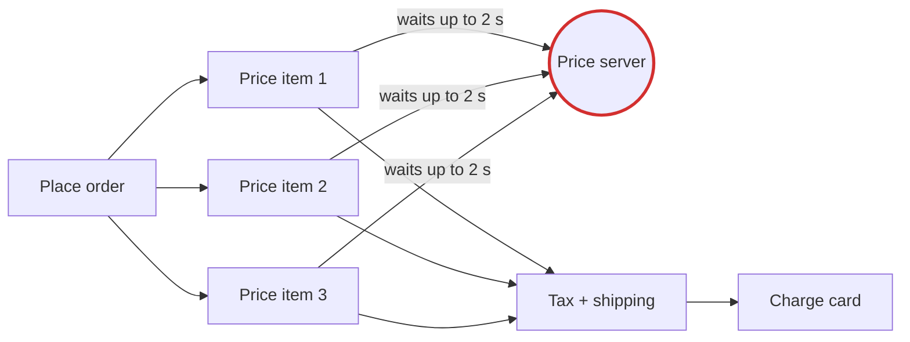
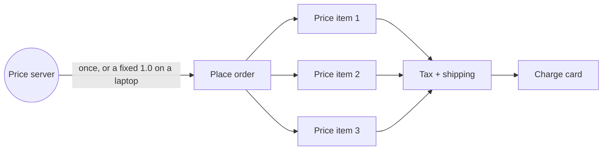
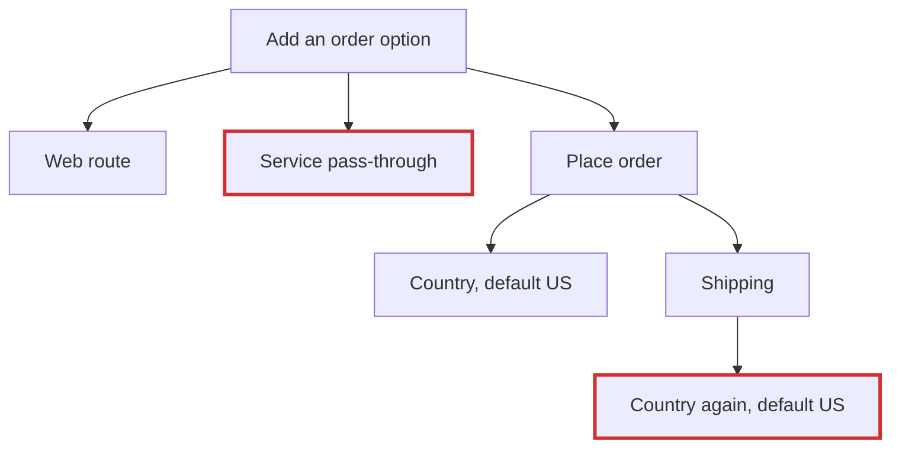
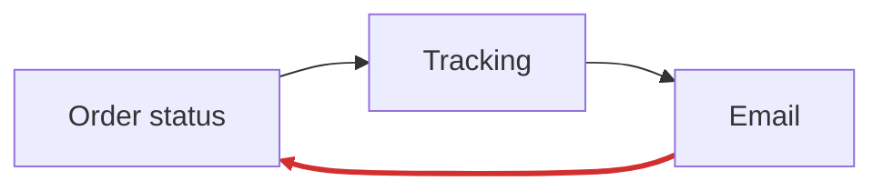

## Verdict: messy in places

You can't run the order flow on a train because placing an order calls a remote price server once for every item in the basket. When that call fails, the code quietly uses a default price instead of reporting an error. Separately, changes ripple because order placement has a layer that only passes calls through, the customer's country is worked out in two places, and status, tracking and email form a hidden loop.

**Map check:** there is no `docs/architecture.md` or any decision records, so there was no map to contradict. I drew one from the entry point `api/routes.py`. I read all 53 files (431 lines) and ran the order flow in a throwaway copy. `fixture/` is unchanged; the check script confirms it.

## Candidates, best first

### 1. Pricing calls a server once per item (Strong, proven) — do this first

**Why it happens:** `orders/lines.py:6` calls `unit_price` for every item. That calls `_fetch_margin` at `pricing/quote.py:19`, which makes a network call with a 2 s timeout (`pricing/quote.py:12`). If the call fails, it uses a margin of 1.0 without an error (`pricing/quote.py:15`).

**Measured:** a 3-item order on a connection where every call times out made 3 network calls and waited **6.0 s**. It still went through, at the fallback price.




**The move (easy to undo):** fetch the margin once, at the web route, and pass it down as a plain number. The payment gateway already reaches the order code this way: it's passed in at `api/routes.py:10`, and there's a fake for local use at `payments/fake.py`.

Each step keeps behaviour the same:
1. Rename `_fetch_margin` to `fetch_margin`, keeping the old name as an alias.
2. Add `margin=None` to `unit_price` and `build_lines`; `None` means "fetch it", as today.
3. In `place_order`, fetch once when no margin is given and pass it down.
4. Have `api/routes.py` pass `fetch_margin()`; laptops and tests pass `1.0`.
5. Remove the per-item fallback.

The signatures that change are at `orders/lines.py:6`, `orders/place.py:9`, `services/order_service.py:4` and `api/routes.py:10`.

I'm not adding a `MarginProvider` class or a price cache. A cache would bring stale-price risk and another thing to invalidate.

**Proof:** run this from `fixture/`. It passes today (total 2646) and must still pass after each step:
```
python -B -c "import urllib.request as u; u.urlopen=lambda *a,**k: (_ for _ in ()).throw(OSError('offline')); from catalog.products import add_product; from inventory.stock import receive; from customers.accounts import open_account; from customers.addresses import add_address; from payments.fake import FakeGateway; from services.order_service import place; add_product('A','Item A',1000); receive('A',5); c=open_account('<email>'); add_address(c['id'],'1 St','Berlin','DE'); o=place(c['id'],[{'sku':'A','qty':1}],FakeGateway(),'WELCOME10'); assert o['total']==2646, o['total']; print('ok', o['total'])"
```

### 2. A declined card leaves stock locked up (Strong, proven)
`orders/place.py:14-16` holds the stock first and charges the card last, and nothing gives the stock back if the charge fails. **Measured:** one declined 2-unit order dropped stock from 4 to 2 for good. The fix is a try/except that calls the existing `release` (`inventory/reserve.py:11`).

### 3. Order changes touch files that add nothing (Worth exploring, traced)
- **Pass-through layer:** `services/order_service.py:4-5` only forwards to `orders/place.py:9`, so a new order option means editing 3 files where 2 would do. `services/customer_service.py` does real work combining three steps, so keep it.
- **Country worked out twice:** the customer's country is read at `orders/place.py:11` and again at `shipping/rates.py:10`, each with its own "default to US" rule. Changing that default means 2 edits instead of 1.



### 4. Hidden loop between order status, tracking and email (Worth exploring, traced)
Order status asks tracking for an arrival time (`orders/status.py:9`), tracking sends the email (`shipping/tracking.py:10`), and the email asks order status for its subject line (`notifications/email.py:15`). The `import x.y` style at the top of all three files hides the loop, so these 3 modules have to change together. To break it, the caller can pass the subject text in, or `subject_for` can move next to `label`.



## Found in passing (not structure, but worse)
- **Security hole:** `api/auth.py:5` takes the customer id from the token without checking it, so anyone can act as any customer.
- `core/ids.py` counts order IDs in memory, so IDs repeat after a restart.

The full report with side-by-side before/after pictures is at `<tmp>\architecture-review-20261026.html` (opened in your browser). The filled-in move file is at `<tmp>\arch-design\be939b334f71\move.md`.

**Which candidate should we explore?** I recommend #1, since it's the train problem, and #2 is small enough to do alongside it.