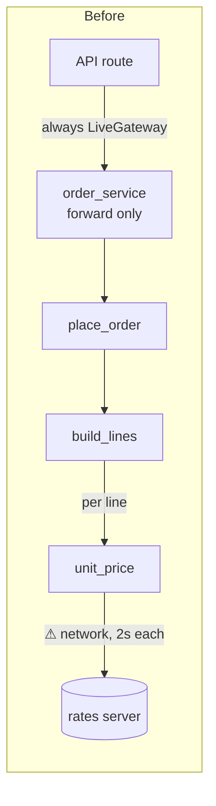
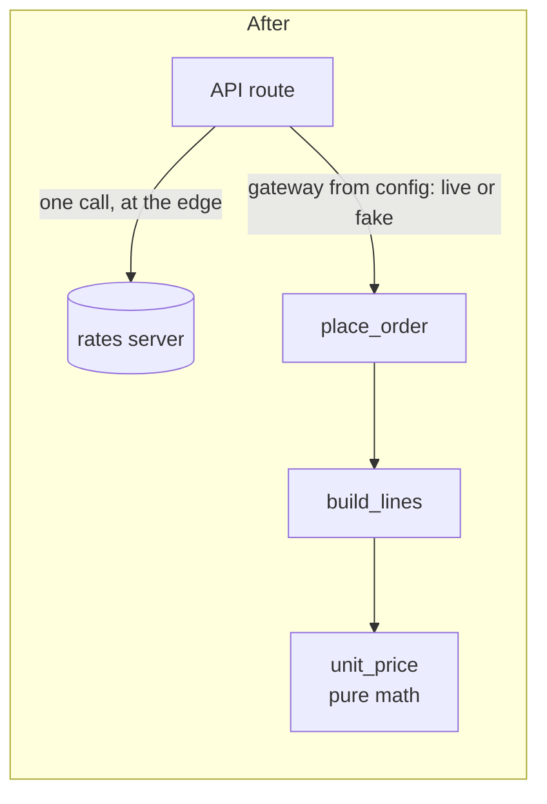
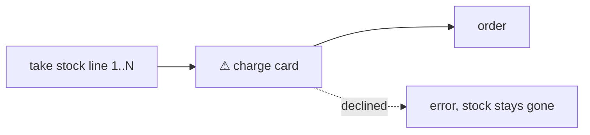
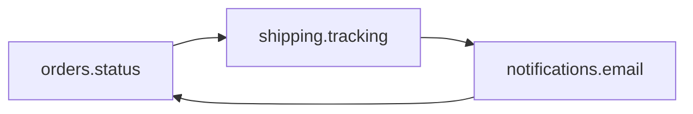
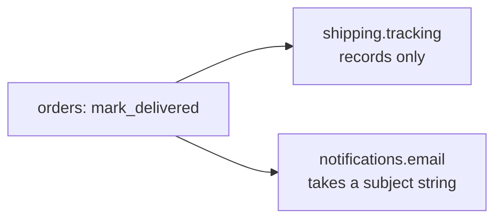

I ran the audit: I read all 53 files, probed in a throwaway copy, and the skill's gate passed with `ARCH-GATE: done`. Nothing in `fixture/` was changed. I did briefly write `__pycache__` folders into it by running a check in the wrong place, and the gate caught them and I deleted them.

## Verdict: messy in places

The modules themselves are small and sensible. The problems are in how they connect. Placing an order calls an outside server and the live card gateway from deep inside, so it can't run offline. And order status, shipping and email import each other in a loop, so a change to one ripples into the others.

There's no architecture doc or decision record to check against, and no git history. So the yardstick below is my best guess at the next three changes, based on the code:
1. Swapping in a real payment provider.
2. A new order status or notification (a `shipped` template exists but nothing sends it).
3. Choosing a shipping address per order.

---

### 1. The order flow can't run on a laptop — *Strong* (proven)

**What you feel:** on a train, placing an order hangs, and you can't use the fake card gateway through the API.

**Why:**
- **Rates server called once per order line:** `pricing/quote.py:10-19` calls `rates.example.internal` with a 2-second timeout every time a line is priced (`orders/lines.py:6`). I measured it: a 5-line order took **10.0 s** and made **5 calls**.
- **Wrong prices without warning:** when the call fails, it quietly uses margin 1.0, so prices are wrong and nothing is logged.
- **Live gateway hard-wired:** `api/routes.py:1,10` always creates `LiveGateway()`. The `PaymentGateway` interface and `FakeGateway` already exist (`payments/gateway.py:4`, `payments/fake.py:1`), but nothing lets you pick the fake one.
- **A layer that only forwards:** `services/order_service.py:5` passes calls straight through and adds nothing.

**What gets cheaper:** rates calls per order go from N to 1, and a 5-line order offline drops from 10 s to at most 2 s. Pricing logic can then be tested with no network at all. Switching gateways becomes one setting instead of a code edit.

**Move** (each step keeps behaviour the same):
1. Add an optional `margin=None` to `unit_price`, `build_lines` and `place_order`. With `None`, it still fetches per line as today.
2. The API route fetches the margin once and passes it down.
3. The route picks the gateway through one function that reads a `PAYMENTS=fake|live` setting, defaulting to live.
4. The route calls `place_order` directly, and `services/order_service.py` is deleted.
5. Make `margin` required and remove the per-line fetch.

There are 8 references to update; the gate listed them all (`api/routes.py:2,10`, `services/order_service.py:1,5`, `orders/place.py:1,10`, `orders/lines.py:1,6`).

**Proof:** the command in the move file places an order offline with `FakeGateway` and checks the total is 2665. It passes today; rerun it after each step.

**Door:** two-way, easy to undo.

**Reuses:** the existing gateway interface, `FakeGateway`, and `core/money.scale`.

**Not adding:** a margin-provider interface or a rates cache. There's one caller and one number, and a cache would be one more thing to keep fresh and run.

### 2. A declined card still uses up stock — *Strong* (proven)

**Why:** `orders/place.py:14-16` takes items out of stock first and charges the card afterwards, with nothing to put the stock back if the charge fails. When I made the charge fail, stock for that item went from **9 → 6** and stayed there.

A second gap: if line 2 is out of stock, the stock already taken for line 1 isn't given back either. `inventory/reserve.py:11` already has a `release` function that nothing calls.

**After:** check stock for every line first, then charge, then take the stock. Or put the stock back with `release` if the charge fails. Either way, each failure path costs one edit in one file.

### 3. Order status, shipping and email import each other in a loop — *Worth exploring* (traced)

**Why:** `orders/status.py:1,9` imports shipping tracking, `shipping/tracking.py:1,10` imports email, and `notifications/email.py:1,15` imports order status. These three modules in three packages only load because they use `import x` rather than `from x import y`. They change together, which is your "touches more files than it should" symptom in miniature. Adding a "shipped" email today means editing all three.

**After:** the orders package decides "delivered → record it and notify". Tracking stops sending email, and email stops reading order status. The loop disappears, and a new notification is one edit in orders.

### 4. The ship-to country is worked out in three places — *Worth exploring* (traced)

**Why:** `orders/place.py:11`, `shipping/rates.py:10` and `shipping/labels.py:6` each repeat `(default_address(cid) or {}).get(...)`. The default `'US'` is written twice, and one order looks up the address twice. Adding "ship to a chosen address" means 3 edits that have to agree.

**After:** `place_order` looks up the address once and passes it to the shipping rates and labels code. That makes 1 owner and 1 edit.

### 5. Shared in-memory stores are read straight from other packages — *Speculative*

**Why:** `jobs/nightly.py:2-3` reads `orders.history.LOG` and `inventory.stock.ON_HAND` directly, and `inventory/reserve.py:8` writes to `ON_HAND`. Moving any of these stores to a real database would mean editing every one of those files. It only matters if that move is coming, so I've ranked it last.

---

**Spotted while reading (bugs and security, not structure):**
- **Security:** `api/auth.py:5` never checks the token. Any string starting with a customer id, like `cus-000001:anything`, logs in as that customer.
- Shipping weight is `500 * len(lines)` (`orders/place.py:13`), so it ignores quantity. 99 of one item costs the same to ship as 1.
- `as_cents` is imported in 6 files and used nowhere. Several other `core.util` imports are unused too.

**What to do first:** #1 (it's what stops you running orders offline), then #2 (it loses real stock). Both are small, easy to undo, and #1 comes with a proof command.

Which one should we explore in detail?