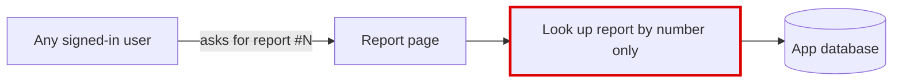
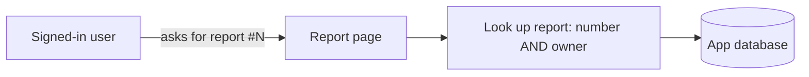
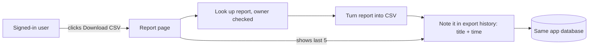

The code is small and simple, but there is one problem to fix before the button ships: **any signed-in user can open any report by guessing its number**. A "Download CSV" button would turn that into one-click bulk download. Once that's fixed, the feature fits into what you already have: one CSV function and one small history table in the existing database. No new system is needed.

I haven't changed anything in `fixture/`. The skill's check passed, which includes confirming the repo was left untouched. There's no architecture doc in `fixture/` to check against, so this is based on reading all 4 files.

## 1. Only show a report to the person who owns it (do this first)

**Strong.** `get_report` looks a report up by its number alone (`app/reports/models.py:10-14`). `report_detail` never checks `request.user_id` (`app/reports/views.py:9-11`). An export action built the same way would leak in the same way.

The fix is one extra condition in one query, and it's easy to undo. The report page behaves exactly the same for a report's owner.

## 2. Export = one CSV function + one history table in the same database

**Strong.** This is the recommended structure.

- **Reuse:** `app/db.py:11` (`execute`) already handles every query against the one SQLite file. History goes through it too.
- **New pieces, all inside the reports module:**
  - `to_csv(report)`: takes the report, returns CSV text, using Python's built-in `csv`. It touches no database, so it's easy to test.
  - `record_export(...)` and `recent_exports(user_id, limit=5)` in `reports/models.py`.
  - A `report_export_csv` view that looks up the report (owner checked), makes the CSV, records the export, then returns the file.
  - `report_list` also returns the recent exports for a history panel.
- **Table:** `report_exports(id, user_id, report_id, title, exported_at)`. The time is stored in UTC, and there's an index on `(user_id, exported_at)`. At launch, nothing deletes old rows; we just show the 5 newest.

**The one decision that's hard to undo is what each history row stores.** Here are the two real options:

| | A: table in the existing database (recommended) | B: browser-only history (localStorage) |
|---|---|---|
| Same history on any device | yes | no, it's lost on a new browser |
| Still correct after a report is renamed or deleted | yes, the title is copied in at export time | yes |
| New thing to run or secure | none | none |
| Easy to undo | a table drop | trivial |

A wins on following the user across devices and on being auditable later. Inside A, **copy the title into the row; don't just store `report_id` and look the title up later.** Otherwise renaming or deleting a report quietly rewrites or erases its export history. That's impossible to fix later, because the old titles are gone.

**Not adding:** a separate store for history (Redis, a log file, an audit service), or a general "exporter" setup for future formats. One format is one function. A second store means another thing to secure and back up, plus a migration later to merge it back.

## 3. Write the database layout down

**Worth exploring.** None of the 4 files declares any table: 3 tables are used and none is created anywhere. The new table should be the first one written down, in a `schema.sql` next to `app/db.py`, so it doesn't become another undocumented assumption.

## Build order

Each step leaves current behavior unchanged:
1. Add the owner check.
2. Add `to_csv`.
3. Add the table.
4. Add `record_export` and `recent_exports`.
5. Add the export view and the history panel.

The skill's check command seeds a sample report and calls `report_detail` and `report_list`. It passes on today's code in a throwaway copy. Rerun it after each step; after step 1 it needs to pass the owner's user id.

## Two questions for product

1. **What goes in the CSV?** Reports are stored as `id, title, created_at, body`, so is `body` already table-shaped data, or free text? This decides whether `to_csv` is 5 lines or real parsing work.
2. **Does history need to follow the user across devices,** or is "this browser" good enough? If it's good enough, option B (no table) is acceptable, but I'd still recommend A.

The same writeup with diagrams is a standalone page at `<tmp>\architecture-review-20261026.html`.

**Which one should we work through in detail?** I'd start with 1, then 2.