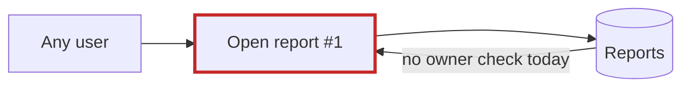
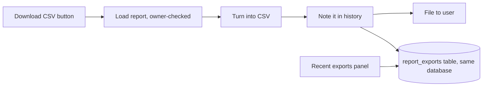

Both features fit inside the existing `reports` module and the existing SQLite database, with nothing new to run. But one bug has to be fixed first: **today any logged-in user can open any report, and a CSV button built on the same code would let them download it too.** I ran that, so it's confirmed. The code is otherwise clean.

## Fix first: anyone can open anyone's report

The reports list only shows your own reports (`app/reports/models.py:6`). Opening a single report doesn't check who owns it (`app/reports/models.py:10`, called from `app/reports/views.py:9`). In a throwaway copy, I created a report owned by user 7 and asked for it as user 8. User 8 got the title and the full body.

**Fix:** change `get_report(report_id)` to `get_report(report_id, owner_id)` and add `AND owner_id = ?` to its query. It has one caller, so this is one small change, and it's easy to undo. The export reuses this same function, so there's only one owner check to get right.

## Proposed structure

| Piece | Where | What it does |
|---|---|---|
| `to_csv(report) -> str` | new `app/reports/export.py` | Turns a report into CSV text. It never touches the database, so it can be tested on its own. Uses Python's built-in `csv` module, with no new dependency and no general "exporters" system for a single format. |
| `report_exports` table | the existing database | Columns: `id, user_id, report_id, report_title, exported_at` (UTC). |
| `record_export`, `recent_exports(user_id, limit=5)` | `app/reports/models.py` | Go through `app/db.py:11` `execute`, which already handles every database query. |
| `report_export`, `export_history` | `app/reports/views.py` | Export: load report → CSV → record → return file. History: list the recent exports. |

**Order to build it:** (1) the owner-check fix, (2) add the table, (3) `to_csv` and its tests, (4) the record and list functions, (5) the two views. Steps 2–5 only add code; nothing that exists today changes.

## The one decision that's hard to undo: how history is stored

Once real users have export history, the table's shape is hard to change. I set the criteria first: history should survive a report being renamed or deleted, there should be no new system to run, and the schema should be the smallest that answers "my last few exports" and can grow by adding columns.

- **Chosen: a dedicated `report_exports` table.** It stores a copy of the title at export time, so the history shows what the user actually exported, even if the report is later renamed or deleted. If product later wants more detail, such as file size, that's a cheap added column.
- **Rejected: a general activity log** (one row per event, details packed into a JSON field). Each query has to dig the title out of the JSON, and moving to proper columns later means migrating the data. It only makes sense if another kind of history is actually planned.
- **Also rejected: a separate store** for history (a file, Redis, or the browser's local storage). That's one more thing to run and back up. Browser storage would also be per device and lost when the browser is cleared.

Both options were compared by me alone, without independent reviewers.

## Questions for product (they change the CSV, not the structure)

1. Is the button on a single report, or does it export the whole list of reports?
2. A report is a title, a date and one block of text (`body`). What should the CSV columns be?
3. Is "last few" 5? Is it fine to keep older entries stored and just show the latest 5?

## Notes for engineers

- **No architecture doc, no table definitions, no tests.** The project has no architecture doc and no file that creates the database tables, so nobody can see where the new table definition belongs. Someone needs to decide that.
- **No real HTTP layer yet.** `render()` (`app/reports/views.py:14`) just hands the data back, so how the CSV is sent as a download depends on a web framework that isn't in `fixture/`.
- **History is a side note to the download.** I'd record the export in the same request. I'd let the download still succeed if writing the history row fails, and log the error; the download is what the user asked for.
- **Check result:** the skill's gate passed (`ARCH-GATE: done`). Its check command confirms the reports list still behaves as it does today. Nothing in `fixture/` was changed.

The illustrated version of this report is at `<tmp>\architecture-review-20261026-csv-export.html` (the gate's working notes are in `<tmp>\arch-design\ce58b5316844\move.md`).

**Which do you want to go deeper on: the owner-check fix (small, I'd do it first), or the history table and CSV design?** Answers to the three product questions would let me pin down the CSV.