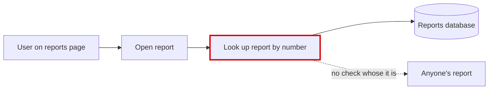
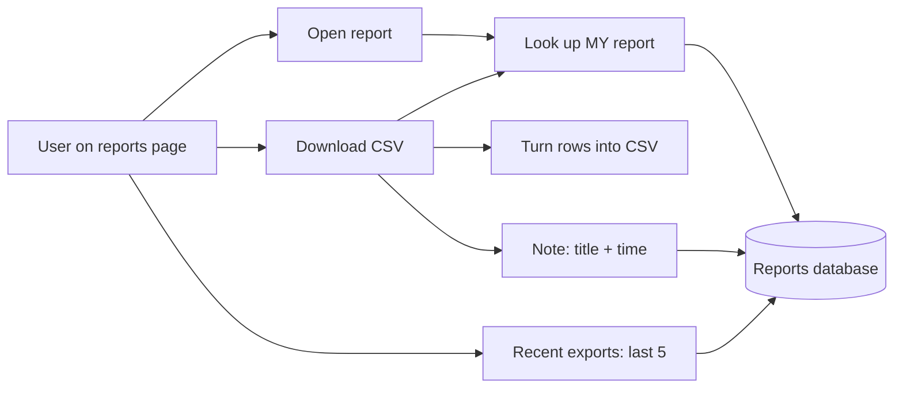

**Verdict: clean, but fix a security hole before building.** The code in `fixture/` is small and well-shaped. All database access goes through one helper, and one module owns report data, so the feature fits next to what's already there. The problem: **today any signed-in user can open anyone's report just by knowing its number.** A CSV button built on the same lookup would let them download it too. I proved this by running it on a seeded copy: user 10 got back user 20's "Payroll" report, including its body.

There's no architecture doc and no table definitions in `fixture/`, so this review is based on the code itself.

## Candidate 1: Lock report lookup to its owner, then add export beside it (Strong)

**Before:** the lookup checks nothing about who owns the report.

**After:** viewing and downloading share one lookup that checks the owner.

**Steps.** Each step leaves today's behaviour for a report's owner unchanged:
1. Add an owner filter to `get_report` (`app/reports/models.py:10`) and have `report_detail` (`app/reports/views.py:10`) pass `request.user_id`. Those two lines are the only callers. This step is worth shipping on its own.
2. Add `to_csv(rows) -> str` in a new `app/reports/export.py`. It uses Python's built-in `csv` module and doesn't touch the database, so it's easy to test.
3. Add a table `report_exports(id, owner_id, report_id, title, exported_at DEFAULT CURRENT_TIMESTAMP)` with an index on `(owner_id, exported_at)`.
4. Add `record_export` and `recent_exports(owner_id, limit=5)` to `app/reports/models.py`, going through the existing `app/db.py:11` `execute`.
5. Add two views:
   - `report_export_csv`: owner-scoped lookup → CSV → record the export → return the file.
   - `export_history`: the user's last 5 exports.

**What it reuses and what it doesn't add:**
- It reuses the existing SQLite database and query helper.
- It adds no second store for history (Redis, a log file, a separate exports service).
- It adds no "export format" plugin layer. One format is one function.

**One-way door: the history table's shape.** I set the criteria first, then compared two options:
- **Criteria, in order:**
  1. History follows the user across devices.
  2. No new datastore.
  3. The title shown is the one that was exported, even if the report is later renamed or deleted.
  4. The smallest stored contract.
- **Option A (chosen):** one narrow table in the existing database. The title is copied in at export time.
- **Option B:** history kept in the browser (localStorage). It fails criterion 1, and history lost that way can't be recovered later.
- **If A is wrong:** it's one small table that only the reports code reads, so it's cheap to drop or migrate.

I compared these two myself in this session; no separate designers were used.

**Proof:** `python %TEMP%/arch-design/c728f0ff7433/proof.py`, run from a copy of `fixture/`. It passes on today's code; rerun it after each step. The skill's checker reported `ARCH-GATE: done` and confirmed nothing in the repo changed.

## Candidate 2: Nobody owns the table definitions (Worth exploring)
There's no `CREATE TABLE` or migration anywhere in `fixture/`, so the new table has no obvious home. Someone needs to tell us where `reports` and `users` are created today.

## Questions for product and the team
1. **What does the CSV contain?** The list on the reports page (title, created date), or one report's contents? A report's `body` has no defined shape in the code.
2. **What does "the last few" mean?** I assumed 5. Should the list show only the export time, or also the report title as it was at export time? I assumed the title as exported.
3. **Where is the schema managed** (candidate 2)?
4. **Which web framework does this use?** `render` (`app/reports/views.py:14`) currently just returns the data unchanged. A CSV download needs a real file response with the right headers.

The full report with diagrams is at `<tmp>\architecture-review-20261026.html`, and I opened it for you. Nothing in `fixture/` was changed.

**Which candidate do you want to explore?** I'd start with candidate 1, step 1 (the owner check). It's needed whatever the answers above turn out to be.