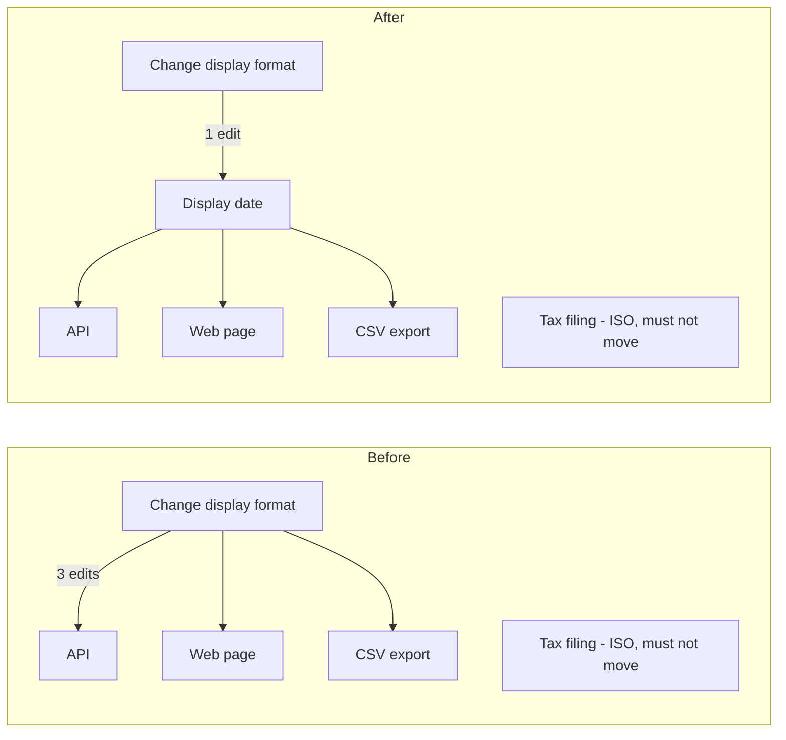

**Verdict: messy in places, but mostly fine.** The code is small (7 files, no tests, no architecture doc, no git history). One thing would catch a newcomer out: the same date format is copied three times, and a fourth date right next to them looks the same but must never change.

## What to know before Monday

**1. Do not "clean up" `billing/invoice.py:5`.** `invoice_date` looks like a fourth copy of the other date helpers. It isn't. Its comment (`billing/invoice.py:2-4`) says the tax authority's upload spec requires ISO-8601 (`2026-03-04`). If that format changes, the authority rejects the whole filing. Any change that merges every date helper into one function will break tax filing.

**2. The date customers see is copied in three places.** All three use `%d/%m/%Y` but under different names:
- `api/serializers.py:1` `format_date`
- `web/views.py:1` `fmt_date`
- `jobs/export.py:1` `date_str`

Changing the displayed format today means 3 edits. Miss one and the API, the web page and the CSV export disagree.

**3. The `providers/` setup is bigger than it needs to be (Speculative).** There's a base class (`providers/base.py:1`), a registry (`providers/registry.py:3`) and exactly one implementation, SMTP. Nothing in `fixture/` calls `registry.get`. Its own docstring says "Implemented once." Don't add more on top of it. But don't delete it either: I couldn't prove it's unused, because something outside this folder might look it up by the string `"smtp"`.

**4. There are no tests.** I wrote and ran a one-line check that pins every current output (below). It passes today. Run it before and after any change.

## Top candidate: one owner for the customer-facing date (Strong)



- **What gets better:** a display-format change goes from 3 files to 1, and billing is touched in neither case.
- **Steps** (each one leaves behaviour unchanged):
  1. Promote `format_date` into a shared `display_date`.
  2. Point `web/views.py` at it.
  3. Point `jobs/export.py` at it.
  4. Leave `billing/invoice.py` alone.
- **Risk:** easy to undo (internal helper only).
- **Option not taken:** one date function for all four, including billing. If that were wrong, a UI tweak would silently get the tax filing rejected.
- **Proof** (run from `fixture/`; I ran it in a throwaway copy and it passes):
  ```
  python -B -c "import datetime as D; from api.serializers import order_json; from web.views import order_page; from jobs.export import rows; from billing.invoice import line; o={'id':7,'placed_at':D.date(2026,3,4)}; assert order_json(o)=={'id':7,'placed_at':'04/03/2026'}; assert order_page(o)=='Order 7 placed 04/03/2026'; assert rows([o])==['7,04/03/2026']; assert line(o)=='7|2026-03-04'; print('OK')"
  ```

The skill's audit check (`arch.py --gate`) passed. Nothing in `fixture/` was changed: my first manual run left `__pycache__` folders behind, and I deleted them. No bugs or security holes turned up while reading. I didn't build the HTML version of the report; the diagram above covers the same thing.

**Which do you want to explore: the shared display date, or finding out whether anything outside `fixture/` uses the provider registry?**