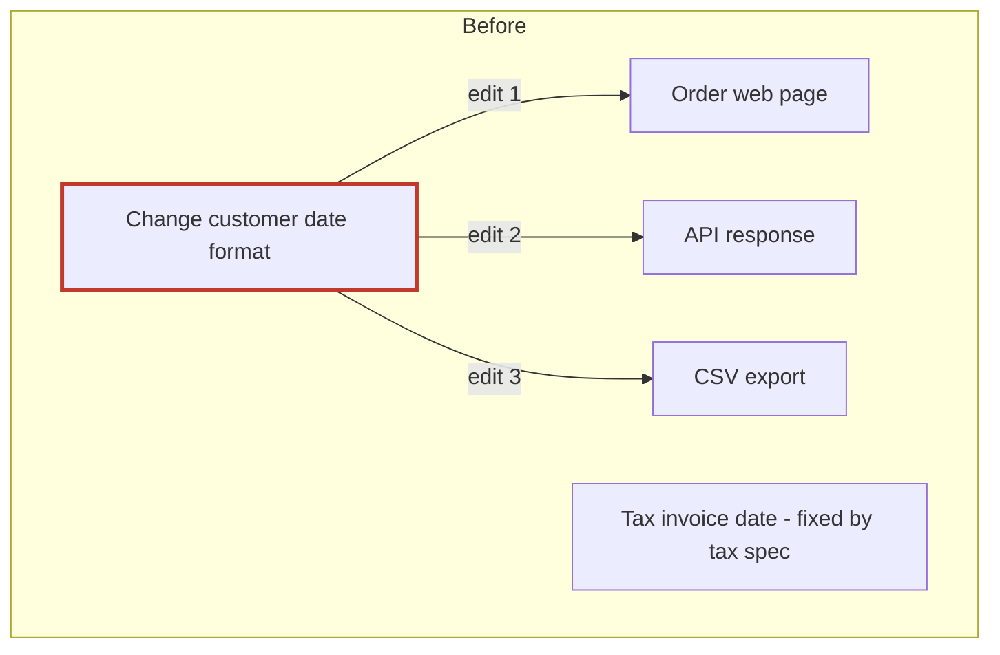
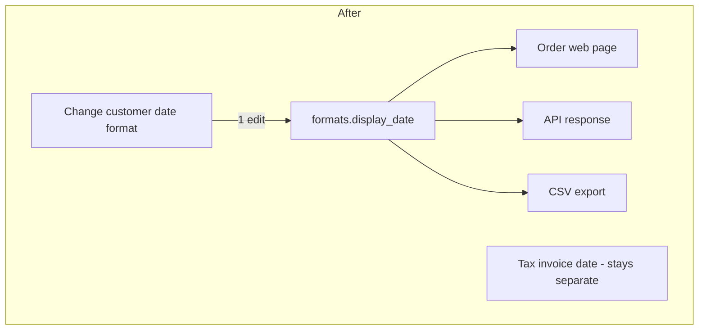

**Verdict: messy in places.** The code is small (7 files, 45 lines) and easy to read. The trap is that it has four date formatters. Three of them really are copies of each other. The fourth looks like a copy but is a legal requirement. The obvious cleanup, merging all four, would get the whole tax filing rejected.

I ran the audit gate to completion and nothing in `fixture/` was changed. I wrote a check script outside the repo that tests all four date outputs plus the email sender, and it passes on today's code.

**No docs to rely on.** There's no architecture doc, no README, no tests and no git history. The only thing protecting the tax rule is a code comment at `billing/invoice.py:2-4`.

## What the new person needs to know

### 1. Don't merge the invoice date into the others (Strong)
`billing/invoice.py:5` writes `2026-03-04` (ISO format) because the tax authority's upload spec requires it. The comment says changing it "rejects the whole filing". The other three helpers write `04/03/2026` and look the same, which makes it tempting to combine them. Customer-facing dates change when the business wants them to; the invoice date changes only when the tax spec does, so they need separate owners.

### 2. The customer-facing date format is in 3 places (Strong, the first change worth making)
The same `"%d/%m/%Y"` format appears in `api/serializers.py:1`, `web/views.py:1` and `jobs/export.py:1`. None of them import each other. Changing the format means 3 edits, and if one is missed, the web page, API and CSV export disagree.

**The change:**
1. Add a `display_date` function in a new `formats.py`.
2. Switch `web/views.py` to use it, then `jobs/export.py`, then `api/serializers.py`, running the check after each one.
3. Add a comment in `formats.py` pointing to `billing/invoice.py:2`.

None of these steps changes behaviour, and it's easy to undo. The shared function goes in its own module rather than in `api/serializers.py`, so the web page and export don't end up depending on the API layer. I'm not suggesting a date/locale config system: the code only needs one format.

**The check:** run `python -B <tmp>/arch-proof/proof.py .` from inside `fixture/`.

### 3. An email "provider" system with only one provider (Speculative)
There's a base class (`providers/base.py:1`, whose docstring says "Implemented once"), a registry holding one entry (`providers/registry.py:3`) and the SMTP sender (`providers/smtp.py:4`). It's three files of structure around one sender. Nothing inside `fixture/` calls `registry.get`, though, so whatever uses it lives somewhere else, and there's no history explaining why it was built. **Leave it alone until someone shows it's unused.**

### Other things to know
- **No tests.** My check script is the only safety net, and it's outside the repo.
- **Run from `fixture/`.** Imports are top-level (`from providers.smtp import ...`), so code only works with `fixture/` as the import root.

The full report with diagrams is at `<tmp>\architecture-review-20261026.html` (I opened it in your browser).

**Which do you want to go into next?** I'd start with #2.