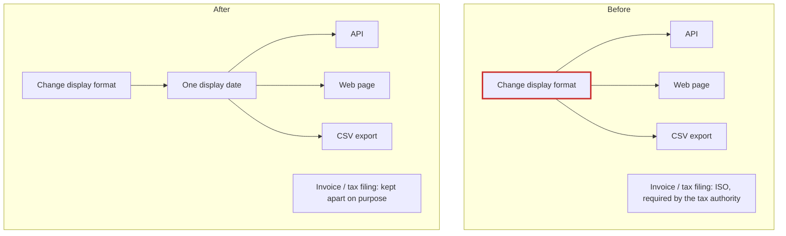

The codebase is small and nothing is tangled, but one thing will bite a newcomer: there are four date helpers that look like copies of each other. Three are copies, and the fourth must never be merged with them. I read all 7 files and ran a check of their current outputs, and it passes. Nothing in `fixture/` was changed.

There's no architecture doc or decision record. The only written rule is a comment in `billing/invoice.py:2-4`, so a newcomer has no other place to learn it.

## What they should know before Monday

### 1. Customer-facing dates are written out in 3 places (Strong)
- `api/serializers.py:1`, `web/views.py:1` and `jobs/export.py:1` each format dates as `%d/%m/%Y`.
- Changing how dates look means editing all 3 files. Miss one, and the API, the website and the CSV export show the same order with different dates.

### 2. The invoice date is not a fourth copy. Don't merge it.
- `billing/invoice.py:5` uses ISO format (`%Y-%m-%d`) because the tax authority's upload spec requires it.
- The comment there says changing it "rejects the whole filing."
- This is the easiest mistake to make: someone sees four date helpers and merges them into one. The next display-format change would then break tax filings.



**Suggested fix:** move the display format into a single `dates.display_date`. Then switch the callers one at a time (`serializers.py:6`, `views.py:6`, `export.py:6`) and leave `invoice_date` alone.
- **Result:** a display-format change goes from 3 file edits to 1.
- **Risk:** low and easy to undo.
- **Check after each step:** this passes today and asserts both the `04/03/2026` display format and the `2026-03-04` invoice format:
  ```
  python -B -c "import datetime as t;from api.serializers import order_json;from web.views import order_page;from jobs.export import rows;from billing.invoice import line;o={'id':7,'placed_at':t.date(2026,3,4)};assert order_json(o)=={'id':7,'placed_at':'04/03/2026'};assert order_page(o)=='Order 7 placed 04/03/2026';assert rows([o])==['7,04/03/2026'];assert line(o)=='7|2026-03-04';print('OK')"
  ```
- **Option I'd reject:** one shared date helper for all four places, billing included.

### 3. A plug-in system with one plug-in (Worth exploring)
- `providers/base.py`, `registry.py` and `smtp.py` are three files around a single SMTP sender. The base class's own docstring says it's "Implemented once."
- Nothing inside `fixture/` calls `registry.get`. This isn't a git repo, so I couldn't check history or callers outside this folder.
- So I can't say whether it's dead code. Don't add to it and don't delete it until you know who uses it.

## Not found
I didn't see any import cycles, any network or database calls tangled into business logic, or any bugs or security problems while reading.

The visual report is at `<tmp>\architecture-review-20261026.html`, and the filled-in proposal file is at `<tmp>\arch-design\fd9b7744e4ef\move.md`.

**Which one should we explore?** I'd start with #1: it's cheap, easy to undo, and protects the tax filing.