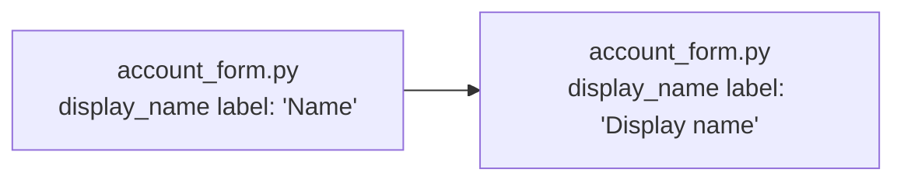

The structure stays as it is. This is a one-string change in the file that already owns the form, so there's nothing to redesign.

**Verdict: clean.** The change is settled and small, so I kept it direct: no competing designs and no new-part design. One thing to know first: `fixture/` contains only `requirements.md`. The file it names, `web/account_form.py`, isn't there, so everything below about that file comes from the requirements and I haven't checked it against code.

**Smallest step**
1. In `web/account_form.py`, change the `display_name` field's visible label from `"Name"` to `"Display name"`. Leave the field name, validation, API, storage and layout alone.
2. If any test checks for the old label text, update it to the new one.

- **Reuse:** `web/account_form.py` stays the form's only owner (`requirements.md:3`).
- **Not adding:** a shared labels or translation module, or a new form component. One string doesn't need a second owner, and one would just be another module to keep in sync.
- **Reversible:** yes. It's a display string with no stored data or public contract, so undoing it is a one-line revert.
- **Proof:** none can run yet because the fixture has no code. Once the form exists, render it and check two things: the label reads `Display name`, and the submitted field is still `display_name`.

**Gate status:** the skill's check script (`arch.py --gate`) reports `ARCH-GATE: open (move)`. It's open only because `web/account_form.py` isn't in `fixture/`. The other two checks passed, and the fixture was not changed. The move file is at `%TEMP%\arch-design\31fe609b6906\move.md`.

Nothing has been edited. Do you want me to go ahead with step 1 once `web/account_form.py` is available?