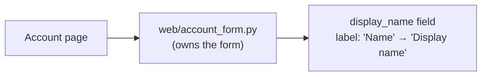

I'd change one string literal in one file. This is a settled, small change, so the skill's "stay direct" path applies: no competing designs, no new-part design, and no candidate cards.

**Missing file.** `fixture/` contains only `requirements.md`. The `web/account_form.py` it names isn't there, so I couldn't check the claim that the form has one owner. Everything below rests on that document alone.

**Structure:** keep what's there.

Before and after look the same, apart from the label text. Nothing gets a new module, component, seam, dependency, data shape or public contract.

**Smallest step:**
1. In `web/account_form.py`, change the `display_name` field's label from `"Name"` to `"Display name"`. Leave the field key, validation, API, storage and layout as they are.
2. Before making the edit, search the repo for other places that use the label. This catches tests, snapshots, translation files and end-to-end selectors that match on `Name`:
   `rg -n "\"Name\"|'Name'|>Name<" .`
   Update only the hits that are this field's label.

**Proof:** render the account form, or run its test, and check that the `display_name` field reads "Display name" and still submits under the key `display_name`. If there's no test for the label yet, a one-line assertion on the label text is enough.

**Door:** two-way. Undoing it means reverting one string. No stored or public contract changes.

**Next likely changes:** none follow from this one, so there's nothing to restructure around it.

**Skipped:**
- I didn't run the skill's checker script (`arch.py`) and its gate. They're built to compare design candidates, and this change has none.
- I didn't create a map or an architecture decision record (ADR), because no decision is being reopened.

Once `web/account_form.py` is in the fixture, the next step is the edit plus the search in step 2.